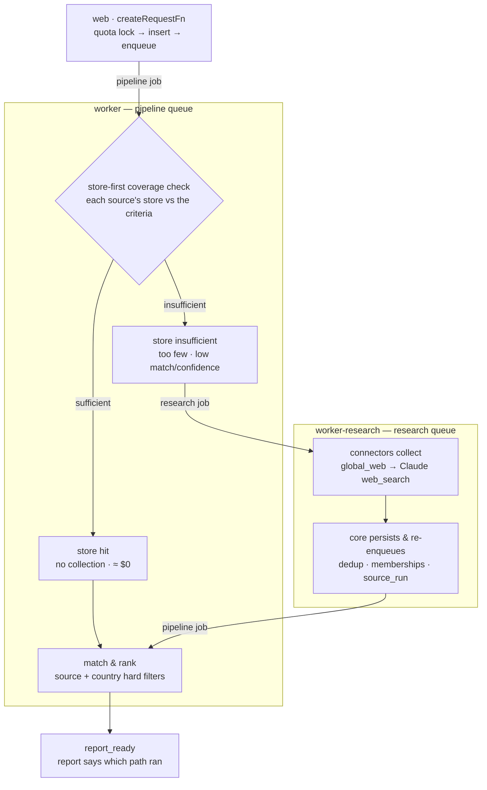
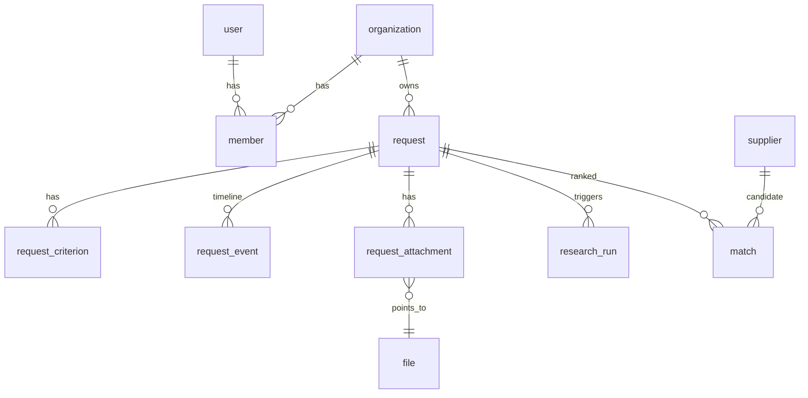
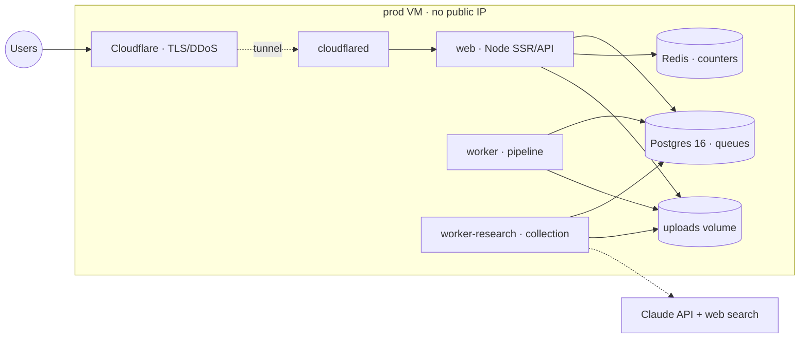

# OSI — Oversea Sourcing Intelligence

A **facilitated marketplace** for industrial sourcing. A buyer describes a need in
plain language; the platform extracts structured criteria, searches the web for
real manufacturers, and ranks the most compatible ones. When the buyer picks a
supplier, **OSI steps in as facilitator** — introduction, coordination, then
transaction tracking through to delivery.

Live at **[osi-solutions.com](https://osi-solutions.com)** · TanStack Start
(Vite · React 19 · Nitro SSR) · Postgres 16 · bilingual **FR / EN**.

> This README is the single reference for the project: what it is, how it works,
> how to run it, and why it is built this way — **including the decision record**
> (the former `ADR-001` file, folded in on 2026-09-13: Part I is in §1, Part II,
> the parcours and the standing constraints in §2b, the open questions in §9).
> **[`BACKLOG.md`](BACKLOG.md) is the companion** — current state, what is
> done, and what is left to reach MVP1.
>
> **Working today:** the full request loop — criteria (typed *and* from attached
> spec sheets) → real web research → shared supplier pool → criteria-aware
> ranking → printable report, with per-workspace plans and daily quotas — and
> the first half of facilitation: the buyer solicits quotes, compares the
> offers, accepts one, the dossier opens with its required contracts drafted
> and their text pre-filled, and the parties sign — buyer and OSI in the
> platform, everyone else by a staff-recorded upload (Phase P1-P6, live on
> prod). Staff can attach a supplier's paperwork to an offer (P8, first
> slice). **Not built:** commandes and milestones, paiements, messages,
> rapports, the stored PDF report, and the supplier import pipeline.

Built with [Lovable](https://lovable.dev)
([editor](https://lovable.dev/projects/a2274c53-10c7-432f-8ad5-d1aeff813df3));
pushes to `main` sync back into Lovable, so avoid rewriting published history.

---

## 1 · The product

**Two-sided eventually, buyer-first now.** MVP1 covers the buyer journey; the
facilitation handoff is the bridge to the supplier side. Multi-tenant buyer
workspaces from day one. Payments are **track-only**; escrow is deferred.

**Public landing, gated action.** `/` needs no login — anyone can type their
need. Clicking *Lancer la recherche* is the auth gate: the draft is preserved
across login/signup and comes back in the form — the buyer presses the button
themselves. It is deliberately NOT created automatically (owner 2026-08-29:
*"if not, cancel it, do not run, so we will not spend some token"*): a research
pass costs money, so launching one stays an act the buyer performs. Drafts
older than **1 h are discarded**, never resurrected — the draft exists to
carry someone across the login gate, not to be kept. Every
other route requires auth.

### Supplier data strategy (hybrid)

The supplier pool is **platform-global** — OSI's shared asset, enriched by every
request — while requests, engagements and documents are tenant-scoped.

1. **Import pipeline** — baseline coverage from B2B directories, trade
   registries, customs data. *(Not built; the seed script stands in.)*
2. **Live AI web research** — ✅ *live since 2026-08-16.* Per request, an agent
   searches the web, extracts candidate suppliers, and **enriches the database as
   a byproduct**. Every request grows the dataset, so repeat searches in a
   category get cheaper: the DB is the cache.

Consequences, all first-class rather than afterthoughts:

- Every supplier carries **provenance** — `imported` · `ai_researched` · `osi_verified`
- **Confidence** maps to verification level and profile completeness
- **Dedup / entity resolution** is a core subsystem — a unique index on a
  normalized `name|COUNTRY` key, so a repeat search cannot re-add a known company

<a id="adr-001-part-i"></a>
#### ADR-001 Part I — the demand-pull supplier graph (accepted 2026-08-26)

> **The decision record.** This and §2b together are **ADR-001**, accepted
> and largely built. It consolidates the former ADR-001 (supplier
> provisioning, 2026-08-26) and ADR-002 (the transaction dossier and contract
> centre, 2026-08-29); both originals are in git history at `8dd740d`, and the
> single-file version lived at `ADR-001-osi-architecture.md` until 2026-09-13.
> **The anchors are preserved:** code comments and backlog lines citing
> `ADR-001 §N` / `S1`–`S6` mean this part; `ADR-002 §N` means Part II in §2b.
> Baseline: main @ `bcbd99d`, prod deploy #38. Source brief:
> [BRIEF-portail-entreprise.md](BRIEF-portail-entreprise.md).
> Implementation plan: Phase S and Phase P in [BACKLOG.md](BACKLOG.md).
> **Published twin:** *The OSI Decision Record*,
> <https://claude.ai/code/artifact/a537df29-e576-4725-b8de-661efd1d1438> — its
> source is [`osi-decision-record.html`](osi-decision-record.html) at the repo
> root; edit there, republish to the same URL. The three companion pages it
> absorbed are kept verbatim in [archive/](archive/README.md).
>
> **Weighting note, still true:** OSI is pre-launch — testers only, no
> customers. No funnel to protect, no data to migrate, no backward
> compatibility to honour. Cost shape weighs *more*: pre-revenue is exactly
> when spend must be demand-justified.

Two operating principles:

1. **Demand-pull, not supply-push** — nothing is spent on a supplier until a
   real request needs them; spend attaches to *presented candidates*, never to
   collected records.
2. **The deal loop is the data-acquisition engine** — every facilitation
   produces capability, pricing and responsiveness data that cannot be scraped.
   That is the moat; everything scraped is bootstrap.

The flow, as built:

```
REQUEST (structured form → taxonomy node)
  → RETRIEVE from the supplier graph (store-first coverage check)
  → coverage insufficient?
      DISCOVER via global_web (Claude + web_search) — free sources only
  → VERIFY each presented candidate (battery, §4)
  → PRESENT Top-N (trust tier + evidence)
  → FACILITATE (Part II, §2b)
  → outcomes (response time · MOQ · lead time · price · satisfaction)
    feed the graph back  ← S6, the moat
```

**Supplier graph** = the `supplier` table as node plus dated, sourced edges:
source records, verification evidence, quotes, deals. Plain Postgres — "graph"
is the shape, not the engine. The lifecycle `lead → profiled → verified →
engaged` is **derived** from which edges a node has, never set by hand. The
sections after this one (*Data sources*, *Supplier cache*, *Visibility tiers*)
describe the built machinery; where they predate the record, their roles are
redirected by it.

##### ADR-001 §1 · No paid data providers, ever

**Owner, 2026-08-26 — a hard constraint on every future design.** No paid
subscription to any data provider, now or later; no design may align with one.

The customs/BoL investigation (§9) found no free route, so **customs data is
closed for the US routes**: the `export_record` check is dormant, and tier-2
capability evidence must come from certifications and the deal loop instead.
The category itself stays open — **owner doctrine 2026-08-28: bills-of-lading
data joins the search category wherever a genuinely free route exists (free
bulk or free API), in any jurisdiction.** New connectors are added only for
genuinely free licensed sources; `global_web` is and stays the default search
source, China corridor included. The availability-driven registry roadmap
(Companies House → SIRENE → BRREG) is retired.

##### ADR-001 §2 · Sources have a ROLE: discovery or verification

An axis orthogonal to dynamic/static, and the decision that makes registries pay
for themselves without enrichment. ✅ **Built 2026-08-26** (S5a, migration
0018, `data_source.role`).

- **Discovery** sources (today: `global_web` alone) are workspace-selectable in
  Préférences de sourcing and are the **only** sources that enter matching.
- **Verification** sources (**all registries**) are platform infrastructure:
  never in workspace settings, never fed into matching. Buyers meet them only as
  evidence lines on a supplier profile — *"Existence vérifiée — Registre du
  Québec, actif, consulté 2026-08"*. On `/interne/sources` the catalogue is
  presented as the two categories, **Recherche** and **Vérification**, and a
  verification source's "enabled" switch means "verification backend active",
  not buyer exposure.

Enforced in `src/server/sources/scope.ts`, which resolves only
`role = 'discovery'` sources; the Paramètres list and its save fn scope to
discovery too. A supplier known **only** through a verification record is
invisible to matching until a discovery source or the deal loop evidences it.

Registry stores are kept as local lookup tables, refreshed by full pull roughly
**every six months per source**, with staff upload for the file-fed ones (QC,
JP); evidence records the snapshot date, and finalists get a live registry-API
confirm where one exists. Coverage expands on demand: when discovery surfaces
candidates from an uncovered country, that triggers adding its registry. Where
no registry route exists (China), tiering falls back to facilitation-time
documents.

##### ADR-001 §3 · Enrichment is lazy, and store-sized batches do not exist

Nothing is enriched ahead of demand. The ~$12k store-scale enrichment gate that
sank the old strategy dissolves because registry records never need enrichment —
they are verification evidence, not candidates. The design is lazy per-request
enrichment of the ~3×N candidates a live request surfaces (S4), with
keyword-scoped batches as the staff-aimed secondary.

**No enrichment stage exists in the code today** — S4 was deferred on
2026-08-28 (design review with the owner): `global_web` returns candidates
*with* descriptions, so the thin-candidate population it exists for is
near-empty, and its cost would dwarf research itself. Revive triggers are in
the backlog's Phase S entry.

##### ADR-001 §4 · The verification battery, and the derived trust tier

Six checks were specified, each writing one `supplier_verification` evidence
row (type, source, result, URL, checked_at). ✅ **v1 built 2026-08-26** (S5b,
migration 0020). **Three run automatically today** (`AUTO_CHECKS` in
`src/lib/verification.ts`), on the research queue right after Top-N promotion;
the rest are dormant or manual, and honestly so:

| # | Check | State |
|---|---|---|
| ① | **Legal existence** — offline lookup in the verification-role stores; evidence carries the registry name + snapshot date | ✅ automated (TTL 180 d) |
| ② | **Digital identity** — site alive, MX, RDAP domain age, name coherence | ✅ automated (TTL 30 d) |
| ③ | **Sanctions** — OFAC SDN local list ≤ 7 days old (EU/UN later); a hit derives `rejected`, −25, and **blocks presentation** pending staff review | ✅ automated (TTL 7 d) |
| ④ | **Export track record** — customs/BoL | ⛔ dormant — no free route (§1) |
| ⑤ | **Certifications** — free cert-registry routes | ❌ not built |
| ⑥ | **Human review** — a staff decision from `/interne/verification` ("Vérifier (Vérifié OSI)" writes the row, "Retirer" deletes it) | ✅ staff action (TTL 5 y) |

**The tier is DERIVED from evidence rows, never set** (`deriveTier`):
0 unverified → 1 existence verified (the floor for a Top-N) → 2 capability
evidenced → 3 Vérifié OSI. A sanctions hit dominates everything: the candidate
is flagged, not tiered. `supplier.verification_status` is a projection of the
tier (3 → verified · 1-2 → pending · hit → rejected), and its **only writer is
`src/server/verification.ts`**.

**AI-found suppliers are capped at confidence 70** (`AI_CONFIDENCE_CEILING`), so
a confident-sounding model can never outrank an OSI-verified company.

##### ADR-001 §5 · Intake is structured, and the pool is bilingual

The structured request form is the primary intake — ✅ **built 2026-08-26**
(S1+S2, migration 0019): product* and category* (required), quantity,
material, certifications, lead time, a details textarea, attachments. Typed
fields become criteria rows verbatim with `source: "user"` — nothing guessed;
the details text still passes the regex parser for extra specs;
`request.category_id` stores the taxonomy node, the coverage/cache key. The
auth-gate draft preserves the whole form as JSON. The plain-language hero
remains a launch-time design task.

The taxonomy (`src/lib/taxonomy.ts`, 78 nodes, FR/EN labels) is one canonical
in-house tree mapped behind the scenes to HS headings — **a typed module, not a
table**, because it is code-adjacent data that evolves by commit. Node ids are
stable and are persisted on requests. *(This closes the old open question "HS,
NAICS or in-house?" — in-house, mapped.)*

**Search runs English-first and the pool stores both languages.** Most of the
manufacturing web is in English; criteria carry a `value_en` and suppliers a
`description_en`, so a French request reaches English text and a later English
buyer finds the supplier a French request discovered. The mechanics are in §2.

##### ADR-001 §6 · The deal loop feeds the graph — the moat

Response time, MOQ, lead time, price and the buyer's satisfaction score are
exactly the outcomes nobody can scrape. They arrive as a by-product of Part II,
not as a separate project.

Two fields protect that data at the source (2026-09-12, migration 0040):
response time is measured from **`sent_at`** — when staff actually emailed the
supplier — and falls back to `requested_at` only when nobody stamped it, so
OSI's own lag is not published as a slow supplier; and `decline_reason`
separates `no_response` (the strongest negative signal the platform owns) from
`supplier_declined` and `lost` (the buyer picked someone else, which says
nothing about the supplier).

#### Data sources & sourcing preferences

> **Status: ✅ IMPLEMENTED (core 2026-08-22 · surfaces 2026-08-23/24) —
> roles redirected by ADR-001 above.** The
> engine is live: connector contract + registry (`src/server/sources/`),
> `global_web` as connector #1, per-source stores (`source_record`),
> `source_run` audit, the store-first request flow on its own `research`
> queue, country-scope plumbing end to end, the Paramètres
> sourcing-preferences UI writing `sourcing_rules` (B5), and the
> `/interne/sources` admin screen (enable/refresh/ban — C1). **Not yet
> built:** every connector beyond `global_web`.

**Data sources are a platform-level catalogue, curated by the platform
owner.** Each source is a row (`data_source`): a type — `global_web` (the AI
web research that runs today), `country_registry` (a national trade-registry
database or API), `import` (B2B directory / customs data files) — an optional
`country_code` (null = worldwide), and an enabled flag. The platform owner
turns sources on and off from an internal screen (`/interne/sources`, E10
sibling); a disabled source is never consulted for anyone. Suppliers keep a
`source_ref` to the source that found them — provenance already exists, this
makes it precise.

**Each account activates its sources once, in Settings — requests never
specify a source** (decided 2026-08-22). A workspace's sourcing preferences
(`sourcing_rules`, one row per workspace) say:

- **Activated sources** — the workspace switches on any of the
  platform-enabled catalogue (default: all of them). From then on **every
  request simply uses the activated set** — there is no per-request source
  picker; the choice is already made. A buyer who only trusts registry data
  deactivates the open web once; this never removes anything from the shared
  pool.
- **Supplier country origin** — where suppliers may come from:
  - `global` — all countries (default, today's behavior)
  - a **country list** — e.g. "China, Vietnam, India" for a buyer with a
    regional strategy, or a single country for **local sourcing**

Effective sources for any request =
**platform-enabled ∩ workspace-activated** — two layers, no third.

**Who consumes the preference:** the research agent scopes its web queries and
registry lookups to the preferred countries; the matcher excludes pool
suppliers whose `country_code` falls outside the preference (an excluded
supplier is filtered, not down-scored — a hard preference is a filter). The
preference applies at *request time* from the requesting workspace's settings;
the shared pool itself stays global — preferences shape what each tenant
*sees*, never what the platform *stores*.

##### Every source is an independent connector module

**Decided 2026-08-22.** Each data source is a self-contained module that does
exactly one thing: *when asked*, collect from its own source and return
candidates in the **one normalized format the platform understands**. The
platform never knows how a source works inside; a source never knows what the
platform does with its output.

```
src/server/sources/
  types.ts            ← the contract every connector implements
  registry.ts         ← data_source.code → connector module
  global-web/         ← connector #1: today's AI web research, refactored in
  registry-fr/        ← example: a French trade-registry API connector
  import-csv/         ← example: file-based directory imports
```

The contract (conceptually):

```ts
interface SupplierSourceConnector {
  /** Self-description — lets /interne/sources render any connector unseen. */
  meta: { code: string; type: "global_web" | "country_registry" | "import";
          countryCode?: string; name: string };
  /** The only entry point. Pull-only: runs when called, never on its own. */
  collect(brief: SearchBrief): Promise<SupplierCandidate[]>;
}
```

- **`SearchBrief`** — what the request needs: criteria, country scope, how
  many candidates are wanted. Same brief for every connector.
- **`SupplierCandidate`** — the single normalized output shape: name,
  `country_code`, website, description, evidence, plus the connector's raw
  payload kept as `source_ref` detail. It is exactly what the persistence
  layer already accepts from the research agent — dedup (`dedup_key`),
  provenance and confidence are applied by the **platform core after**
  collection, never inside a connector.
- **Pull-only** — a connector runs only when the pipeline (or an admin-triggered
  import) invokes it. No schedules, no background crawling inside connectors;
  if periodic imports are ever wanted, the *scheduler* calls the connector —
  the connector itself stays passive.
- **Isolation** — connectors are invoked with a per-connector timeout and
  fail independently: one broken registry API degrades that source's
  contribution, never the request. Each failure is recorded on the
  `research_run` (per-source outcome), so `/interne/sources` can show source
  health from real usage.
- **Adding a source = one module + one row.** Implement the interface, register
  it, insert its `data_source` row. Nothing in the pipeline, matcher, or UI
  changes. Conversely a `data_source` row whose connector is missing renders
  as unavailable rather than crashing.
- **The existing AI web research becomes connector #1** (`global_web`) —
  refactored behind this interface, proving the contract on day one. This is
  the same seam the INFRA principles already promised: a Tavily/Brave adapter,
  or any national registry, slots in without touching domain code.

##### The request flow across sources

> **Status: ✅ BUILT 2026-08-22** (thresholds are draft defaults — A8). AI web
> search is no longer the automatic path; it is one connector among peers.
> Each dashed region below is a container; every hop between them is a durable
> pg-boss job, never a direct call.



```
request enters `searching`
  1. Resolve effective sources: platform-enabled ∩ workspace-activated
  2. STORE-FIRST — match from each source's own store (its
     source_record candidates): fresh, non-banned, in country scope
  3. Live-collection fallback — ONLY when the store's answer is
     insufficient: too few candidates, match too low, or confidence too
     low — and only for sources that HAVE a live collector.
     Today that is global_web alone (AI web search); registry and
     import sources are store-only, refreshed by manual admin trigger
  4. Persist what a fallback collected: normalize → dedup → provenance
  5. Match & rank from the stores, WITHIN the source + country scope
```

- **Every source answers from its store first — `global_web` included**
  (decided 2026-08-22). The AI search goes to the internet only when its own
  store comes up short; a registry source never goes anywhere at request time
  — its store is whatever the last admin refresh collected.
- **The fallback triggers on quality, not just quantity:** too few candidates
  *or* compatibility scores too low *or* confidence too low. Local stored data
  always gets the first chance; the internet is for finding *new* suppliers,
  not re-finding known ones.
- **A8 decisions (settled 2026-08-22):** thresholds keep their defaults
  (2×Top-N candidates · score ≥ 40 · confidence ≥ 30 · fresh ≤ 90 days), all
  env-tunable without a deploy. **Cross-source order: sequential, catalogue
  order** — revisit parallel fan-out when a second live connector exists.
  Failure UX: sources fail independently; a fully failed collection still
  ranks the existing store. The field defects were fixed in the matcher
  instead of the thresholds: **numeric tokens must match** ("ISO 9001" no
  longer satisfies "ISO 8573-1") and **morphological aliases**
  ("inox" ↔ "inoxydable") — both under unit test.
- A workspace that activated only the Canadian registry never calls the AI
  search at all.
- **Source scope is a hard filter at match time**, exactly like country
  origin: a pool supplier known only from a non-activated source does not
  appear for that workspace — preferences shape what a tenant *sees*, never
  what the platform *stores*.

##### The two kinds of source, and the store→supplier promotion model

> **Status: ✅ BUILT 2026-08-24 (kinds + Phase D promotion, migrations
> 0012/0013).** Decided in discussion; do not re-derive differently.

**Every source is one of two kinds** — derivable from `data_source.type`
(`src/lib/source-kind.ts`), deliberately not a schema column:

- **Dynamic** (`global_web`): the dataset does not exist until asked — a
  request brief *generates* candidates. Fed **exclusively through requests**
  via the store-first fallback; never admin-triggered. Its store is a cache
  of past request-driven collections.
- **Static** (`country_registry`, `import`): the dataset exists independently
  of any request. **"Mettre à jour" = full pull** — the connector collects
  everything its source has, the core saves it, and idempotence comes from
  dedup, so every trigger is a complete, duplicate-free sync. No scope, no
  parameters.

**Stores are disposable; suppliers are promoted** (decided 2026-08-24):

- What a source collects is **kept in its store as raw records — candidates
  to become suppliers**, not suppliers yet.
- A record is **promoted** to a `supplier` row only when the platform
  actually uses it: it ranks into a request's Top-N (first trigger; staff
  pick and verification join later with E10). Promotion dedups through the
  same `dedup_key` unique index.
- Consequence, and the reason for the design: **a store can be wiped at any
  time without impacting the platform** — requests, matches, reports and
  engagements reference promoted suppliers only. Wipe, re-pull, nothing
  user-facing moves. The supplier pool becomes exactly "companies that have
  surfaced for buyers", not a mirror of anyone's dataset.
- Matching ranks **logical candidates**: store records deduped by
  `dedup_key` across the workspace's effective sources, merged with
  already-promoted suppliers. Unpromoted records are `unverified` by
  definition.

##### Per-source collections & bans

**One supplier entity, N source memberships** (decided 2026-08-22). The same
company will legitimately be found by several sources (registry + Alibaba +
web). Global dedup stays untouched; each source keeps its own **store** — the
supplier list it answers requests from — as membership rows:

```
source_record                          (Phase D, 2026-08-24)
  data_source_id  → data_source
  dedup_key                            (unique on the pair — groups the same
                                        company across sources)
  supplier_id     → supplier | null    -- set at PROMOTION only
  name / country / website / description / confidence / source_url
  status          active | banned
  first_seen_at / last_seen_at
  payload         jsonb                -- what THIS source said about the company
```

A source's collection is browsable in `/interne/sources` (count, freshness,
health). `supplier.source_ref` stays as "first discoverer".

**Bans, at two levels — both survive re-collection** (the dedup key lands new
encounters on the existing row, so the flag sticks; a banned supplier can
never be resurrected by a fresh crawl):

| Level | Where | Meaning |
|---|---|---|
| Per-source | `source_record.status = banned` | This source's data for this company is ignored; the company can still surface via other sources (junk Alibaba listing, fine registry record) |
| Global | `supplier.banned_at/by/reason` | Never matched, never shown, for anyone (fraud, sanctions) |

Bans are staff actions (owner/manager) with a who/when/why trail, managed from
the source's collection view.

##### Admin-triggered source updates

> **Status: ✅ BUILT 2026-08-24 (C1; semantics settled same day).** Facts a
> future session must not re-derive differently: the server fn creates the
> `source_run` row (`trigger=admin`, status `running`, `triggered_by`) so
> the screen shows it immediately, then enqueues `{sourceRunId}` on the
> **research queue** — collection always runs in `worker-research`, never in
> web. `runAdminRefresh()` (`src/server/research.ts`) persists through the
> exact request path. **Static sources only, always a full pull, no scope**
> (dynamic sources are refused — they are fed exclusively by requests; the
> initial category-scoped variant was superseded the same day). One admin
> run at a time per source; a **disabled** source can still be refreshed
> (warming a store before enabling it is a rollout move).

Connectors stay pull-only; **platform management is the second legitimate
caller** (the request pipeline being the first). From `/interne/sources`,
staff trigger **"Mettre à jour"** on one source, with a scope
(category, country) so a refresh is targeted. The run executes that one
connector, upserts `source_record` rows and refreshes
`last_seen_at` — an admin refresh literally re-warms the store. Audited as
**`source_run`** rows (source, trigger `request | admin`, who, counts,
errors) — this absorbs the previously planned `import_run`.

**Manual trigger is the only store update for now** (decided 2026-08-22) —
for store-only sources (registries, imports), staff refreshes are how their
supplier lists grow. Scheduled refreshes can come later; when they do, the
scheduler is just a third caller of the same connector — nothing else
changes.

##### Connector roadmap (integrate while going)

> **Superseded for *discovery* by ADR-001 (2026-08-26):** next connectors
> are demand-driven over **genuinely free sources only** (owner constraint:
> no paid data subscriptions, ever — customs/BoL is closed, see §9); the
> registries below are retained as **verification backends** (per-candidate
> lookups + ~6-monthly store refresh), not discovery sources. Rows #5/#6
> (registry-us, UK/FR/NO) are deprioritized to "when verification demand
> surfaces that country".

Each connector is coded independently and plugged in when ready — one module
+ one `data_source` row, nothing else changes:

| # | Connector | Note |
|---|---|---|
| 1 | `global_web` | ✅ Refactor of the existing AI research — proves the contract |
| 2 | `registry-ca` | ✅ 2026-08-24 — static full pull of the federal bulk open data (OGL): 643k active corporations streamed, numbered shells filtered, ~393k records loaded, idempotent by dedup. **Performance-safe to enable since C2b** (big-store SQL prefilter by criteria name tokens — measured 345 ms over 393k rows; shared vocabulary in `src/lib/match-tokens.ts`). Enabled in dev; **prod switch stays OFF as a product call** — name-matched records can store-hit and reach a Top-N as bare names until the enrichment agent exists |
| 3 | `registry-qc` | ✅ 2026-08-25 — first FILE-FED static source (the endpoint cannot be fetched autonomously): staff uploads the Registraire's ZIP on the source's tab, the pull parses Entreprise.csv + Nom.csv (NEQ join, active only, **activity descriptions** — records are genuinely matchable). Seeded disabled |
| 4 | `alibaba` | ⚠️ **ToS/licensing gate before coding** — marketplace access must be cleared legally first |
| 5 | `registry-us` | Investigated 2026-08-25 (README §9): no federal registry — v1 = SAM.gov public extract (free key, NAICS activity codes, autonomous pull); free-bulk states optional; Delaware/California closed. Not built |
| 6 | `registry-uk` · `registry-fr` · `registry-no` · more | Verified autonomous candidates with activity codes — priority Companies House → SIRENE → SAM.gov → BRREG; full access table in §9 "Autonomous-pull registry candidates". Not built |

#### Supplier cache — research reuse

> **Status: ✅ IMPLEMENTED 2026-08-22 (v1).** The coverage check runs in the
> pipeline before any research is enqueued (`evaluateStoreCoverage` in
> `src/server/research.ts`); "insufficient" means too few candidates, match
> too low, **or confidence too low** — thresholds in `sourcing-config.ts`,
> env-overridable (`STORE_MIN_CANDIDATES/_SCORE/_CONFIDENCE`, `STORE_FRESH_DAYS`).
> Verified in dev: a warm category answered with `research.store_hit`
> (14 qualifying of 19), zero AI cost, and the report says so.

When a request enters `searching`, the pipeline first scores the **existing
pool** against the request's criteria (within the workspace's country scope)
and picks one of three paths:

| Path | Condition | What runs |
|---|---|---|
| **Pool-only** | ≥ N fresh candidates above a score threshold | No AI research — matched from the pool, cost ≈ $0 |
| **Top-up** | Coverage thin or stale | Reduced research (1–2 searches) targeting the gaps |
| **Full research** | Poor coverage | Today's behavior |

N = the plan's `suppliers_returned` × 2, so ranking keeps choices.

- **Similarity fingerprint** — each `research_run` stores a normalized
  fingerprint (product category + key criteria + country scope). A new request
  matching a recent successful run's fingerprint is strong evidence the pool is
  warm, however the need was worded.
- **Freshness** — `supplier.last_researched_at`, touched whenever research
  re-encounters the company (a dedup hit proves it still exists). Entries older
  than **90 days** don't count toward coverage; they still match, but a top-up
  refreshes the category.
- **Honesty in the report** — the methodology section states which path ran:
  "matched from OSI's pool" vs "web research conducted on {date}". A pool
  answer is a feature, not a secret. Events: `research.skipped_cache`,
  `research.topped_up`.
- **Quota** — a pool-only request costs the same quota unit (decided): the
  buyer pays for the result, not the method; the saving is platform margin.

#### Visibility tiers & ranking — Vérifié / Recommandé

> **Status: VALIDATED 2026-08-22 — to implement.** The commercial tier, and
> the ground floor of the future supplier-side space.

Three buyer-facing tiers on top of `verification_status`:

| Tier | Badge | Granted by | Meaning |
|---|---|---|---|
| *(none)* | **nothing** — no badge, no "unverified" mention | default | In the pool, matched normally; absence of a badge is neutral |
| **Vérifié** | ✓ Vérifié | OSI staff (E10 verification workflow) | OSI checked the company exists and is what it claims |
| **Recommandé** | ★ Recommandé | **platform owner** — paid *or* discretionary (both allowed, case by case) | A partner OSI puts forward — the commercial tier |

**Recommandé is a partnership, not a verification status** — its own satellite
table, deliberately, because this is where the future supplier-side space
attaches (claimed profiles, supplier logins, partner dashboards — a
`claimed_by_user_id` lands here later, not in `supplier`):

```
supplier_partner
  supplier_id   (uq → supplier)
  status        active | expired | suspended
  source        paid | granted
  granted_by    → user (platform owner)
  starts_at / ends_at        -- time-boxed, renewable
  notes
```

Rules (all decided):

- **Recommandé requires Vérifié.** OSI cannot put its name behind an unchecked
  company — payment is the trigger, verification is the gate.
- **Expiry is read-time** — `ends_at` passes and the tier silently drops to
  Vérifié; no cron.
- **Ranking: relevance first, tier breaks ties.** "Equal ground" = same
  **5-point band** of compatibility score. Ordering: band (desc) → tier within
  the band (Recommandé > Vérifié > none) → exact score → deterministic
  tiebreak. A recommended supplier that matches poorly never outranks a nobody
  that matches well.
- **Recommandé adds zero score points.** Vérifié keeps its existing +12 (real
  evidence); paid visibility must not masquerade as computed compatibility.
  `score_breakdown` records band and tier, so every ranking stays explainable.
- **Disclosure** — the report methodology carries one line: *"Les partenaires
  Recommandés sont mis en avant à pertinence égale."* The badge plus this line
  keeps the ranking story honest (and aligns with P2B-style transparency rules
  if Recommandé is ever sold in the EU).
- Owner surface: **`/interne/partenaires`** — grant, renew, suspend, with the
  `granted_by` trail.

### Plans & quotas

Limits live in **`plan` rows, not in code or env** — changing what the Free tier
gets is an `UPDATE` from `/interne/plans`, live on the next request, no deploy.

| | Free | Pro | Business | Enterprise | Internal |
|---|---|---|---|---|---|
| Audience | individual | individual | organization | organization | internal |
| Requests / day | **1** | 10 | 50 | 100 | **0 = unlimited** |
| **Requests total (lifetime)** | **2 — then upgrade** | ∞ | ∞ | ∞ | ∞ |
| Seats (`max_members`) | 1 | 1 | 5 | 0 = custom | 0 |
| Quota scope | per user | per user | pooled | pooled | pooled |
| Suppliers returned | 5 | 10 | 20 | 20 | 10 |
| Model tier | `cheap` | `best` | `best` | `best` | `cheap` |
| **Soumissions** (ask suppliers for quotes) | ❌ requests only | ✅ | ✅ | ✅ | ✅ |

**Soumissions are a paid feature** (owner, 2026-09-14: *"to ask a quote, a
buyer should have a paid subscription — Pro for an individual account,
Business or Enterprise for an organisation; a free plan only allows
requests"*). `plan.quotes_enabled` (migration 0044) says which plans include
them — `free` and `org_trial` do not, the paid and internal tiers do — and
the owner moves that line from Abonnements like every other limit.
`requestQuotesFn`, the one place a solicitation is created, refuses with
`plan_required` before touching a row; the dossier shows the reason and a
"Changer de forfait" link instead of the checkboxes, and Paramètres →
Abonnement states whether the plan includes soumissions. This answers the
record's open question 2: the deal layer *is* a plan dimension.

`0` means unlimited so the internal plan needs no special case, and an accidental
`0` reads as "no cap" rather than silently locking every buyer out. A workspace
with **no** subscription falls back to the env values, so dev works with an empty
`plan` table.

**Free is a trial** (✅ built 2026-08-23): 1 request per day AND **2 requests
total, ever** — after the second, the only path is a paid plan. The lifetime
cap is a plan column like everything else (`max_requests_total`, 0 =
unlimited), checked **before** the daily window at the same choke point (an
exhausted trial never comes back, so "try again at 14:00" would be a lie), and
the refusal is distinct: daily says "come back at {time}", lifetime says "your
free requests are used — upgrade".

**Quota scope** (✅ built 2026-08-23): individual plans count the **user's**
requests, organization plans pool the **workspace's** (`plan.quota_scope`).
Seats (`max_members`) are stored per plan; invitations get refused at the cap
when the invitation flow lands (B3).

**Subscription management** (✅ built 2026-08-23): the platform owner's screen
is **"Abonnements"** with one tab per audience — **Individuel** (Free, Pro) ·
**Organisation** (Business, Enterprise) · **Interne** (staff), driven by
`plan.audience`. Every column above is editable live with the cost estimate
and `updated_by` trail; audience-constrained *assignment* hardening comes with
the workspace-type revisit.

Quota is enforced in `createRequestFn` — the single choke point every request
passes through, including the post-login auto-create — **before** the insert, so
a refusal leaves no half-created dossier and the buyer keeps their typed text. It
counts `request` rows in a **rolling 24h window** rather than a counter column:
always accurate, nothing to reconcile, and no "two requests at 23:59" hole that a
calendar reset leaves. The allowance returns when the *oldest* request in the
window ages out.

Plan rows are seeded in a **migration**, not the seed script — prod runs
migrations on every deploy and never runs `db:seed`.

> Staff and demo workspaces are moved to `internal` by that migration. With
> `SHOW_TEST_LOGIN=true` and public credentials, `buyer@osi.dev` on the free tier
> would mean one stranger burns the day's allowance and the demo is dead.

**Billing is not wired.** Plans and enforcement work without a payment provider;
`subscription.current_period_end` and the provider columns stay null until Stripe
(or equivalent) lands.

### Sign-in

Email/password plus **Google — production only** (decided 2026-08-17). The code
is always present; the button appears when `GOOGLE_CLIENT_ID` and
`GOOGLE_CLIENT_SECRET` are both set, so dev simply leaves them out. Putting them
in dev would render a button that fails with `redirect_uri_mismatch` unless
`localhost` were also registered, and a broken affordance is worse than none.

The redirect URI Google must have registered is derived from `BETTER_AUTH_URL`:

```
https://osi-solutions.com/api/auth/callback/google
```

Exact string — scheme, host, path, no trailing slash. A mismatch is the single
most common failure. Scopes are `email profile openid` (non-sensitive, so no
Google review), and the consent screen must be **Published**, not left in
*Testing*, or only listed test users can sign in.

Google accounts arrive with `email_verified = true`. Note the signup guards
(honeypot, disposable domains, plus-addressing) only run on `/sign-up/email` —
the social route bypasses them, which is defensible since Google has verified
the address.

#### Email verification & password reset (E1 — ✅ built 2026-08-23)

Both flows are **better-auth built-ins configured in `src/server/auth.ts`**,
delivering through the SendGrid adapter (`src/server/mail.ts`). Implementation
facts a future session must not re-derive differently:

- **Verification**: `emailVerification.sendOnSignUp: true` sends a localized
  (by `user.locale`) email on every email/password signup. The link hits
  better-auth's own `/api/auth/verify-email?token=…&callbackURL=/` — no custom
  route; `autoSignInAfterVerification: true` signs the user in and lands them
  on `/`. A **resend** lives in Paramètres → Profil (unverified users see
  "renvoyer l'e-mail" → `authClient.sendVerificationEmail`).
- **Verification is ENFORCED at login since 2026-08-28** (owner: "at
  registration email should verify") — an unverified account cannot sign
  in; the blocked attempt re-sends the verification link
  (`sendOnSignIn: true`), so pre-enforcement accounts self-heal at their
  next login. This closes the free-tier multi-account hole (a trial now
  costs a real inbox). Demo accounts are seed-verified; Google arrivals
  are verified already.
- **Password reset**: login page carries "Mot de passe oublié ?" →
  `/mot-de-passe-oublie` (public) → `authClient.requestPasswordReset({ email,
  redirectTo: "/reinitialiser" })`. The page answers **the same whether the
  account exists or not** (no email enumeration — keep it that way). The
  email link goes through better-auth's `/api/auth/reset-password/:token`,
  which redirects to `/reinitialiser?token=…` (or `?error=INVALID_TOKEN`);
  that public page collects the new password (min 8, confirmed twice) and
  calls `authClient.resetPassword({ newPassword, token })`. Reset tokens
  expire in 1 hour (better-auth default).
- **Rate limits** already cover the endpoints: `/sign-up/email` 3/h,
  `/request-password-reset` falls under the global 60/min window plus the
  legacy `/forget-password` rule; counters live in Redis when `REDIS_URL` is
  set.
- **Public paths**: `/mot-de-passe-oublie` and `/reinitialiser` are in
  `PUBLIC_PATHS` (`src/lib/auth-guard.ts`) — everything else stays
  default-deny.
- **Mail delivery modes** (`src/server/mail.ts`): no provider key → logged to
  stdout; `MAIL_SILENT=true` → logged even with a key (dev default today);
  otherwise a real send (plain fetch — no SDK, the adapter is the vendor
  seam). Failures return `{ok:false}`, never throw: a bounced email must not
  break a signup.
- **Resend is the only provider** (2026-10-13). `RESEND_API_KEY` → `POST
  /emails`, success is **200** + `{id}`. SendGrid was the provider from
  2026-08-23 and has been **removed, not kept as a fallback**: no free tier
  since May 2025, the trial ended, and the account answered every send with
  401 *"Maximum credits exceeded"* — an account state no code change lifts, so
  a fallback to it could only ever fail. The dual-provider dispatch existed to
  make the cutover safe; once Resend was proven in prod it was just a second
  contract to keep in step (202 vs 200, different error vocabularies) for no
  benefit.
  - **Why Resend** (owner, 2026-10-13: no paid plan). Of the free options,
    Brevo gives more volume (300/day vs 100) but stamps *"Sent with Brevo"* on
    every message — unacceptable on a quote solicitation to a supplier. OSI's
    busiest day ever was **4 emails**, so the lower cap is irrelevant and the
    branding is not. The 100/day is shared across every domain in the account
    (`osi-solutions.com` and `prestigelocations.ca` both live there).
  - **A verified domain is required** — Resend sends only from a domain you
    own, so `MAIL_FROM` must be on it. An unverified domain, or a sender
    outside it, answers **403**, which is permanent: the outbox abandons it
    rather than retrying. Verify before setting the key.
  - **A used-up allowance is 429** (`daily_quota_exceeded`, reset at midnight
    UTC) — retryable. **401 is retryable too**, deliberately: on Resend it
    means a missing or restricted key, and a held message is delivered when
    somebody fixes the key, whereas an abandoned one is gone — and the message
    most likely to meet a broken key is a password reset.
  - **Retries carry an idempotency key.** The `mail_outbox` row's own id IS
    the key, minted before the first attempt, so a retry of a message that
    actually landed cannot deliver it twice. Resend expires keys after 24 h
    and our backoff can exceed that, so this narrows the window rather than
    closing it — the right trade against a lost reset.
- **Verified end to end in dev** (2026-08-23): signup → logged verification
  email → link → `email_verified = true` + auto sign-in; forgot → logged
  reset email → link → new password → fresh login with it returned 200.
- **Email is no longer a single point of failure for ACCESS** (2026-10-13).
  The SendGrid outage exposed it: verification is enforced at login, and a
  password reset arrives only by email, so a person who cannot receive our
  mail could neither get in nor get back in — and retrying a dead mailer does
  nothing for someone locked out today. Two staff actions on
  `/interne/utilisateurs` (`src/lib/account-recovery-fns.ts`, gated on the
  `users` permission, both audited):
  - **Mark verified** — for an address confirmed some other way. This does
    not weaken the 2026-08-28 rule that a trial costs a real inbox; a human
    is still vouching, instead of a link that cannot arrive.
  - **Issue a reset link** — a REAL better-auth reset link with its usual
    one-hour expiry, handed over by phone rather than emailed. Not a bypass:
    staff never see or set a password, the person still chooses their own.
    Issuing one is effectively account takeover, so every issuance is in the
    journal with who, for whom and when.
  - It takes a typed ADDRESS rather than acting on the table, because that
    table lists staff only and the people who get locked out are customers.
  - **How the link is obtained** (`src/server/reset-capture.ts`): we ask
    better-auth for a normal reset and intercept the URL in our own
    `sendResetPassword` callback — a documented seam — rather than minting
    tokens ourselves, which would be a second implementation of a format
    better-auth owns. The capture **waits** for the callback instead of
    reading once, because better-auth does not promise to await it; reading
    once would work or not on an internal detail, and would fail by telling
    staff "no link" while a customer waits.

#### 2FA, password change & personal theme (2026-08-27)

Paramètres → **Profil** is the personal hub: name/language, **password
change** (better-auth `/change-password`, other sessions revoked), **2FA**
(better-auth `twoFactor` plugin, issuer OSI — enable shows the TOTP secret +
one-time backup codes and requires a first code before the flag flips; a
2FA login lands on the public bare `/2fa` page), and a **personal accent
theme** (5 palettes in `src/lib/themes.ts`; the stylesheet derives gradients
and the accent shadow from `--gold` via color-mix, so a theme is one
variable pair, applied by the root shell from the session).

**Platform roles are granted from `/interne/utilisateurs` (owner-exclusive)
or in the database — never at signup.** Granting through the UI also enrolls
the person into the internal OSI workspace; revoking removes that membership
and re-points their sessions (`setPlatformRoleFn`, audited). `platformRole`
is declared `input: false`, so a signup payload cannot request it — otherwise
anyone could register as platform owner:

```sql
UPDATE "user" SET platform_role = 'owner' WHERE email = '…';
```

The change takes effect on the next sign-in, since the role is read from the
session established at login.

### Who sees what, in one line

A buyer sees their own workspace's data, plus the suppliers they are **linked
to** — matched on one of their requests, asked for a quote, on their deal, or a
party to their contract. OSI staff see everything, but **only while standing in
the internal workspace**: in any other workspace the same person is an ordinary
buyer, and the global supplier directory is withheld from them on the server,
not merely hidden. The two sections below are the tenancy rules that make that
true.

### The platform workspace cannot be deleted

Two guards, because one was not enough. `destroyWorkspace` refuses an
`internal` workspace, and so does a `beforeDeleteOrganization` hook on the
better-auth organization plugin — which ships its own `POST
/organization/delete`, reaches the adapter with no app code in the path, and
is available to any `owner` (our owner role inherits `ownerAc`, which carries
`organization: ["delete"]`). Guarding only our own function left the workspace
one API call from deletion; that was verified against a throwaway
internal-typed workspace before the hook existed, and re-verified after.

The general rule it stands for: **a "this cannot happen" guarantee about a
workspace belongs in an `organizationHook`**, where both the plugin's routes
and ours pass through — the same reasoning that puts the seat cap there.
Deleting a user never deletes an organisation, so there is no cascade path.

### The platform workspace holds no customer data

OSI's own workspace (`organization.type = "internal"`) exists for internal
action and nothing else. Staff do not file needs there — they run other
people's — so a request cannot be created from it: `createRequestFn` refuses
with `internal_workspace`, and the intake form is not offered. There is no
"Mes données" half of the dashboard, `/demandes` or `/soumissions` in that
workspace either; by rule it would only ever show zeros.

That single refusal is the whole enforcement, because request creation is the
only place customer data enters. Every other buyer action is already scoped to
rows that cannot exist in the internal workspace, and a second guard there
would be the wrong shape the day staff act on a buyer's behalf.

Staff keep their own personal workspace. To act as a buyer — to test the
journey end to end — they switch to it, or to a shared buyer test account,
where `effectivePlatformRole` already reduces them to exactly a buyer: no
INTERNE menu, no cross-tenant reads, no gold badge.

### Roles

**Workspace roles** (buyer companies): `owner` · `buyer` · `viewer` (owner/admin merged 2026-08-23 — the owner manages account AND team).

**Platform roles** (OSI employees, on `user.platform_role`): `owner` (full
control) · `manager` (ops) · `accountant` (finance) · `user` (regular buyer,
default).

**One dashboard for everyone** — there is no separate admin app. Every user gets
the same shell. **Staff access is DATA since 2026-08-28**: what `manager` and
`accountant` may do lives in the `platform_permission` table (migration 0031),
toggled live by the platform owner from `/interne/utilisateurs` → **Rôles &
accès** (12 capabilities: the 9 features + source toggle, store wipe, journal
purge; every flip audited). The **owner always has everything** — hardcoded,
never a row, so the matrix cannot lock out its own editor — and **role
granting stays owner-only forever**. [`src/lib/roles.ts`](src/lib/roles.ts)
holds the keys and the fallback defaults; `src/server/permissions.ts` resolves
(30s cache); the session ships the resolved set so nav and route guards follow
automatically, while server fns re-check per call. Buyers see their own
workspace only; `owner`/`manager` see all sourcing dossiers; `accountant` is
**forbidden** from buyers' dossiers — their domain is finance.

Employee surfaces split into **"Vue globale"** / **"Mes données"** via the shared
`EmployeeTabs` component.

**The shell (2026-08-28):** account concerns live in the **header** — the
top-right avatar opens the profile menu (`UserMenu.tsx`: name, email, staff
role badge, Paramètres link, déconnexion) next to the always-visible
workspace badge, the language toggle and the notification bell. The
**sidebar is navigation only**; anonymous visitors get a "Se connecter"
button at its bottom.

**Nav gating:** entries whose feature has no data behind it render **disabled** —
greyed, `aria-disabled`, emitted as a `<span>` rather than a styled link so they
cannot be reached by keyboard or middle-click — rather than being hidden or
linking to an empty page.

### Account model — Individual & Enterprise (SaaS)

> **Status: VALIDATED 2026-08-22 — ✅ BUILT as Phase B (2026-08-23) and the
> foundation waves of 2026-08-26/27.** Every use case below is live except
> UC-11 (billing) and the set-password-link variant of UC-4 (delivered through
> the invitation flow instead). The decisions at the end of this section are
> settled (only Q4, enterprise pricing, stays open as a business call). The
> text is kept as the specification the code was built to.

> **Made explicit 2026-08-26 (owner):** `organization.type` now carries the
> account model in the schema — `internal` (the one staff workspace,
> **"Oversea Sourcing Intelligence"**, slug `osi`, seeded by migration 0022
> with every platform staff member on the internal plan) · `individual`
> (personal workspace created at signup) · `enterprise` (a buyer company's
> shared workspace). A buyer account is individual OR organisation — the
> signup UX for that choice is the open design item.

#### The idea in one paragraph

OSI becomes a two-tier SaaS: an **Individual account** is what exists today — a
person signs up and gets a personal workspace with a plan (Free by default). An
**Enterprise account** is a shared workspace owned by a company: one
subscription, many user accounts inside it, invited or created by the workspace
owner, each with rights the owner chooses (manage the account, create requests,
read-only). The enterprise owner gets a managerial view of the team's sourcing
activity and usage.

**Why this is mostly wiring, not building:** the tenancy model was designed for
this from day one. `organization` *is* the workspace, `member` already carries
the roles (`owner | buyer | viewer`; `admin` schema-valid but unused), the `invitation` table
already exists in the schema (better-auth organization plugin — never wired to
any UI), and plans/quotas already attach to the workspace, not the user. What
is missing is the surface: invitation flows, a team screen, role enforcement
helpers, and the managerial view. That is exactly backlog **E2** ([BACKLOG.md](BACKLOG.md)), plus the
Enterprise items added to **E12** on 2026-08-20.

#### Who is who — the three populations

| Population | Identified by | Examples | Powers come from |
|---|---|---|---|
| **Platform staff** (OSI employees) | `user.platform_role` = `owner` · `manager` · `accountant` | ops running facilitation, finance | [`roles.ts`](src/lib/roles.ts) feature map — internal surfaces, all-tenant visibility |
| **Customer — Individual** | regular `user` (+ personal workspace, 1 member) | a solo buyer on Free/Pro | their `member.role` in their own workspace |
| **Customer — Enterprise** | regular `user`s sharing a company workspace | a purchasing team on Business/Enterprise | their `member.role` in the company workspace |

The two axes never mix: `platform_role` is granted only in the database and
gives OSI-internal powers; `member.role` is granted by the workspace owner
and gives powers **inside that workspace only**. A staff member who also buys
would simply have both — like `yves@overseaimportexports.com` today (platform
`owner` + owner of his own workspace).

#### Account types (customers)

| | Individual | Enterprise |
|---|---|---|
| Workspace | Personal, created at signup | Company workspace, shared |
| Members | Exactly 1 (the person) | Many; invited/created by the owner |
| Who pays | The person (Free/Pro) | The company (Enterprise plan) |
| Quota unit | **Per user** (= per workspace, since 1 member) | **Pooled per workspace**, with optional per-member ceilings |
| Managerial view | — | The owner sees all team requests + usage |
| Plans | Free · Pro | Business · Enterprise |

An individual account is not a separate concept in the database — it is simply
a workspace with one member. Nothing about today's signup flow changes.

#### Workspace roles and rights

**Three roles** (decided 2026-08-23: `owner` and `admin` merged — the owner
manages both the account and the team; no separate admin tier). The `admin`
string remains schema-valid in `member.role` so reintroducing the tier later
is non-breaking, but nothing grants it and guards rank it like `buyer`.

| Right | `owner` | `buyer` | `viewer` |
|---|---|---|---|
| Manage the account (plan, billing, rename, delete, transfer) | ✅ | — | — |
| Invite / create members, assign roles, remove members | ✅ | — | — |
| See all the team's requests, reports & usage (managerial view) | ✅ | — | — |
| Create sourcing requests | ✅ | ✅ | — |
| See own requests & reports | ✅ | ✅ | — |
| See requests shared with the workspace | ✅ | ✅ | ✅ |
| Edit sourcing preferences (sources, country origin) | ✅ | — | — |

Rules that keep this simple:

- **Only organisations invite** (owner rule 2026-08-27): an individual
  workspace is one person by definition — the Utilisateurs tab is hidden
  there and `beforeCreateInvitation` refuses server-side
  (`INVITE_NOT_ALLOWED_INDIVIDUAL`).
- **Exactly one `owner` per workspace.** Ownership transfers, it does not fork.
  (Transfer is an owner-only action; the previous owner becomes `buyer`.)
- Roles are per-workspace: the same user can be `owner` of their personal
  workspace and `buyer` inside an enterprise.
- Workspace roles are unrelated to `user.platform_role` (OSI staff). An
  enterprise owner has no OSI-internal powers, ever.

#### Use cases

##### UC-1 — Individual signup *(exists today, unchanged)*
A person signs up (email/password or Google). A personal workspace is created,
they are its `owner`, subscription = Free. Everything below is additive.

##### UC-2 — Create an enterprise workspace
An authenticated user clicks **"Créer un espace entreprise"** (Paramètres),
names the company, and becomes its `owner`. Their personal workspace is
untouched — they now belong to two workspaces and can switch between them (the
active workspace is session state; better-auth's org plugin supports this
natively). The enterprise workspace starts on a trial/Business plan until
billing lands (open question Q3).

*Acceptance:* switching workspaces re-scopes every list (requests, suppliers
links, stats) with no leakage between the two; the workspace switcher shows
both, with the active one marked.

##### UC-3 — Invite an existing or new user by email
The owner enters an email + role on the **Équipe** screen. An `invitation`
row is created (`pending`, expires in 7 days).
- Email already has an OSI account → they see the invitation at next login
  (and receive an email once E9 lands), accept or decline.
- Email unknown → the invitation email carries a signup link; after signup the
  invitation auto-attaches (match on verified email).

*Acceptance:* accepting creates exactly one `member` row with the invited role;
declining or expiry ends the flow; the inviter sees status (pending / accepted
/ expired) and can revoke while pending. Signup-guard rules still apply to the
new-user path (an invitation is not a rate-limit bypass, but it does bypass the
disposable-domain block only if we decide so — open question Q5, default: no
bypass).

##### UC-4 — Owner creates a member account directly
For companies that don't want a signup dance: the owner enters name + email,
OSI creates the account **without a password** and emails a set-password link
(same mechanics as password reset). Until the link is used the account cannot
log in. No temporary passwords: they end up on sticky notes; a set-password
link expires cleanly.

*Acceptance:* the created user lands directly as a member with the assigned
role, `email_verified = false` until the link is used; the link expires (48h)
and can be re-sent.

##### UC-5 — Change a member's rights
The owner changes a member's role from the team screen. Effect is immediate
on next request (server functions re-read membership per call — no session
invalidation needed since role lives in `member`, not the session).
Constraints: only the owner assigns roles, no one can be promoted **to**
owner this way (that is ownership transfer, UC-6bis), and the owner cannot
demote themselves — transfer first.

##### UC-6 — Remove a member / member leaves (re-interpreted 2026-08-26)
The owner removes a member. Their `member` row is deleted, and then:
- **If they belong to another workspace** (an individual invited into the
  org), nothing else happens — they fall back to their own workspace.
- **If this was their ONLY workspace** (invited-only signups), **their
  account is deleted** — no orphan logins, no deadlock; coming back means
  registering again. Platform staff are never auto-deleted.

**The tenant keeps the work either way** — that part of the original UC-6
stands: `request.created_by` and `file.uploaded_by` are nullable with
`on delete set null`, so the enterprise's dossiers, matches, reports and
attachments survive the person, attributed to "utilisateur supprimé".
The `owner` cannot be removed and cannot leave without transferring
ownership.

##### UC-7 — Quota & usage (the money view)
The enterprise plan's `requests_per_day` is a **pooled workspace limit**
(existing behavior — quotas already count per `organization_id`). Optional:
a per-member daily ceiling within the pool (e.g. pool 50/day, each buyer max
10/day) so one person cannot exhaust the team's allowance — this is the
`quota_scope` refinement already sketched in E12. The Free individual plan
counts per user, which is identical to per-workspace while workspaces have one
member, so **individual accounts need no code change**.

*Acceptance:* the quota refusal alert (shipped 2026-08-20) states which limit
was hit — "your daily limit" vs "your team's daily limit".

##### UC-8 — Managerial view
The owner gets a **Mon équipe** surface in the workspace: members and their
roles, pending invitations, each member's requests (count + list, linkable),
and usage against the pooled quota over the current window. Buyers see only
their own dossiers, exactly as today; viewers see dossiers shared with the
workspace but the "Lancer la recherche" affordance is disabled for them (same
disabled-not-hidden nav rule the app already follows).

##### UC-9 — Settings & subscription (every account)
Every account — individual and enterprise — gets a **Paramètres** surface with:

- **Profil** — name, language (server-persisted; syncs the existing toggle)
- **Abonnement** — the workspace's current plan, its limits, live usage
  against the daily quota, and the upgrade path. Read-only until billing
  lands (the upgrade CTA is "Contactez-nous" for now); becomes self-service
  with Stripe. This is the buyer-facing counterpart of the staff screen
  `/interne/plans` — same data, no editing.
- **Préférences de sourcing** — which data sources this workspace's searches
  use and where suppliers may come from (global / country list / local) — see
  *Data sources & sourcing preferences* above. Editable by the `owner`;
  applied to every request the workspace launches.

The panel is scoped to the **active workspace**: switch workspace, see that
workspace's plan. Visible to every member; plan *changes* stay owner-only
(rights matrix above).

##### UC-10 — Enterprise user management view
Enterprise workspaces additionally show a **Utilisateurs** section in
Paramètres — visible to the `owner` only (disabled-not-hidden for others,
per the nav rule). It is the operational home of UC-3…UC-6: members list with
roles, invite by email, create an account directly, change rights, remove,
pending invitations with revoke/resend. The managerial *analytics* (UC-8) can
live as a tab of the same surface — "Utilisateurs" manages people,
"Mon équipe" reads activity; one screen, two tabs.

##### UC-11 — Billing (deferred, unchanged)
One subscription per workspace — already the data model. Enterprise pricing is
per-seat or flat (open question Q4); the `subscription` provider columns stay
null until Stripe lands. Nothing in UC-1…UC-10 depends on billing.

#### What it takes to build (delta over today)

| Piece | Status |
| --- | --- |
| `organization`, `member` (4 roles), `invitation`, `subscription` tables | ✅ exist |
| Pooled workspace quota at the choke point | ✅ exists (`checkRequestQuota`) |
| Workspace switcher + active-organization session state | ✅ B2 (`WorkspaceSwitcher.tsx`, better-auth `setActive`) |
| `requireRole(workspaceId, minRole)` helper used by every mutating server fn | ✅ B1 (`requireWorkspaceRole` / `requireMember` in `src/server/workspace-guard.ts`) |
| Invitation server fns (create/accept/decline/revoke) + team screen | ✅ B3 (org-plugin endpoints + `organizationHooks`, `/invitation/$id`) |
| Create-member-with-set-password-link flow | ✅ B4 — delivered through the invitation flow (the invitee's signup IS the set-password step); the dedicated passwordless variant is not built |
| Managerial view (members, usage, team requests) | ✅ B6 — folded into the Utilisateurs panel |
| Paramètres: profile + **Abonnement** panel (plan, usage, upgrade CTA) | ✅ B5 — read-only, "Contactez-nous" until billing |
| Paramètres: **Utilisateurs** view (enterprise, owner-gated) | ✅ B5 — hidden on individual workspaces since 2026-08-27 |
| Per-member ceiling within the pool (`quota_scope`) | ✅ B8 — `plan.quota_scope` (`user` / `workspace`); a per-member ceiling INSIDE a pool is still open |
| Enterprise plan row | ✅ B8 (+ `org_trial` 2026-08-26) |
| Ownership transfer | ✅ B7 (`transferOwnershipFn`, atomic) |

**Hard dependency to call out:** UC-3 and UC-4 need an email provider —
**decided 2026-08-23: SendGrid** (behind a `src/server/mail.ts` adapter like
every other vendor, so the provider stays swappable; `SENDGRID_API_KEY` in
`.env`, absent in dev where sends are logged instead). Until it's wired we can
still ship invite-by-link (owner copies an invitation URL and sends it
themselves) as an interim: same tables, no email.

#### Decisions (validated 2026-08-22)

- **Q1 — Personal workspaces:** users created by an enterprise owner (UC-4)
  get **no** personal workspace — they live only in the enterprise. Self-signup
  users keep the personal workspace they already have.
- **Q2 — Multi-enterprise membership: allowed.** The schema supports it; the
  workspace switcher handles it.
- **Q3 — ~~staff-assisted only~~ SUPERSEDED 2026-08-26: organisation
  signup is self-serve.** The signup form forks (Individuel | Organisation);
  an organisation signup creates an `enterprise` workspace named after the
  company on the **`org_trial`** plan (Free-like, 3 seats) and NO personal
  workspace (Q1 extended). Upgrades to Business/Enterprise stay
  "Contactez-nous" until billing.
- **Q4 — Enterprise pricing** (per-seat vs flat): still a business call; the
  schema is agnostic (`plan` rows). The only question left open.
- **Q5 — Invitations do *not* bypass signup guards** — no disposable-domain or
  plus-addressing exemption.
- **Q6 — Viewer scope v1: all team requests** are visible to every member
  ≥ viewer; per-request confidentiality is a later refinement if a client asks.

---

### External accounts — a supplier is not a customer (V03)

Two kinds of account are **workspace accounts** — `individual` and
`organization` — and they are the customers: a person acting inside a
workspace, on a plan. Since 2026-11-18 there are two more, and they are not:

| `user.account_type` | Who | Workspace | Plan | Surface |
|---|---|---|---|---|
| `individual` · `organization` | a buyer (and OSI's staff) | yes | yes | the app |
| **`supplier`** | someone at a supplier, answering its RFQs | **none** | **none** | `/portail` |
| **`partner`** | someone at a partner (V21) | **none** | **none** | the Partner Hub, `/partenaires` (V23) |

**An external account can do nothing a customer can.** It belongs to no
workspace and can never join or create one, has no plan and no quota, and its
type is set at creation and never changes (`/update-user` refuses it; the
organisation endpoints refuse external sessions). The public signup creates
buyer accounts only — **there is no unsolicited supplier signup**;
`createExternalAccount` (`src/server/auth.ts`) has no route of its own, and
what calls it is what vouches for the account (the RFQ invitation, V15).

**How the wall holds — one choke point, not a hundred reviews.** Every guard
in the product asks "which workspace is this session in?", and an external
session answers "none" — which a guard may read as "no filter". So the
session itself is withheld: `auth.api.getSession`, which every server function
and API route calls, **throws `ExternalAccountError` for an external account**
(`src/server/auth.ts`). The ~110 existing functions refuse without having
been edited, and so will the next one written. A refusal, deliberately, not
"no session": an empty list is indistinguishable from a filter that matched
nothing by luck.

What IS for external accounts goes another way, by name:
`getAnySession` (the root session function — it is what recognises the
account and routes it) and `src/server/party-guard.ts`
(`requireSupplierSession` → the caller's `supplierIds`, from `supplier_user`;
null for anyone else, and for a supplier account linked to no supplier). That
list of suppliers is the whole of a supplier account's authority: every
portal query is filtered by it.

**The register and its test.** `src/lib/external-access.ts` names the server
functions that read no session on purpose (2) and those opened to external
accounts (1 — the root session; the portal's arrive with V16).
`external-access.test.ts` reads the source: every exported server function
must reach the guarded getter, directly or through a helper, or be on one of
those lists; nothing but the listed modules may import the unguarded getter;
every API route must read its session through the guarded one. **A new
function that asks nobody who is calling fails the suite until someone
decides.**

**Routing** (`authRedirect`, in the root guard, before any loader runs): an
external session opens `/portail` and the pages about its own account, and is
sent to the portal from anywhere else; a buyer or staff member is sent home
from the portal. The portal has its own shell — the app's sidebar is not
theirs.

### How a supplier gets an account — the RFQ link, and nothing else (V15)

Every RFQ email carries a **personal link** (`/portail/inscription/<token>`).
Following it, the supplier's contact chooses a password and has an account —
**free, and live immediately**: no approval, no queue, no plan. The link is
the vouching (owner, 2026-10-25): it was sent to an address OSI holds for that
supplier, so whoever opens it controls that mailbox. The account is created
with exactly that address, already verified.

- **One row per link sent** — `rfq_invitation`: the quote, the contact, the
  address, `expires_at` (30 days), `opened_at`, `registered_user_id`. **The
  token is never stored**, only its SHA-256; a backup or a log of that table
  gives nobody a working link. A link whose email did not leave is withdrawn.
- **What a valid link offers depends on who already holds its address**
  (`invitationOffer`): nobody → the form creates a supplier account; a
  supplier account → the invitation is **attached** to it, no second account;
  a customer account → refused and explained (an account's type never changes,
  so OSI must send the RFQ to another address).
- **A second contact of the same supplier**, redeeming their own link, joins
  the same supplier: two accounts, one `supplier_id`.
- A used, expired or unknown link says which and offers sign-in. It shows no
  supplier name and no address — a link that does not work confirms nothing.
- The form is shown **in the contact's language**, the one the RFQ was
  written in, not the site's default.
- The session is opened by better-auth's own sign-in with the password just
  chosen — one way of opening a session, not two.
- Both functions are public, authorised by the token, and **rate limited by
  caller address** (30 per ten minutes, `src/server/rate-limit.ts` — Redis
  when `REDIS_URL` is set, per-process memory otherwise, fail-open like
  better-auth's own limiter).

**There is no supplier signup form.** `createExternalAccount` is called from
`src/server/portal-invitations.ts` and nowhere else, and a test fails if a
second caller appears. The reply by email stays, permanently: the RFQ lists
the figures to send back, and staff type in an answer that arrives that way.

The preview staff read before sending shows a placeholder where each
recipient's own link will be — the one part of the email that cannot be byte
for byte what leaves.

### The supplier portal — answer, decline, attach (V16)

`/portail` is the supplier's own surface, in its own shell: the RFQs addressed
to their supplier, and for each one the specification, the deadline, the form
to answer, their documents, and a way to decline.

**What a supplier is told, and nothing else.** The specification of the
round's version (what the email said), the deadline, their own offer and
their own files. Never the buyer, another supplier, how many were asked or
answered, a rank, a score, or a note of OSI's. The state of an RFQ is one of
four words — *to answer · offer sent · declined · closed* — and "closed" covers
every ending the supplier did not cause (the window ran out, enough offers
were in, the buyer withdrew), because each of those says something about the
others. Whether an offer was retained is told once, in its own message (V17).

**How the partition holds.** Every function in `src/lib/portal-fns.ts` goes
through `requireSupplierSession`; every query in `src/server/portal.ts` is
filtered by the caller's `supplierIds`, and only reaches quotes the platform
sent in a round. A quote that is not theirs answers `null` — the same as an id
that does not exist — for reads and `not_found` for writes. The views are
built field by field; nothing is spread from a row.

**Answering.** `submitOfferFn` takes the same figures staff key in (price and
currency required here — a supplier writing their own offer states a price).
It is decided under a lock on the quote and a shared lock on its round: an
offer racing the close lands in the round or is refused, never "accepted but
not ranked". `responded_at` is the server's clock — the one route where the
answer time is observed, not typed — and stays the FIRST answer's when an
offer is revised. `channel` is `portal`, `recorded_by` null. While the window
is open a supplier may revise their offer, and may answer after having
declined; once it closes the page is read-only and says so. **The offer that
reaches the round's target closes it**, by the same call the staff route makes.

**Documents.** A file a supplier attaches to their offer belongs to the
**buyer's** workspace (P8's ownership rule) and is read back by the supplier
through `/api/portal/file` — a second access path to the same row, open only
to files attached to a quote of theirs. The buyer's own lists leave it out
until the Decision Pack discloses the offer, as for a file staff uploaded.

**Both routes stay.** A supplier who answers by email is typed in by staff
(`channel: staff`); staff are told in-app when an offer or a refusal arrives
through the portal, since nobody typed it.

### What a supplier is told, and the response funnel (V17)

**A supplier who was asked is told when the question no longer stands.** Three
moments, each an email to the supplier's primary contact, in that contact's
language (`rfq-mail.ts`; sent from `rfq-window.ts`):

| When | Who | What it says |
|---|---|---|
| The window closes into the review | suppliers of that round who **answered** | closed; their offer is being reviewed; the outcome will follow |
| …and it closed **before the deadline** (staff stopped waiting, or enough offers were in) | suppliers of that round who had **not** answered | closed earlier than the date they were given; nothing is expected any longer |
| The buyer chooses an offer | the supplier **retained** | their offer was retained; OSI will be in touch |
| | every supplier whose offer was **not** | that it was not retained — **and nothing else** |

A supplier who let the **deadline** pass is told nothing: they knew the date,
and a silent supplier is not chased. No message says why a window closed
("enough offers were in" tells a supplier how the others answered), and the
not-retained message has nowhere for a winner, a price, a count or a rank to
go — a test reads the sentence for those words. The buyer is still not named
in the retained message: disclosing the buyer is the dossier's step (V25).
Only offers the platform asked for (a quote in a round) get these; the two
earlier messages — the buyer withdrew, staff refused the pack — are unchanged.
Each batch leaves a count on the request's timeline.

**The response funnel** — third tab of `/interne/packs`, « Réponses des
fournisseurs », over 30 days by default (90 days and 12 months offered). Of
the RFQs the platform sent: *sent → with a link → opened → registered →
answered → answered before the close*, then the answers split by route
(portal, or an email staff keyed in), and the rest as declined, silent at the
close, or still pending. Round by round below. It answers the two questions
that decide whether the five-offer window works: **what share of invited
suppliers registered, and what share answered.** Read from `quote`,
`rfq_round` and `rfq_invitation` only (`src/lib/response-funnel.ts`, pure and
tested; `src/server/response-funnel.ts`).

### Partners, and the adapter they sit behind (V21)

A **partner** is a company that does for a dossier what neither the buyer,
the supplier nor OSI does: moves the goods, inspects them, clears them,
insures them, holds the money. Since 2026-11-18 it is a record (`partner`)
staff keep on `/interne/partenaires` (permission `partners`, owner and
manager by default).

- **`kind` is the slot it fills** — `transport` · `inspection` · `customs` ·
  `insurance` · `settlement` (decision D10). A company that does two things
  is two partners: a case is opened with a slot, not with a company. The kind
  is chosen once.
- **`settlement` is in the vocabulary and cannot be created.** It is the slot
  the adapter was designed around, and the money circuit waits on its legal
  opinion (§2c): shown greyed, refused by the server — the same rule as an
  unimplemented option of a platform setting.
- **`provider` is HOW the platform talks to it**, and there is one:
  `manual`. A person at the partner does the work and what they answer is
  recorded. No contract, no key, no legal opinion — which is what makes the
  seam real before any integration is.

**The adapter** (`src/server/partners/adapter.ts`) is the one seam, with the
five operations the V6 document names: `createCase`, `requestDocument`,
`getStatus`, `redirectUrl`, `receiveWebhook`. **No domain code imports a
provider** — only `adapterFor(partner.provider)`, the rule `mail.ts` and
`esign.ts` already follow; a test reads the source and fails if anything but
the adapter imports `./manual`. The `manual` provider answers each operation
truthfully ("nothing was handed over — a person will") rather than
pretending. An integrated provider would be a second file there and a second
value in `PARTNER_PROVIDERS`, and nothing else would change.

A partner's people get accounts of their own (`partner_user`, the counterpart
of `supplier_user`); `requirePartnerSession` is a separate guard from the
supplier's on purpose — a partner's need-to-know is not a supplier's (V23).

### Cases and enrichments — what a partner adds to an offer (V22)

A partner knows what the supplier's price does not say: what it costs to
bring the goods here, to insure them, to clear them, to inspect them. Since
2026-11-18 staff **open a case** with a partner about one offer and record
what the partner answers — an **enrichment**: an amount, in its own currency,
with its own validity.

Where: each received offer on `/soumissions` has a block « Partenaires sur
cette offre » (permission `partners`). The rules are in
`src/lib/partner-case.ts`, the rows in `src/server/partner-cases.ts`.

- **One live case per offer per kind of partner.** A cancelled case frees the
  slot; its figures stay on record and stop counting.
- **The kind of partner decides the cost line** — transport → main carriage,
  insurance → insurance, customs → import duties, inspection → inspection.
  Nobody files a freight quote under duties.
- **A correction is a new version**, never an edit. The latest version of
  each live case is the figure that counts (`currentEnrichments`).
- **A case goes through the adapter** (`createCase`). With `manual` nothing
  is handed over: the case is ours to follow.
- **Step 08 blocks nothing** (owner, 2026-10-24). A round closes and produces
  its pack whether or not anyone opened a case. A figure recorded while the
  pack is under review rebuilds it (`enrichment_changed`); one recorded after
  release changes nothing the buyer was sent.

**What the buyer sees.** The pack's « Coût total rendu » block shows the
figure on its line, and says what it is next to the supplier's price:

| Standing | When | Said as |
| --- | --- | --- |
| `addable` | same currency as the offer, still valid | « fourni par un partenaire d'OSI — valable jusqu'au … » |
| `other_currency` | another currency (decision D7: nothing is converted) | « … dans une autre devise que l'offre : ne s'additionne pas au prix » |
| `expired` | its validity has passed | « … ce chiffre a expiré le … » |
| `already_included` | the incoterm puts that line INSIDE the supplier's price (freight on a CIF offer) | « … déjà couvert par le prix du fournisseur (CIF) : ne s'additionne pas au prix » |

`already_included` is decided first, whatever the currency or the validity.
Since V24 there are two more — `no_quantity` (the figure does not say how many
units it covers) and `converted` (added through a stored rate) — and the
verdict is read off the calculation itself (`landedComponent` in
`src/lib/landed-cost.ts`). An absent figure is « non fourni », never zero. The
partner is never named to the buyer: the frozen copy of the offer holds kind,
amount, currency, validity and units only.

### KPI #2 on landed cost (V24)

**The basis is one unit** (owner, 2026-11-19). A supplier quotes a *unit*
price — the RFQ asks for one, and the quantity is free text. A partner quotes
a figure for a *shipment*. Adding the two as they stand would be a wrong
number, so every partner figure records **how many of the supplier's units it
covers** (`partner_enrichment.units`), and:

```
landed unit cost = unit price + Σ ( partner figure ÷ units it covers )
```

A figure with no number of units is shown and added to nothing. The whole
calculation is `src/lib/landed-cost.ts` (pure); the ranking, the staff panel
and the buyer's cost block all read it.

**Each cost line of an offer is one of three things:** *included* in the price
by the incoterm (nothing added — and a partner's figure for that line is not
added on top), *added* from a partner's figure, or *unknown*, with the reason:
not provided · expired · no number of units · another currency with no stored
rate.

**A missing figure is never zero.** KPI #2's price factor compares the landed
unit cost over the lines **known for every priced offer**, and no other. One
offer with no freight figure takes freight out of the comparison for all of
them, and that offer is noted `landed_incomplete` — otherwise the least
documented offer would rank first. A figure somebody recorded that the
comparison could not use is still shown on the ranking, as unused.

**Exchange rates are stored, never looked up** (decision D7). A staff member
stores a rate on the pack under review (`decision_pack.fx_rates`: from, to,
rate, source, date) from the Decision Pack panel of the dossier; doing so
recomputes the ranking. A rate is used for exactly its pair, in its direction
— never inverted, never chained through a third currency. With one:
- a partner figure in another currency is added to its offer's unit price;
- offers in several currencies are compared in the currency of most of them
  (alphabetical on a tie), provided every other one has a stored rate into it.

Without one, nothing is converted and the behaviour is version 1's. The rates
are frozen with the pack when it is released.

**Where it shows.** Staff: the ranking on the dossier spells the arithmetic
out per offer (« Coût rendu comparé : 1 060,00 $US par unité = marchandise
980,00 + transport principal 80,00 »), what was left out and why. The buyer:
each partner figure with what it comes to per unit, the rate it was converted
at with its source and date, and **« Coût connu par unité »** — unit price
plus what was added — with what it does not cover named beside it (the lines
nobody provided, OSI's fee, the settlement partner's fees). The buyer gets
only the rates a figure *they are shown* uses.

**Not done:** the buyer's « Ce que nous avons relevé » lines still compare the
*stated* unit prices; the fees are not in the landed cost (slice 6); a
figure's validity is judged at the round's close for the ranking and at the
moment of reading on the buyer's page.

### The Partner Hub — where a partner's person answers (V23)

Since 2026-11-18 a person at a partner has a surface of their own,
`/partenaires`, and an account type of their own (`partner`). It is **not**
the supplier portal with a flag: a supplier account cannot open it, a partner
account cannot open `/portail`, and each is behind its own guard.

- **How someone gets in.** Staff invite an address from
  `/interne/partenaires`; the email's link creates the account (30 days, one
  use, token stored as a hash). There is no partner signup. An address that
  already belongs to a customer or a supplier account is refused — an
  account's type never changes.
- **What they see.** The cases addressed to their partner(s), and in each
  case only what that kind of question needs (`src/lib/partner-need.ts`):

  | Kind | Shown |
  | --- | --- |
  | transport | goods, quantity, country of departure, incoterm, lead time |
  | insurance, customs | goods, quantity, country of departure, incoterm, **value of the goods** |
  | inspection | goods, quantity, country of departure, **the supplier's name** |

  Never, for any kind: the buyer, another supplier or offer, a rank, OSI's
  fee, payment terms. The cut is made on the server (`factsForCase`) — what a
  kind does not need is not sent.
- **What they do.** Give their figure — amount, currency, validity, a note —
  and correct it; the earlier one stays on record. It is the same row as a
  figure staff key in on their behalf, marked `portal`.
- **What they are told.** When a case is opened, the partner's people who
  have an account get an email with the reference and the kind, nothing else.

### The Transaction Room — one dossier, four readers (V25)

When a buyer accepts an offer a **dossier** opens (`deal`). Since 2026-11-19
it has a page — the Transaction Room — and the four parties each open it and
read a different page: the buyer and OSI's staff at `/dossiers/$id` (the
list is `/transactions`, « Commandes » in the menu), the supplier at
`/portail/transaction/$id`, a partner at `/partenaires/transaction/$id`.

**Who is on a dossier is a row** (`deal_party`): the buyer's workspace, OSI
and the supplier from the instant the deal opens; a partner when staff put it
there. A reader's page is defined by its party — the documents shared with
it, the threads it is in. A supplier that is not a party, a partner that was
never added, a buyer of another workspace: all read "no such dossier".

**The server builds the whole dossier and cuts it down before it leaves**
(`projectDossier`, `src/lib/dossier.ts`). What each reader gets:

| | Parties named | The offer | Documents and threads |
| --- | --- | --- | --- |
| **Staff** | everyone | yes | all of them |
| **Buyer** | OSI, the supplier; a partner by what it does (« Transport — partenaire d'OSI »), not by name | yes | those shared with / including the buyer |
| **Supplier** | OSI; the buyer **once disclosed**; no partner | its own | those shared with / including it |
| **Partner** | OSI; the supplier only for an inspection; never the buyer | no — what its kind of work needs (`partner-need.ts`) | those shared with / including it |

- **The buyer's identity is disclosed by a step, not by a join** (decision
  D6). `discloseBuyer` sets `deal.buyer_disclosed_at` and writes a line on
  the dossier's timeline; the code that opens a deal calls it on purpose.
  Until then the supplier's page says « Client d'OSI ». A dossier opened
  before V25 is not disclosed until a staff member presses the button.
- **A thread states who is in it** (`message_thread.parties`). OSI is in
  every thread and is never listed. Only staff put two sides in one
  conversation; every other side's thread is with OSI alone. A thread a
  reader is not in does not exist for it — reading, answering, or guessing
  its address.
- **A document is read by staff and by the parties it is shared with**
  (`document.shared_with`) — the buyer included, although the file sits in
  the buyer's workspace: `/api/files` and the Documents page ask the same
  rule. Staff choose the audience; a buyer's upload is the buyer's.
- **A new version is a new row.** It points at the one it replaces
  (`supersedes_id`), inherits its audience, and nothing is overwritten: the
  earlier file stays downloadable at its own address.
- **Nobody but staff reads a person's name from another side**: a message
  says which party spoke. And a reader is told *that* other parties read a
  thread or a document even when not told who — « 1 autre partie du
  dossier » — so a shared conversation is never taken for a private one.

Each side downloads through its own route, behind its own guard:
`/api/files/$id` (workspace), `/api/portal/file/$id` (supplier),
`/api/partner/file/$id` (partner). Uploads are staff's and the buyer's in
this version (`/api/dossier-document`).

**Not built:** uploads by a supplier or a partner (they come with the tasks
that give them something to upload, V27–V29); a notification or an email on
a new message; removing a party; the dossier's milestones (V27).

### A supplier signs in the portal — behind a setting, off (V26)

Until V26 a supplier's signature was always a countersigned PDF recorded by
staff: suppliers had no login. A supplier's person can have an account now,
so they can sign their own line the way the buyer and OSI do —
**when the platform setting `contracts.supplier_signature` is on. It is off
by default**: whether a signature given in the platform by an *external*
party is sufficient evidence is a legal question, to be put to counsel with
the money circuit. Shipping the code switched nothing on.

- **Both ways stay, permanently.** With the setting on, a supplier that has
  an account signs in the portal; staff can still record a countersigned PDF
  for one that has no account or prefers paper (`recordManualSignatureFn`,
  unchanged). The staff contract page says « Peut aussi signer dans son
  portail fournisseur » beside the paper route.
- **What a supplier reads.** The contracts its supplier is a *party* to
  (`contract_party.supplier_id`), once **sent** — a draft is OSI's working
  copy — and only on a dossier where the buyer has been disclosed: a contract
  names its parties. The mandate between the buyer and OSI is never theirs.
  `/portail/contrat/$id` shows the frozen text, the signatories and the N/M
  count.
- **Signing.** `canSupplierSign` (`src/lib/signature.ts`) decides: their own
  supplier line, pending, on a live contract, setting on. They sign as
  themselves — name, date, IP and user agent kept on the party row, with
  `signedAs: supplier_account`.
- **One trail.** A portal signature and a recorded PDF write the same
  `contract_event` (`contract.signed`) and recompute the status from the same
  rows; they differ in `detail.method` (`in_platform` / `manual_upload`).

## 2 · How a request works

```
draft → spec_review → received → searching → validating → report_ready → closed
                                    ↓
                              (cancelled)
```

**`spec_review` since 2026-11-18** (V20): a new request waits there until its
buyer validates the specification — see "The buyer validates before anything
is searched" below. It is skipped (`draft → received`) while the platform
setting `flow.spec_validation` is off.

**Two flows since 2026-11-14** (BACKLOG Phase V · V04). The line above is the
**report flow**, and it is still the only one any request takes today. The
validated V6 parcours adds a **pack flow**, which forks off when `validating`
finishes — for workspaces whose plan includes quotes (`plan.quotes_enabled`):

```
… → validating → shortlisted → soliciting → pack_review → report_ready → closed
                                    ↑             │  │
                                    └── relaunch ─┘  └→ unfulfilled
```

`shortlisted` (KPI #1 done, staff confirm who is asked), `soliciting` (an RFQ
round is open) and `pack_review` (the round closed, staff decide) are
**resting states**: the first and last wait on a person, the middle one on a
clock, so none is polled by the page or re-adopted by the worker's sweep.
`unfulfilled` is that flow's own ending — staff refused to send a pack — and is
neither `report_ready` (the buyer received nothing) nor `cancelled` (which
means the buyer withdrew). `report_ready` keeps its name on both flows; on the
pack flow it means the Decision Pack has been released.

**The fork exists and is switched off** (V05, 2026-11-14). When `validating`
finishes, the worker sends a request to `shortlisted` only if the workspace's
plan includes quotes **and** the platform setting `flow.pack_enabled` is `on`.
It ships `off`. A pack-flow request travels the whole way — shortlist, RFQ
batch, the window closing, the offers ranked, the Decision Pack built,
released, read and chosen from, down to the dossier de transaction (BACKLOG
Phase V, V05–V14). While that was being built `on` could not be selected
from the product; since V14 (2026-11-18), the task that completes the slice,
the owner can switch it on from `/interne/parametres`. The default is still
`off`: deploying the code switches nothing on, and before switching it on
`rfq.reply_to` must be a mailbox someone reads. A request already on the pack
flow stays on it if the switch goes back to `off`.

What is already true on the pack flow, and tested as the owning workspace:

- A request's flow is *derived* from where it has been, never stored.
- **The workspace that owns the request reads no supplier.** Not the ranking,
  not the quotes OSI solicits, not their documents (the list, and the file
  itself for someone holding its address), not the linked-suppliers list nor
  the per-supplier count on it — and no "offer received" notification goes
  out. One helper answers
  "is this request on the pack flow?" for every fn that needs to know
  (`src/server/request-flow.ts`). What the buyer does see is the stage and a
  count: « 3 fournisseur(s) retenu(s) pour consultation ».
- **Staff read the ranking as a shortlist**, on the dossier: why each supplier
  ranks where it does (`score_breakdown`, computed since day one and shown
  nowhere until now), who an RFQ would go to, and the one decision the stage
  holds — who is asked. Confirming creates the `quote` rows and sends nothing.

On the report flow nothing changed: the buyer still reads the Top-N and still
picks who OSI approaches.

**The platform sends the RFQ** (V06, 2026-11-14). From the dossier, staff see
who would be written to and the email itself, then send the whole confirmed
shortlist in one act. That opens a **round** — a batch and a clock: one
deadline, stored on the round, shared by every supplier in it, and never moved
by a later change to the configured delay. Three rules worth knowing:

- **`quote.sent_at` is stamped after the email, not before.** Only for a
  message handed to the provider or queued for retry. A quote in a round with
  no `sent_at` therefore means "not written to", and sending again writes only
  to those — the batch is resumable by construction.
- **No reply address, no RFQ.** The platform sends from no-reply@, so the
  setting `rfq.reply_to` must be filled first; the reply address travels with
  the message, including through the outbox.
- **The email cannot name the buyer.** Its builder (`src/lib/rfq-mail.ts`) is
  never given the workspace. The deadline is quoted in UTC.

Until the supplier portal exists, the supplier answers by email and staff key
the offer in, as on the report flow.

**The window closes** (V07, 2026-11-14). A round ends one of four ways, and
`closeRound` (`src/server/rfq-window.ts`) is the only function that ends one:

| Reason           | What triggers it                                              | Closed by      |
| ---------------- | ------------------------------------------------------------- | -------------- |
| `target_reached` | the offer that brings the count to the round's `target_offers` | the system     |
| `deadline`       | the worker's sweep, once a minute, past `closes_at`            | the system     |
| `early`          | a staff member, from the dossier — **a written reason is required** | that person |
| `withdrawn`      | the buyer cancels the request while the round is open          | the buyer      |

The first three hand the request to `pack_review` and notify staff holding
`deals` (`rfq_window_closed`, in-app and email — not the person who closed it
early). A round that closes with **no offer at all** goes to the review like
any other: relaunching or refusing is a person's decision. `withdrawn` leads
nowhere — the request is cancelled — and instead every supplier who was
written to gets a notice that the RFQ no longer stands.

One conditional update (`WHERE closed_at IS NULL`) decides who closed the
round; the stamp, the declines, the status change and the timeline event are
one transaction. Two closes arriving together — the fifth offer keyed in as
the sweep runs — end as one close, one notification, one journal row.

**What a close records about a supplier who had not answered** is the part
that matters for the graph, and it is three different facts:

- `no_response` — written to, and the whole window ran out. The only one of
  the three that says something about the supplier.
- `closed_before_deadline` — written to, but the round was cut short (target,
  early close, withdrawal). They still had time.
- `not_reached` — the RFQ never got to them. Whatever closed the round,
  deadline included: silence from someone who was not asked is not silence.

**An answer has a time and a route** (V08, 2026-11-14). Until the portal
exists every offer is typed in by staff from the supplier's email, and two
things about that route are now on the record:

- **When the supplier answered is typed, not stamped.** The offer form asks
  « Réponse reçue le » — prefilled with now, editable — and that is what
  `quote.responded_at` holds. An offer emailed on Tuesday and entered on
  Thursday answered on Tuesday; stamping the typing time recorded OSI's lag
  as the supplier's speed. The server refuses a time before the request was
  sent or in the future, and a mistyped one can be corrected like a price,
  with the change in the journal.
- **`quote.channel`** says which route an answer came by — `staff` (keyed in
  by OSI) or `portal` (the supplier's own entry, slice 2) — and each offer
  on `/soumissions` shows it. Null while there is no answer.

**The late-keyed answer.** A round closes on its own and declines whoever had
not answered — but on the staff route "answered" means "typed in". A supplier
who replied in time, whose email nobody had entered yet, would stay on record
as `no_response`. So a quote its round declined as unanswered (`no_response`
or `closed_before_deadline`, never `not_reached`) can still take an offer
while the request is in `pack_review`, **provided the typed answer time is
not after the round closed**. The quote goes back to `received`, the decline
reason is cleared, and the timeline says an offer was added after the close.
That is the one `declined → received` path; everything else about a declined
quote stays frozen.

Three things staff **cannot** do on the pack flow, each refused by the server
(2026-11-14 review): record an offer before the RFQ has been sent to that
supplier (it would belong to no round and reach no ranking); decline a quote
as "no response" by hand (that is the round's verdict, reached only when its
window runs out); and correct an answer time to after the round closed.

**The offers are ranked — KPI #2, version 1** (V09, 2026-11-14). When a round
closes into the review, the offers it holds are ranked and the result is
stored; staff see it on the dossier, with every factor of every offer. KPI #1
scored *suppliers* (who is worth asking); this scores what they *answered*.

| Factor         | Weight | How it is scored                                                        |
| -------------- | -----: | ----------------------------------------------------------------------- |
| Price          |     40 | against the best stated price — twice the best earns half               |
| Lead time      |     20 | against the shortest stated lead time, same rule                        |
| KPI #1 score   |     20 | the supplier's `match.compatibility_score`, as is                       |
| Verification   |     10 | the supplier's status **as it stands now**: verified 100, pending 40    |
| Incoterm       |      5 | how much the seller takes on, EXW (0) → DDP (100) — ordinal, not a cost |
| Validity       |      5 | days left when the round closed: 30 or more = 100                       |

Four rules decide what is compared, and they matter more than the weights:

- **Money is never converted on a rate nobody stored** (ADR-002; decision D7
  as its default). If the priced offers are not all in one currency, price is
  compared only when the pack holds a stored rate from each other currency
  into one of them (V24, below); otherwise it is compared **for nobody**: the
  factor is dropped from every score and each offer says *non comparable*.
  Comparing it inside one currency only would still let price decide the
  order between a USD offer and a EUR one.
- **A factor nobody stated is dropped**; one that others stated and an offer
  did not earns that offer 0. A dropped factor's weight is redistributed, so
  the score is always out of 100 over what *was* compared.
- **MOQ is not scored.** It is free text on the quote and the quantity needed
  is a free-text criterion; scoring it would mean parsing prose. It is shown
  beside the ranking.
- **The price factor compares LANDED cost per unit** (V24, `kpi2.v2` — see
  "KPI #2 on landed cost" below). With no partner figure it rests on the
  stated price and on what the incoterms put inside it, which is the order
  version 1 gave; when prices are compared across different incoterms, the
  panel still says they do not cover the same costs.

The ranking covers **every offer the request holds, across its rounds**: after
a relaunch, the offers kept from the first round are ranked with the new ones.

`kpi_result` is **append-only**: each computation is a run, and a
recomputation — an offer corrected, added late, or declined during the review,
or a staff member asking for one after a verification result lands — writes a
new run and leaves the earlier order readable. A recomputation whose inputs
are identical to the latest run writes nothing. Validity is measured from the
round's close, not from now, so the same inputs always give the same order.
Once the request leaves the review the ranking is a record and is no longer
recomputed. The scorer is a pure function, `src/lib/kpi2.ts`.

**The Decision Pack is built** (V10, 2026-11-14). When a round closes into the
review, a `pending` pack is created for the request: the best
`target_offers` of the ranking, in the ranking's order. It has no content of
its own — each item points at its offer and at the ranking row that placed
it — and what it adds is memory:

- **Each item holds a frozen copy of the offer** (figures, validity, channel,
  the supplier's name, country and verification as they stood). The quote can
  be corrected, expire or lose its supplier afterwards; the pack still reads
  as it did. Staff's own notes on an offer are not copied — they were never
  written for the buyer.
- **Two ranks per item:** `rank_computed` (KPI #2) and `rank_shown` (what the
  buyer sees). Equal until a person corrects the order (V11); the pair is
  what lets "would the automatic release have shown the same?" be asked.
- **While pending it follows the round.** Every event that re-ranks the
  offers rebuilds the items; a rebuild that would change nothing writes
  nothing. Once the request leaves the review, nothing rebuilds it.
- **A round that closes with no offer still gets a pack — an empty one.** It
  is what puts that round in front of a person, who alone decides between
  relaunching and refusing.
- **The release mode is stored on the pack when it is created**, so changing
  the setting never alters how a pack already waiting is released.

One pending pack per request at a time. Staff read it on the dossier; **the
workspace that owns the request reads nothing of a pending pack** — the
projection that decides what each audience gets (`projectPack`,
`src/lib/decision-pack.ts`) gives the buyer a *released* pack only, in the
order shown, without the computed order.

**The release queue, and the four things staff can do with a pack** (V11,
2026-11-14). `/interne/packs` lists every pack awaiting a decision, the one
that has waited longest first, with whose desk it is on — an unassigned pack
looks unassigned. The acts themselves are on the dossier, beside the offers:

| Act          | What it does                                                                                              | Requires            |
| ------------ | --------------------------------------------------------------------------------------------------------- | ------------------- |
| **Approve**  | releases the pack as built; request `pack_review → report_ready`                                           | at least one offer  |
| **Correct**  | changes the order shown or withholds offers, then releases                                                 | a written reason    |
| **Relaunch** | opens a new round for more suppliers of the shortlist; the pack stays pending; request back to `soliciting` | a written reason    |
| **Refuse**   | sends nothing; request `unfulfilled`; the buyer is told why                                                | a reason, for the buyer |

- **Release is the irreversible act.** From that instant nothing rebuilds the
  pack: change the quote, let it expire, rename the supplier — the pack reads
  as it did. `released_by` null means the system released it, and nothing
  else; a person's name is kept as a snapshot.
- **A correction never rewrites the computed order.** It writes `rank_shown`
  (null for an offer withheld) and leaves `rank_computed`. Asking for the
  computed order with nothing withheld is refused: that is an approval, and
  recording it as a correction would count an untouched pack among the
  changed ones.
- **A relaunch keeps what is in hand** (decision D5, built as its default).
  The offers already received stay; the new round has its own deadline; when
  it closes, the *same* pack is rebuilt from all of them. So the ranking and
  the offer count span the request's rounds: two offers held and three new
  ones are five, and that is what closes a window on its target. A supplier
  who was cut short, never reached or never answered may be asked again — the
  last being a decision the page spells out; one who said no may not.
- **A refusal tells everyone who was waiting.** The buyer, in the app and by
  email, with the reason as staff wrote it. And the suppliers whose offers
  are in hand, with a notice that says the request is closed and no order
  follows — and nothing about why.
- **A buyer who cancels during the review** withdraws the pack (`withdrawn`,
  not `refused`: nobody at OSI decided anything) and the suppliers holding
  offers are told.
- **Two people deciding at once end as one decision**: every act locks the
  request, then the pack, and checks under the lock that the pack is still
  pending and the request still in review.

What was done to a pack — by whom, when, and the reason — is kept in
`decision_pack_event`, beside the pack and permanently; `audit_log`, which is
purged at three months, carries a copy for the journal.

**The buyer reads the pack** (V12, 2026-11-18). A release notifies the person
who filed the request (`pack_ready`, in the app and by email), and
`/demandes/$id/pack` shows the offers in the order shown, each with:

- **what the supplier stated** — price, lead time, incoterm, validity,
  quantities, payment terms — a figure not given says « non indiqué », and
  which route the offer came by;
- **what OSI observed** — plain statements, every comparison made **against
  the other offers on that page**: the lowest price, a lead time 50 % longer
  than the shortest, prices not compared because the currencies differ, the
  supplier's fit with the need and its verification. Not a score: the order
  may have been corrected by a person, and a number that disagreed with it
  would explain nothing;
- **a landed-cost block that labels what is not known.** The supplier's unit
  price as stated; transport, insurance and import duties either *included in
  the price* by the incoterm quoted (CIF covers carriage and insurance, DDP
  duties), a partner's figure (V22), or *non fourni*. **No total is
  computed.** Since V24 one figure is stated when a partner's figure could be
  added: the **known cost per unit**, beside the list of what it leaves out;
- **OSI's fee and the settlement partner's fee are listed, and not quoted.**
  The buyer must not read the supplier's price as the whole cost, so both
  lines are there — « s'appliquent, montant non communiqué à ce stade ». No
  rate is shown: the rates wait on the legal review of the money circuit
  (§2c — *for anything financial, do not build it yet*);
- **the supplier's documents**, for the offers shown.

Any member of the owning workspace reads it, a `viewer` included. Staff
holding `requests.all` can open the same page and get exactly what the buyer
gets, under a banner saying so.

What does not reach the buyer is enforced by what the server sends, not by
what the page hides: the computed order, the correction and its reason, who
released the pack — and **any trace of an offer staff withheld**. The
ranking's factors are scored against every offer ranked, a withheld one
included, so they are not sent at all; the page works its comparisons out
from the offers it was given. A withheld offer's quotation stays a 404 for
the owner; a shown offer's becomes downloadable when the pack is released.

`report_ready` reads « Decision Pack disponible » on this flow — on the
dossier, in the lists and on the timeline — since the same status means a
report on the other.

**Choosing from the pack opens the dossier** (V13, 2026-11-18). On the pack
page a `buyer` seat accepts ONE offer — two clicks, since it is final — and
that is the same act as on the report flow (`acceptQuoteFn`): the dossier de
transaction opens, the other offers are closed as `lost`, and no second
acceptance is possible. Two things are specific to the pack:

- **Only an offer the buyer was SHOWN can be accepted**: a shown item of the
  request's *latest released* pack. Not one staff withheld, not one beyond
  the pack's cap, not one that only an earlier pack held. The deal records
  the pack it was chosen from (`deal.decision_pack_id`), so "what was the
  buyer looking at when they chose?" is one join onto frozen rows.
- **An offer whose validity ran out cannot be accepted — it can be asked for
  again.** That is the pack flow's second way back, `report_ready →
  soliciting`: a new round opens for that one supplier and the RFQ goes out.
  Until the round closes and staff release a *new* pack, the one on screen is
  no longer current and nothing in it can be accepted — the page says so.
  The earlier pack keeps its frozen copy; the new one carries the new offer.

A `viewer` seat reads the page and gets neither button; staff previewing a
customer's pack never act on their behalf.

**The other release mode — built, and switched off** (V14, 2026-11-18).
`pack.release_mode` has two values. `manual`, the default: a staff member
triggers every release (approve or correct). `automatic`: the pack goes to the
buyer the moment its round closes, as ranked, with nobody looking. The owner
can select it on `/interne/parametres`; nothing selects it for them. The rule
is one pure function, `autoReleaseHold` in
[`src/lib/decision-pack.ts`](src/lib/decision-pack.ts), and its transaction is
`releaseAutomatically` in [`src/server/decision-pack.ts`](src/server/decision-pack.ts),
called by `closeRound` and by nothing else:

- **The mode read is the one stored on the pack**, written when the pack is
  created (at the close of its round) — never the setting again. Flipping the
  setting changes the packs created afterwards and none that exist.
- **A round that closes with no offer always goes to a person** — and so does
  a round that added nothing to offers already held (an expired offer asked
  again and not answered). The pack gets a `held` event, by the system.
- **A pack that has reached a person stays a person's.** Automatic release
  happens at one moment only: the close that built the pack. A pack with any
  history — held, relaunched, taken onto a desk — is never released by a
  later close. Without this a relaunched pack would leave alone at its second
  close even after the setting had gone back to `manual`.
- **"The system" is a null actor, and nothing else is**: `released_by` *and*
  `released_by_name` null on the pack, a `decision_pack_event` of action
  `auto_released` with no actor, and `pack.auto_released` in the journal.
- **Nobody is told a review happened.** The buyer's email says the offers
  were *ranked*, not *reviewed*, and the pack page's first line drops "après
  revue par notre équipe" — `PackView.reviewed` is the only thing about how
  a pack left that the buyer's projection carries. Staff holding `deals` get
  `pack_auto_released` instead of `rfq_window_closed`.
- **Whoever can still stop it is warned**: while a round is open in this mode
  the RFQ panel says the close will send the pack, and « Fermer la fenêtre
  maintenant » says it again, with "cela ne s'annule pas".

**« Ce que la revue a changé »** is the second tab of `/interne/packs`, and
the evidence the automatic mode waits for. Over 30 days, 90 days or 12 months
it counts every pack *decided* in the period as exactly one of: sent as built,
corrected, relaunched then sent, refused, sent automatically — and answers in
one sentence how many of the packs a person decided were changed by that
person. Below it, the buyer's wait: the **window** (rounds open) and the
**desk** (rounds closed, a person deciding), as means, shown apart and summed,
then pack by pack; and every window closed before its deadline with the reason
typed. All of it is read from `decision_pack`, `decision_pack_event` and
`rfq_round` — rows that are kept — and none of it from `audit_log`, which is
purged at three months. Rules:
[`src/lib/pack-review-report.ts`](src/lib/pack-review-report.ts); rows:
[`src/server/pack-report.ts`](src/server/pack-report.ts).

Guarded transitions live in [`src/lib/request-status.ts`](src/lib/request-status.ts);
illegal ones throw. So do **stale** ones (since 2026-11-14): `transitionRequest`
only moves a request that is still in the state the caller read, so whoever
acts second — the pipeline finishing a stage, staff sending an RFQ, the round
sweep — loses cleanly to a buyer's cancel instead of overwriting it. Every
change writes a `request_event` row, so timelines, activity feeds and
dashboard stats are **pure read-models of the DB**.

1. **Create** (`createRequestFn`) — the **structured form** (ADR-001 S2,
   2026-08-26) inserts a `request` (ids from `request_id_seq`, `#3000+`) with
   its taxonomy `category_id`; the typed fields become criteria rows verbatim
   (source `user`, zero tokens), and the details text still passes the regex
   parser ([`parse-criteria.ts`](src/server/parse-criteria.ts)) for extra
   specs. Free-text intake remains as the legacy path (criteria fully
   regex-parsed, source `ai`). There is no pre-search AI analysis *(removed
   2026-08-05)*. With attachments, the pipeline is held until the upload
   finishes, then released.
2. **Research** (worker, `searching`) — **store-first (2026-08-22):** the
   pipeline scores each source's own store against the criteria; when the
   answer is sufficient the request is served from the pool
   (`research.store_hit`, ≈ $0). Otherwise it hands off to the dedicated
   **`research` queue**, whose worker reads any attachments, runs the
   connectors (today: `global_web`'s real web search), and saves what they
   collect as **store records** (`source_record`, deduped per source on the
   normalized key, audited in `source_run` — never suppliers, Phase D) —
   then re-enqueues the pipeline to match and finish.
3. **Match** — scores the workspace's logical candidates (promoted suppliers
   + unpromoted record groups) against the criteria, **promotes the Top-N
   that aren't suppliers yet** (`provenance` from the source type,
   `discovered_by_request_id`), and persists the ranked Top-N in `match`
   with the per-criterion reasoning in `score_breakdown`.
4. **Report** — `/demandes/$id/rapport` renders the need, criteria, ranked
   suppliers and methodology, with PDF export via the browser's print pipeline.
   Its file is `demandes/$id_.rapport.tsx` — the trailing underscore keeps it
   OUT of the dossier route's layout. Named `$id.rapport.tsx` it was a child
   of `$id.tsx`, which renders no `<Outlet />`, so the URL showed the dossier
   again under the report's title (found and fixed 2026-11-18, with the pack
   page that would have had the same problem).
5. **Recovery sweep** — on boot and every 60 s the worker re-adopts requests
   stranded mid-pipeline (crash, lost enqueue) and runs them to completion.

### The buyer validates before anything is searched (V20)

Step 04 of the V6 parcours, **behind the platform setting
`flow.spec_validation` — ON by default** (owner, 2026-11-18). Unlike the pack
flow, deploying this changes what every buyer does on their next request; the
switch in Paramètres is the way back.

With it on, the form's button reads **« Vérifier le cahier des charges »**.
Submitting creates the request exactly as before — same checks, same quota,
counted at creation — and takes it to **`spec_review`**, a resting state:
no pipeline job, nothing polled, nothing the worker's sweep adopts. Version 1
of the specification is written at that moment. The dossier then shows one
screen:

- **what will be searched and sent to suppliers** — the « Cahier des charges »
  panel, with the weights;
- **what is missing** — quantity and lead time when no criterion carries them
  (`absentBasics`). Plain code, no model, so it is there whether or not the
  assistant is switched on. The buyer may validate without them;
- **the criteria, editable in place** — every edit makes the next version,
  and the button always names the version it will validate;
- **the assistant**, when `AI_CHAT` is on (V18, folded into this screen —
  owner, 2026-11-18): it restates, asks, proposes; the buyer accepts or
  ignores;
- **« Valider la version N et lancer la recherche »**.

`validateSpecFn` is the **one door from `spec_review` to `received`**. It
takes the version the buyer had on screen, rebuilds the spec from the request
as it is at that instant, and refuses (`stale`) if they differ — an edit in
another tab, a colleague, a file that finished uploading — showing the current
version instead. A validation records who, when, and exactly which spec and
which KPI profile version it covered (`request.validated_*`), in the same
transaction as the move to `received`. A read-only seat cannot validate.
There is no "back to draft": correcting happens on the same screen.

With the setting **off** it is the older flow: the search starts on submit,
and the form's second button (below) returns when `AI_CHAT` is on. A request
already waiting when the switch goes off keeps waiting, and its buyer's
validation launches it. A draft held before the switch went on is presented
for validation rather than launched.

**Two limits, stated plainly.** The buyer validates and sees the weights but
cannot yet change them by number — marking a criterion mandatory is the one
adjustment (it counts double); `kpi_profile.source = buyer` is still written
by nothing. And criteria that the research stage later reads out of an
attachment make a version AFTER the validated one, by the platform; the panel
says which version the buyer validated.

### The clarification before launch — built, and switched off (V18)

Step 02 of the V6 parcours: *the AI clarifies, reformulates, asks what is
missing*. Behind the platform flag **`AI_CHAT`, off by default and off on
prod** — with it off none of this is visible and the flow is exactly the one
above.

**Since V20 the assistant lives on the validation screen** (above): with
`flow.spec_validation` on, every request already stops before the search, so
the assistant is offered there and the form has one button. What follows —
the second button and the held draft — is how it works with the validation
step **off**.

With `AI_CHAT` on and the validation step off, the request form (signed-in
buyers) has a second button,
**« Préciser avec l'assistant »**. It creates the request like any other —
same validation, same quota, counted at creation — and **leaves it a
`draft`**: no transition, no pipeline job. `draft` is not an in-flight state,
so the worker's sweep never adopts it either. The dossier of a draft says so,
and carries the only way forward: **« Lancer la recherche »** (`launchDraftFn`,
`draft → received`, then the pipeline as usual) — or cancel.

On that draft, an **Assistant** panel:

1. The buyer presses **« Faire relire ma demande »**. One model call
   (`src/server/ai/chat.ts`) receives the buyer's words, the criteria rows,
   and which basics no row carries yet (`absentBasics`: quantity, lead time).
   It returns a **restatement**, up to five **questions**, and **proposed**
   criteria operations.
2. The buyer answers in the box; each answer is another call.
3. Every proposal is shown with **Accepter / Ignorer**. Only an accept writes.

**The assistant never writes a criterion.** Its operations stop in
`criterion_proposal`; an accept goes through `src/server/criteria.ts`, the
same three functions the edit form calls — same columns, `source: "user"`,
the same `criteria.updated` event. The E3 chat this replaces (never switched
on anywhere) applied the model's operations as returned.

What the model returns is filtered before anyone sees it
(`normalizeProposals`, pure, tested): an update or removal naming an id that
is not one of the request's criteria is dropped, as is an addition without a
label or value, a repeat of an existing criterion, an update that changes
nothing, anything already proposed and waiting, and anything the buyer
declined. A waiting addition that a later turn replaces ("8 weeks", then "10
after all") is withdrawn as `superseded`, so two competing proposals are never
both on the page. A proposal accepted after its criterion was deleted by hand
is refused as `stale`.

**Three rules, all enforced on the server:**

- **It runs when the buyer asks, never on its own.** No job, no timer, no call
  from the worker — "a pending draft never spends money on its own" (owner,
  2026-08-29).
- **It runs before the launch only** — on a held draft, or on a request
  awaiting validation (`beforeLaunch`). Once launched, the exchange is closed (the
  transcript stays; proposals left open can still be answered while the
  criteria are editable, exactly as the edit form still works then).
- **Six turns per request** (`CLARIFY_MAX_TURNS`), counted on turns that
  reached the model. The plan's quota counts requests, not calls, so nothing
  else bounds them. A turn lost to an outage is not counted.

**The model is the workspace plan's `model_tier`**, by the same rule as the
supplier search (`searchModelFor`, below). Measured in dev on the `cheap`
tier: about **$0.003 per turn**. Not measured on `balanced` or `best`, which
is what prod's plans are set to — see BACKLOG D16.

### The plan decides which model searches (fixed 2026-11-18)

`plan.model_tier` (`cheap` · `balanced` · `best`) has been stored, editable on
`/interne/plans` and priced there per tier since the plans were built — and
**until 2026-11-18 no search read it**: every one ran on `ANTHROPIC_MODEL`,
whatever the workspace's plan said. Now the search brief carries the plan's
tier and `searchModelFor` (`src/server/ai/research.ts`) picks the model and
the web-search tool variant that model takes. `ANTHROPIC_MODEL` is what it was
always described as: the fallback when no plan applies — a workspace with no
subscription, or a staff refresh of a source, which belongs to no workspace.

Only the **search** follows the plan. Turning the findings into rows
(extraction), reading attachments and translating criteria stay on the
extraction model (`ANTHROPIC_EXTRACTION_MODEL`) for every plan: that is the
"cheap model for extraction, strong model for research" split of §4.

**`suppliers_returned` is still not read** by the pipeline: the Top-N is
`SUPPLIERS_RETURNED` from the environment for every workspace, while
Paramètres shows the plan's number. Same class of gap, not fixed here.

### The cahier des charges and the KPI profile — two records per request (V19)

Step 03 of the V6 parcours. Until 2026-11-18 "the specification" was whatever
the criteria rows said at the instant someone looked, and the scoring weights
were constants inside each scorer. Both are now **versioned, immutable rows**:

- **`request_spec`** — what a supplier is asked to quote against: the need,
  the criteria, the buyer's own description, the number of attachments, and
  the same thing rendered as text (`SpecContent`, `src/lib/request-spec.ts`).
  **Nothing in it names the buyer** — the builder is not handed a workspace
  or a person, so it cannot print one. The buyer's free text is the one place
  identity can still appear, which is why staff read the RFQ preview before
  sending, as before.
- **`kpi_profile`** — the weights both scorers rank with
  (`src/lib/kpi-profile.ts`): for KPI #1, how much each criterion counts, by
  criterion id, plus the platform's own numbers; for KPI #2, the six factors.
  `source` is `default` (proposed by the platform) or `buyer` (validated by
  the buyer — V20, nothing writes it yet).

**One rule decides when a version is written** (`ensureSpec`,
`src/server/spec.ts`): build both from what the request holds now, and write a
new version of each only if its fingerprint differs from the latest. So the
call is always safe and usually writes nothing. It runs where a version is
about to be relied on — the launch, a ranking, an RFQ round opening — and
wherever the criteria change once a spec exists (`criteriaEdited`, which every
edit goes through, by hand or accepted from the assistant; and the research
stage when it reads criteria out of an attachment). **A held draft has no spec
until it is launched.** Version 1 stays readable after version 2 exists; the
dossier shows the latest and a button per earlier version.

**The default profile changes no ranking.** It is the scorers' former
constants, moved into data: a required criterion counts double in KPI #1's
coverage (now written out per criterion, which is what makes it adjustable),
and KPI #2 keeps price 40 · lead time 20 · KPI #1 20 · verification 10 ·
incoterm 5 · validity 5. A test pins that a default profile scores exactly as
no profile does.

**Everything made against a spec says which one**: `rfq_round.spec_version`
(one per round), `quote.spec_version` (stamped with `sent_at` — what that
supplier was asked, so what their offer answers), `match.spec_version` /
`profile_version`, `kpi_result.spec_version` / `profile_version`. The RFQ email
is built from the round's spec version, no longer from the live criteria
rows. Criteria freeze before the first RFQ leaves, so two offers of one
request cannot answer different versions today; `runKpi2` logs a warning if it
ever ranks such a mix.

### The search runs in English; the pool is stored in two languages

**Owner, 2026-08-29:** *"when we are receiving a request we should be looking
into English first, so a translation will be necessary."* Translation earns
its place twice, and the two are separate mechanisms.

**1 · Search English-first.** The buyer writes French; the manufacturing web
does not. The agent is instructed to translate the need into the English trade
terms the industry actually uses and spend its first and most searches there,
falling back to the buyer's language only where a local supplier base matters.
The searches run are persisted on `research_run.queries`, so this is auditable
rather than assumed. *Measured:* before, a French request spent one of three
searches on French terms; after, a request for "joints toriques fluorocarbone
FKM" ran four English queries including **"viton"** — the trade name for FKM,
which no French-term search would ever surface.

**2 · Store both languages.** Descriptions are written in the language of the
request that discovered the company, so a pool built by French buyers could
not answer an English one: the product gate would reject every supplier and
the buyer would pay to re-discover companies OSI already knew. The extraction
step now returns `description` (the buyer's language) **and** `descriptionEn`,
persisted on `source_record` and `supplier` (migration 0035), and the matcher
reads **both**. Same call, no extra cost.

- A connector that cannot produce an English form leaves it null — a registry
  must not be made to invent one.
- A re-collection never erases an English text already held (`coalesce` in the
  upsert): a later pass by a connector without one must not undo the work.
- The matcher searches the **union** of both texts rather than picking by
  request language: a false negative costs a whole research pass, a false
  positive is bounded because the tokens still have to match.

### Supplier origin: per request, falling back to the workspace

**Owner, 2026-08-29:** *"request criteria override org criteria; if not set we
fall back to org criteria."*

Country scope used to live only in Paramètres → Préférences de sourcing, which
made it a policy rather than a choice: a buyer sourcing in Europe today and
Asia tomorrow had to edit Settings between requests. The creation form now
takes an origin, and the resolution is one line —
`resolveScope(orgId, requestCodes)` returning `requestScope ?? workspaceScope`:

| The request says | What applies |
|---|---|
| `CA` | Canada only, for this request |
| nothing | the workspace preference — which is **worldwide** unless the workspace set one |

An empty field therefore means worldwide for anyone who has not set a policy,
**without silently widening a workspace that deliberately restricted itself**.
Stored on `request.country_codes` (migration 0037) and applied as a HARD
filter at both store-first and match time, exactly like the workspace scope
always was.

The field takes ISO 3166-1 alpha-2 codes, with an info popover listing the
**24 corridors OSI sources from**, ordered alphabetically **by code** — the
code is what the buyer types, and ordering by code keeps the list identical in
both languages (ordering by name would reshuffle between FR and EN). It is a
hint, not a restriction: any valid code is accepted.

*Verified live:* request #3036 restricted to `CA` returned five Canadian
suppliers, with the 47 non-Canadian suppliers in the pool excluded.

### Criteria are matched in both languages too

**Owner, 2026-08-29:** *"some company information is listed in English, so
let's make sure a request written in French can select those also when
applicable… we are optimizing cost."* Storing supplier text in two languages
fixed one direction. This fixes the other.

The matcher reads a supplier's **name and descriptor** as well as its
description, and those are English far more often than not even for companies
described in French — *Abbott Ball Company*, *Auburn Bearing & Manufacturing*,
*AST Bearings* (53 of 56 supplier names in the dev pool are plain ASCII). A
French criterion cannot reach any of it, and since the product criterion is a
**gate**, unreachable means invisible, not merely ranked lower.

So `request_criterion.value_en` (migration 0036) carries an English form,
filled by the worker before store-first and matching, and
`criterionMatches` accepts **either** form. Both are the buyer's own
requirement said two ways, so this widens reach without loosening what counts
as a match — the tokens still have to be there. A wrong translation costs
reach; it can never un-match what the native form matched.

**The money, since that was the question.** Measured on a real request:
429 input + 14 output tokens on the cheap model = **$0.0005**. A research pass
is **~$0.07** — 140× more. And `translation_memory` (same migration) caches
every term platform-wide, so a term is paid for once, ever, and the
per-request figure trends to zero.

A free translation API would save at most ~$0.05 per hundred requests while
risking the expensive failure: this is trade vocabulary, where generic MT
slips ("joints toriques" → *toric joints*, when the industry says **O-rings**;
"courroies transporteuses" → *transporting belts*, not **conveyor belts**).
One wrong term empties the relevant set and triggers an avoidable research
pass — ~$0.07, or more than 140 translations. **Here the accurate option is
also the cheap one.** *Verified:* "roulements a billes acier chrome" →
"ball bearings chrome steel".

> Registries are **not** the reason for this. Registry stores are
> verification-role under ADR-001 and never enter matching, so Singapore's
> ~613k English activity descriptions are not what it buys. The reach is over
> discovery-role text: names, descriptors, and `global_web`.

### Attachments are read, not just stored

A sourcing need often lives in a spec sheet rather than a textarea. Text/CSV are
decoded directly (zero tokens); PDFs and images are read by the model. Criteria
found in them are parsed with the **same intake regexes**, so a criterion from a
PDF is indistinguishable from a typed one, and the content also feeds the search
brief. See [`src/server/attachments.ts`](src/server/attachments.ts).

### Scoring

```
10 base
+55 × criteria coverage        (required criteria weighted ×2)
+20 × confidence / 100
+12 verified · +5 pending · 0 unverified · −25 rejected
−0 / 4 / 10                    risk: low / medium / high
```

Numeric criteria (pressure, flow, quantity, lead time) are recorded as
**`unverifiable`** and excluded from the denominator rather than counted as
misses — a one-line supplier description cannot evidence "16 bar", and scoring
absence as failure penalises every supplier equally. They become checkable when
the capability/certification satellite tables exist.

> ✅ **Relevance is a GATE, not a component (fixed 2026-08-29).** The three
> quality terms (base + confidence + verification − risk, up to 42 points)
> are awarded independently of relevance, so a verified, confident supplier
> scored ~40-41 with **zero criteria matched**. That produced two failures:
> an electronics request came back with a Top-5 of pump companies at "41 %
> compatible" (dev #2540), and — worse — that floor cleared
> `STORE_MIN_SCORE = 40`, so a pool of ≥ 2×N verified suppliers could
> **store-hit any request** and suppress live research entirely.
>
> The quality terms no longer decide eligibility, only ORDER within the
> eligible set:
>
> - a candidate matching **zero checkable criteria is ineligible** — excluded
>   from ranking *and* from store-first qualification (`isRelevant` in
>   `src/server/matching.ts`);
> - the Top-N **presents fewer than N rather than padding**; an empty relevant
>   set means the pipeline falls through to live research, which is what
>   research is for;
> - a request with **nothing checkable** (all-numeric criteria, or none) keeps
>   every candidate eligible for ranking, but **never satisfies store-first** —
>   otherwise the 0.5 coverage midpoint would make the pool look permanently
>   sufficient and the request would never be searched.
>
> `score_breakdown` now persists `matchedCount` and `checkableCount`, so any
> ranking stays explainable after the fact. *Verified live:* the same
> electronics need that produced pumps under the old code returned five PCB
> assemblers at 75 %, each matching 1 of 1 checkable criterion.
>
> **The PRODUCT is the gate** (owner 2026-08-29: *"certification is just a
> supplementary criterion, product is the first"*). Asking for merely *any*
> matched criterion let a supplier through on a near-universal certification
> alone — "ISO 9001" says nothing about whether they make the thing. The
> structured form marks its product row `request_criterion.is_primary`
> (migration 0034 — an explicit flag, never a guess from the translated label
> or from position 0), and when a request has one, **that row must match**.
> Legacy free-text requests carry no primary row and fall back to the looser
> "at least one criterion", which is the best that intake supports.
>
> The worry that a strict product gate empties the Top-N — a French product
> string meeting an English supplier description — is answered by the design
> rather than by loosening the gate: an empty relevant set fails store-first,
> the request goes to live research, and the agent writes its descriptions in
> the buyer's own language. *Verified live:* a conveyor-belt request carrying
> "ISO 9001" excluded all five ISO-9001-certified pool suppliers (heat
> exchangers, bearings, pumps) and returned five belt manufacturers.

> ✅ **A GRADE CODE RANKS THE TOP-N, IT DOES NOT EMPTY IT** (owner
> 2026-10-11, after prod request 3026). The digit-token rule above — every
> numeric token must be present — is right for a certification and wrong for a
> product grade. A buyer asking for "PVC Paste Resin PSH25" was handed nothing
> at all, even though the research agent had just found nine PVC paste resin
> makers including **Kaneka, who make that exact grade**: they write it
> "PSH-25", the hyphen split it into two tokens, and the gate rejected every
> candidate.
>
> Two things changed, and a third did not:
>
> - **The haystack is normalised, the needle is not.** `haystackTokens` adds
>   the separator-collapsed form of every run in a supplier's text, so
>   "PSH-25" also answers to `psh25`. The criterion stays exactly as the buyer
>   wrote it — widening both sides would inflate the ratio denominator and
>   require a supplier to carry both `8573` and `85731`, trading a false
>   positive for a false negative. It also keeps `criteriaSearchTokens`, the
>   C2b SQL prefilter, in step with the scorer: same vocabulary, same side.
> - **A missing grade is a `partial`, not a miss — on the PRIMARY row only.**
>   The supplier makes the product but does not quote that grade, so they are
>   an alternative: eligible, and scored at `PARTIAL_CREDIT` (half) so an
>   exact grade always outranks them. Guarded by a minimum of two non-numeric
>   words, which is precisely why a certification can never qualify this way:
>   "ISO 8573-1" carries one word, "iso". Spec rows (material, certification)
>   stay strict.
> - **The gate itself did not move.** A supplier evidencing nothing the buyer
>   asked for is still excluded.
>
> *Replayed on the real request:* nine eligible, Kaneka first at 75 % on an
> exact match, the other eight at 48 % as alternatives. Before: zero, and a
> crash (see the backlog entry).

---

## 2b · From the report to a delivered order (Phase P)

> **Status: P1-P6 BUILT** (P1-P5 live since deploy #21; P6 — signatures, both
> mechanisms — built 2026-08-29) — the schema spine, soumissions, comparison &
> acceptance, the contract centre, contract templates, and now sending,
> signing, recording an offline signature and chasing whoever has not answered.
> **P8 has its first slice** (2026-09-12): the `document` table, staff attaching
> a supplier's PDF/PNG/JPG to a quote, the `/documents` list, and a 36-month
> retention sweep. **P7, P9-P11 remain**: commandes, paiements, messages,
> rapports — plus the rest of P8 (deal/contract documents, versions). Decision
> record: Part II below (cited elsewhere as `ADR-002 §N`). Plan: **Phase P** in
> [BACKLOG.md](BACKLOG.md). The owner-validated parcours is drawn as a
> three-lane swimlane in the published twin (see §1).

The request loop ends at `report_ready`. Everything after it — the half that
makes OSI a facilitator rather than a search engine — is Phase P.

```
demande → Top-N → the BUYER picks who to solicit → OSI sends → soumissions
  → the buyer accepts ONE → that opens the dossier (deal) → contracts
  → signatures → commande → the buyer validates → STAFF close
```

<a id="adr-001-part-ii"></a>
### ADR-001 Part II — the transaction dossier and the contract centre (accepted 2026-08-29)

OSI used to stop at `report_ready`. The owner's brief asks for the rest of the
cycle and states the intent plainly: *"donner l'impression qu'OSI orchestre la
transaction complète, et non seulement la recherche de fournisseurs."* Each rule
below is enforced by the schema or a pure function, not by convention — a
future change that breaks one should fail, not drift.

#### ADR-002 §1 · One dossier, three entities

```
request → match (Top-N)
        → quote      (soumission — one per supplier asked)
        → deal       (dossier de transaction — opened by ONE acceptance)
            ├── contract ×N   (parties · signatures)
            ├── document ×N   (typed · hangs from a quote today)   [first slice]
            ├── order_milestone ×N   (production → livraison)      [not built]
            ├── payment ×N    (tracked, never moved)               [not built]
            └── message_thread                                     [not built]
```

**A quote is the unit of facilitation.** Asking supplier X creates a `quote` in
`requested`; what comes back moves it to `received` with price, lead time, MOQ
and terms; the buyer compares and accepts **one**, and that acceptance is the
single event that creates the `deal`.

There is deliberately **no entity between the match and the quote**. An
engagement with no offer in it is a status with no content — which is why the
old E6 design was retired rather than extended.

**The buyer picks who is approached** (owner, 2026-08-29) — they select from
their Top-N and ask OSI to solicit. Nothing is ever solicited automatically.

**No splitting** (*"pas de répartitions"*): one accepted offer, one dossier; a
buyer wanting two suppliers makes two requests. Enforced by the partial unique
index `quote_one_accepted_per_request_uq`, not by an application check — two
acceptances arriving together would both pass the latter.

Two repairs since (2026-09-12): a recorded price can be **corrected** while the
quote is still `received` (a correction is not a transition —
`offerEntryMode`), and a supplier who declined or never answered can be
**asked again**, with that round's clocks reset. An answer already held is never
thrown away — **until it expires.**

**An offer is valid for one month by default** (owner, 2026-09-14: *"a quote is
valid for 1 month by default if not set; when staff respond they can specify
the time a quote is valid; if a quote expires the buyer can request the quote
again from the request he has made"*). `quote.valid_until` is **stored** when
staff record the offer — what they typed, else one calendar month from the
answer (`defaultQuoteValidUntil`) — because it is a fact the supplier stated.
Whether it has **expired is derived at read time** (`isQuoteExpired`, no cron,
no stored flag, the contract-expiry rule). An expired offer cannot be accepted
or corrected; on `/soumissions` it reads *Expirée le …* with what the buyer can
do about it; and on the dossier the buyer ticks that supplier again — the row
walks `received → expired → requested` so its history says when the validity
ran out, and the clocks reset for the new round. Offers recorded before this
rule have no date and never expire.

#### ADR-002 §2 · External parties are RECORDS, never users

**Owner, 2026-08-29:** suppliers have no platform access for now; staff handle
the interaction with them. This is what keeps v1 from becoming two products.

So `contract_party` (and `quote.supplier_id`) is a **row describing a party**,
not a membership: it points at a `supplier` or an `organization` when we have
one, and otherwise carries a bare name + email. Same tombstone pattern as
`audit_log` — nullable references plus a name snapshot, so the record stays
readable forever regardless of what happens to the row it referenced.

Consequences, all first-class:

- **No party accounts, no guest sessions, no supplier login.** The `member`
  model and every tenancy guard stay exactly as they are.
- The portal has **exactly two audiences**: the buyer (own workspace) and OSI
  staff (internal workspace, via `effectivePlatformRole`).
- **Every external interaction is staff-mediated and outbound**: OSI sends, OSI
  records what came back. A quote is *entered by staff*; an external signature
  is *recorded by staff*.

> ⛔ **SUPERSEDED 2026-10-21 — suppliers DO get accounts.** Owner: *« les
> fournisseurs sont contactés par email pour les inviter à créer un compte et à
> répondre à la demande de quotation. »* The invitation email now carries a
> registration link; the supplier creates an account and answers in a supplier
> portal. That reverses the rule above, and the V6 architecture document builds
> on it (`Candidate → Invited → Active → Transaction Supplier → Validated`).
>
> Nothing has been built yet, and the consequences are not small:
>
> - **Two more audiences.** The two-audience guarantee above is void; every
>   tenancy guard was written on it. Supplier and transit agent each bring
>   their own surface — see the four-audience note below.
> - **Strict partitioning becomes a requirement, not a nicety.** V6 is explicit:
>   a supplier must never see competitors' prices, rankings or identities, nor
>   internal notes, OSI revenue or the partner revenue share.
> - **§3 below is in question.** Its split — accounts sign in the platform,
>   everyone else uploads a countersigned PDF — was derived from suppliers
>   having no account. An authenticated supplier could sign in the platform.
> - **`contract_party` keeps its shape regardless.** Carriers, brokers and
>   inspectors are still records; only the supplier gains a login.
>
> **How the account is created, 2026-10-25.** Supplier accounts and transit-agent
> accounts are **free** — outside the plan ladder entirely, so `plan` and
> `subscription` never gate them — and both are **set up from a link the person
> receives**.
>
> **An account created from the link is live immediately, with no approval.**
> The link is the vouching: OSI chose that address and wrote to it, so there is
> nothing left for a human to confirm. That also removes a delay worth avoiding
> — an invited supplier never waits in a queue while their 72 h runs down.
>
> It leaves one thing to settle: whether any *other* route into an account
> exists. V6's lifecycle starts at `Candidate` — found by research — and moves
> to `Invited`; it describes no unsolicited signup. If there is none, approval
> is moot and no moderation queue is needed at all. If an unsolicited supplier
> can one day ask for an account, that path is the one that needs a human,
> because nothing vouches for it.
>
> Two things still follow:
>
> - **A supplier may refuse the portal, and staff then act for them** (owner,
>   2026-10-25). Not a leftover: a permanent second route. Staff receive the
>   quote by email and key it in, receive the countersigned PDF and upload it,
>   and do the same for contracts and documents. The portal is the default, not
>   a requirement — a supplier who will not register must still be able to win
>   a dossier.
>
>   Three consequences, and the third is the one that bites:
>
>   - **Every supplier-facing feature needs both routes.** Quotes, signatures,
>     documents. That is not a fallback bolted on at the end; it is the surface
>     doubled, and it should be priced in before the portal is designed.
>   - **`recordedBy` becomes the discriminator** — it already exists, and its
>     comment is now wrong: *"nobody else can: the supplier has no account"*.
>     Some can. The field stops meaning "staff keyed it" and starts meaning
>     "this did not come from the supplier's own hands", which is what a reader
>     needs to weigh it.
>   - **A staff-entered answer must not carry OSI's clock.** If the supplier
>     emails at 09:00 and staff key it at 16:00, `responded_at` is 09:00. This
>     is exactly the error `sent_at` was added to stop on 2026-09-12, arriving
>     from the other end: there, OSI's lag was recorded as a slow supplier;
>     here, OSI's lag would be recorded as a slow *answer*. Same corruption of
>     the one signal nobody can scrape.
> - **Four audiences, four surfaces** (owner, 2026-10-25). Supplier and transit
>   accounts are not restricted buyer views; they are their own thing. V6
>   describes them separately — the supplier portal carries offers, documents,
>   signatures, production and shipping, the Partner Hub carries quotes,
>   documents, validations and statuses — and it names what each must never
>   see: a supplier sees no competitor's price, ranking or identity, no
>   internal note, no OSI revenue; a partner sees only the dossiers assigned to
>   it.
>
>   **The scoping rule changes with them, and that is the real work.** Today
>   every guard answers one question: which workspace is this session standing
>   in? A supplier is a member of no workspace — not the buyer's, not OSI's —
>   so that question returns nothing useful. They are scoped by *the rows they
>   are a party to*: the quotes addressed to them, the deals they won, the
>   contracts naming them. That is a different mechanism from
>   `organization_id` matching, and it is where a partitioning mistake would
>   leak one supplier's price to another.
> - **Transit agents hold accounts too**, which is what the Partner Hub assumed
>   all along — V6 has a partner seeing *"uniquement les dossiers qui lui sont
>   assignés"*, and scoping to assigned dossiers requires authentication. So the
>   external-account work covers suppliers and partners together, not suppliers
>   alone.
>
> **Settled 2026-10-22 — the account comes first.** The invitation email asks
> the supplier to register, and the RFQ is answered from the portal. V6's
> `Invited` state is therefore a *pending registration*, not a way to answer
> without one.
>
> The cost is accepted deliberately, and it is a cold-email cost: a company
> that has never heard of OSI is asked to create an account before it sees the
> request. **So response rate becomes a number to watch, not an assumption.**
> Three things lean on it — the five-offer window (a Top 5 built from three
> offers is a list, not a ranking), the response-time data Part I §6 calls the
> unscrapable half of the moat, and the honesty of the `no_response` signal,
> which the schema treats as the strongest negative the platform owns. A
> supplier who simply would not register must not read as one who ignored us.

#### ADR-002 §3 · Two signature mechanisms, split by who the party IS

| Party | Mechanism | Evidence |
|---|---|---|
| **Buyer · OSI** (they hold accounts) | **signed in the platform** — no vendor, no email round trip | user id + name snapshot, when, IP, user agent |
| **Supplier · carrier · broker · inspector** (⚠ suppliers and transit agents DO hold accounts since 2026-10-21 — this row predates that and is the open question flagged in §2; carriers, brokers and inspectors still hold none) | **manual upload** — staff send it, receive it signed, upload the countersigned PDF (`signed_file_id`, optional) | who signed as stated, when, the document, and which staff member recorded it |

*(2026-11-18: the supplier account type exists in the code since V03 — `user.account_type = supplier`, no workspace, its own guard. Whether a supplier SIGNS in the platform is still V26, and still a legal question.)*

The mechanism follows the party's **role**, not a setting and not
`contract_party.user_id` (which is null at draft time). Both paths write the
same `contract_party` row and the same `contract_event` trail, so the N/M
indicator and the "all mandatory signatures in" transition do not care which
produced a signature.

The in-platform signature is the **stronger** of the two by construction — an
authenticated session, not a claim in an email — and it covers the two parties
that matter most.

**No e-signature vendor** (owner, 2026-08-29). `src/server/esign.ts` is the
seam for the external path only; its one provider is `manual`, and a vendor
would replace it there and touch nothing else. The **intended successor is a
private signing link** — our own capability URL, emailed to a party with no
account (the `/invitation/$id` pattern already does this) — kept for later,
**optional and additive**: some counterparties will always return a signed PDF
by post, and a link that replaced upload would strand them. Still not a vendor,
so no recurring bill appears.

#### ADR-002 §4 · Signature evidence is permanent; `audit_log` is not

`audit_log` is **purged at `AUDIT_RETENTION_MONTHS = 3`**. Signature evidence
must be immutable. These cannot be the same store.

Signature evidence therefore lives on the contract's own rows
(`contract_party`, `contract_event`) — never purged, never FK-cascaded away,
with tombstone actor ids. `audit_log` keeps recording the *operational* actions
around it. **Two trails, two retention rules, on purpose.**

"Never FK-cascaded away" became true against workspace deletion only on
2026-09-12 (migration 0043): a workspace that carries a **contract or a deal is
archived, never erased** — `organization.archived_at`, every route redirects to
`/recuperation`, the owner restores it by signing in, and the archive is kept
six years (`ARCHIVE_RETENTION_YEARS`; nothing purges it yet). A workspace with
no financial trace is still destroyed outright. No foreign key changed.

#### ADR-002 §5 · Required contracts are derived from the parties

A deal with a carrier needs a carrier agreement; one with a customs broker needs
a brokerage mandate. That mapping is a **pure function of which parties the deal
has** (`src/lib/contract-types.ts`, a typed module like the taxonomy). Staff can
add a contract the mapping did not predict; staff cannot *silently miss* one it
requires — the gap surfaces on the dossier.

**v1 ships the two unavoidable types** — mandat OSI↔client and the
buyer↔supplier order. Transporteur, courtier, inspection, NDA and annexes follow
once the machinery is proven.

**A contract's TEXT is frozen at draft time, not derived at read time**
(`contract.content`, P5). This is the one place a stored copy is right:
everything else derived on read is a fact about the present, while a contract
records what the parties were shown. Editing `src/lib/contract-templates.ts`
must never rewrite a signed document, so the template version travels with the
text and re-drafting is refused once a contract leaves `draft`. **It is written
in ONE language — the request's, not the reader's**; the fiche says which. **A
term nobody recorded renders as `[à compléter]`**, never as a plausible default —
the same honesty rule that makes an unmatched numeric criterion `unverifiable`
rather than a miss. Numbering is `OSI-2026-0000`, per-year sequential and
platform-global (`contract_number_seq`).

#### ADR-002 §6 · Documents: one typed table *(first slice built 2026-09-12 — P8)*

A single `document` row — kind, what it hangs from, a `file_id`, an issuer, a
version — absorbing the open E7 item (the stored PDF report).

**What exists** (migrations 0041–0042): the `document` table over `file`, kind
`offer | other`, hanging from a **quote and/or request** (both SET NULL, so a
document outlives its source); staff attach a supplier's PDF/PNG/JPG to an
offer through `/api/quote-document`; `/documents` lists them naming and
linking both sources; and an orphan is purged **36 months** after losing both
references — the first time `storage.deleteFile` has ever run on a user file.
**Ownership follows the paperwork, not the uploader**: staff upload, the rows
belong to the buyer's workspace.

**Still open:** documents hanging from a deal or a contract (the
countersigned-contract upload still writes a `file` row directly), the fuller
kind vocabulary (facture, douane, B/L… — each lands with the phase that
produces it), versions, and the stored PDF report.

#### ADR-002 §7 · Money is tracked, never moved

Payments are track-only: no PSP, no escrow. `payment` rows will be staff-entered
records of things that happened elsewhere *(not built — P9)*. **Money is an
integer plus a currency, never converted** (`amount_cents` + `currency`) — there
is no rate source, so multi-currency totals would be a lie.

#### ADR-002 §8 · Status machines and derived views

Every entity gets guarded transitions in `src/lib/*-status.ts` — **an illegal
transition throws** rather than writing a state the machine forbids — and every
change writes an event row. Timelines and dashboards stay **pure read-models**.

**Closure is two acts by two actors.** The buyer confirms reception and **rates
the deal**; only then may staff close it. `delivered → closed` is an illegal
transition — it must pass through `reviewed`. The satisfaction score is also
the first supplier-performance signal that cannot be scraped (§6 of Part I):
it is earned on a real deal or not at all.

**A contract's status is a function of its party rows**
(`statusFromSignatures` in `src/lib/deal-status.ts`), so the stored status and
the `2/4` indicator cannot disagree; the indicator counts **mandatory**
signatures only. The contract filters (Tous · Actifs · À signer · En attente ·
Complétés · Expirés) are **derived views, never columns**; `Expirés` is computed
at read time from the échéance — no cron. Same trick as the Recommandé tier.

#### ADR-002 §9 · Staff powers are data, including who may sign

`contracts.sign` is a permission key in the `platform_permission` matrix,
owner-assigned per role from **Rôles & accès**. Custom staff roles beyond
`manager`/`accountant` are built (Phase R): roles are rows, the matrix is
dynamic.

**The owner is never a row, and role granting stays owner-only, forever** — or
the matrix could lock out its own editor.

### The parcours — 16 steps, and where it actually stops

*(folded in 2026-09-07 from the former "Parcours OSI" artifact, re-checked
against the code — the original claimed the product stopped at step 4. Its
three-lane swimlane, acheteur · OSI · tiers, is redrawn in the published twin
with today's build state; the French original is archived at
[archive/2026-08-29-parcours-swimlane.html](archive/2026-08-29-parcours-swimlane.html).)*

The owner-validated journey, with **who acts** at each step. The two steps that
leave the platform are the whole of §2 made concrete: a supplier is reached by
email and answers by email, and nothing else about them touches the product.

| # | Step | Who acts | State |
|---|---|---|---|
| 01 | Describes the need | Buyer | ✅ built |
| 02 | Search — pool first, web only if thin | Platform | ✅ built |
| 03 | Verification of each candidate | Platform | ✅ built (3 of 6 checks) |
| 04 | Top-N + printable report | Buyer receives | ✅ built |
| 05 | **Picks who to solicit** | Buyer — *decision* | ✅ built |
| 06 | Sends the quote requests | OSI staff | ⚠️ the ask is recorded and staff are alerted; **the email goes out by hand** — since 2026-11-14 the quote shows staff who to write to (`supplier_contact`, Phase V · V02), or warns that no address is on file |
| 07 | Answers with price, MOQ, lead time | **Supplier — off platform** | by design when this table was written. A supplier ACCOUNT TYPE exists since V03 (2026-11-18) and the portal where they answer is slice 2 (V15–V16) |
| 08 | Records each offer | OSI staff | ✅ built |
| 09 | **Compares and accepts ONE** | Buyer — *decision* | ✅ built |
| 10 | Dossier opens automatically | Platform | ✅ built |
| 11 | Required contracts drafted | OSI staff | ✅ built |
| 12 | **Signs** | Buyer + OSI in-platform; **supplier off platform** | ✅ built |
| 13 | All mandatory signatures in | Platform | ✅ built |
| 14 | Tracks the order to delivery | OSI staff | ❌ **not built** |
| 15 | **Validates reception and rates** | Buyer — *decision* | ❌ **not built** |
| 16 | Closes the dossier | OSI staff | ❌ **not built** |

**Where it actually stops, precisely.** The `deal` table already carries
`satisfaction`, `reviewed_at`, `reviewed_by`, `review_comment`, `closed_at` and
`closed_by`, and `DEAL_TRANSITIONS` enforces the full ladder
`open → contracting → in_production → shipping → delivered → reviewed →
closed`. But **`transitionDeal` has exactly one caller**: sending a contract
moves the dossier `open → contracting` (`signature-fns.ts`). Nothing moves it
after that. So a dossier today opens, advances one step when its first contract
goes out, and then cannot progress — not because the machine is missing, but
because no surface drives it. That is the honest shape of steps 14-16, and it
is why P7 (commandes) is the next real piece of work rather than a late polish.

**Specified in this record but NOT built** (re-checked 2026-09-13):

| What | Where |
|---|---|
| **S3 — category-aware retrieval.** `request.category_id` participates in neither retrieval nor matching; the big-store prefilter is still a name-only `ILIKE` (`scope.ts`). Largely defused by Part I §2, but the capability is absent. | Part I |
| **S4 — lazy per-request enrichment.** Deferred; no scrape/enrich stage exists. | Part I §3 |
| **Checks ④ ⑤** — export record (dormant by §1) and certifications. | Part I §4 |
| **P7 commandes** (`order_milestone`) · **P8 documents beyond slice 1** · **P9 paiements** · **P10 messages** · **P11 rapports** | Part II |
| **The deal lifecycle past `contracting`** — steps 14-16 have no surface. | Part II §8 |

<a id="standing-constraints"></a>
### Standing constraints

The rules that bind every future design. Breaking one needs the owner, not a
pull request.

| Constraint | Source |
|---|---|
| **No paid data-provider subscription, ever** | owner, 2026-08-26 · Part I §1 |
| **No e-signature vendor** (gate G1) | owner, 2026-08-29 · Part II §3 |
| **No cloud provider** — prod is a local VM behind Cloudflare Tunnel, at every scale stage | owner, 2026-08-04 |
| **Suppliers have no platform access**; staff mediate every external interaction (gate G2) | owner, 2026-08-29 · Part II §2 |
| **Money is tracked, never moved** | Part II §7 |
| **One accepted offer per request** — no splitting | owner, 2026-08-29 · Part II §1 |
| **Nothing is solicited without the buyer's explicit selection** | owner, 2026-08-29 · Part II §1 |
| **Derived, not stored**: trust tiers, contract filters, expiry, the N/M indicator | Part I §4, Part II §8 |
| **The platform workspace holds no customer data** and cannot be deleted | owner, 2026-08-29 · §1 |
| **Registries never enter matching** | Part I §2 |
| **A workspace carrying a contract or a deal is archived, never erased** — six-year retention | owner, 2026-09-12 · Part II §4 |

---

## 2c · The V6 architecture document (2026-10-21)

A strategy document arrived — *OSI — Architecture stratégique et fonctionnelle,
Yves & Zack*, dated 16 October, addressed to Yves for the product and Zack for
the legal review. It is **larger than what Parts I and II describe**, and some
of it contradicts them. This section records what the owner has confirmed
since; the document itself is the reference for the rest.

It marks its own items `CONFIRMÉ` / `RECOMMANDÉ` / `À VALIDER` / `JURIDIQUE`.
That is a *decision* axis and says nothing about what exists — which is why the
diagram below carries both.

**📐 [The parcours, drawn](https://claude.ai/artifact/Bn6QLTgjbCf61ks2ghQm5N)** —
20 steps in five lanes, with what is decided and what is built shown
separately. The artifact is the live copy; a printable two-page copy is
[`OSI-Parcours-V6.pdf`](OSI-Parcours-V6.pdf) at the repo root — the parcours on
page 1, the money circuit on page 2.

> **Status: VALIDATED — reported by the owner on 2026-11-14.** Both drawings,
> the parcours and the money circuit, were validated. What this records is the
> owner's statement and nothing more: **who** validated is not written down
> here, and it does not by itself lift the two reservations this section
> still carries — Henrik on the structure, Zack on the legal points (see
> *Everything here is provisional* below, and the « À confirmer par Zack »
> line the money circuit still shows). Nothing is built as a result; the
> distance to it is in [BACKLOG E13](BACKLOG.md), and the work to close it is
> cut into 34 tasks in **BACKLOG Phase V** (2026-11-14).

It carries **two drawings** (2026-10-25). The parcours is not one-way, and a
strictly descending diagram claimed it was, so it now shows the returns: a
**relaunch** at step 10 and an **expired offer** both reopen a round of
solicitation, and **refusing to send** leaves the flow — with a card in the
buyer's lane, because a buyer who waited through a window and a review has to
be told something.

Below it, **the money circuit**: the buyer funds one amount containing the
supplier's price plus OSI's 3 %, and a single settlement partner — escrow.com
**or** Globex, never both — holds it until acceptance, then pays the supplier
and remits the fee. It exists because §8 takes three pages
to say what one picture settles — **OSI is never on the money path**, which is
exactly what Zack's first question turns on.

The partner lane is split in two (owner, 2026-10-25): **financial** — Globex,
escrow.com — and **logistics** — transport, SGS, customs, insurance. They are
not the same kind of counterparty: one touches the money and raises Zack's
first question, the other touches the goods. Enrichment at step 08 spans both,
which is the one moment they act together.

### What changes versus the built product

- **Twenty steps, not sixteen.** Twelve from the need to the order, then eight
  for execution (Transaction Room, contracts, settlement, production,
  inspection, transport/customs, reception, closure).
- **Two scorers, not one.** `matching.ts` today produces one ranking and sends
  it straight to the buyer. V6 splits it: **KPI #1** (supplier fit) yields an
  *internal* shortlist worth an RFQ; partners then enrich the five best offers;
  **KPI #2** (transaction fit) re-ranks on landed cost, FX, inspection, duties
  and risk. Only then does the buyer see anything.
- **A fourth surface, the Partner Hub**, with `PartnerCase` / `PartnerEnrichment`
  and a generic adapter — `createCase()`, `requestDocument()`, `getStatus()`,
  `redirectUrl()`, `receiveWebhook()`.
- **Suppliers get accounts** — see the superseded note on Part II §2.

### Owner decisions taken on 2026-10-21

| Decision | Consequence |
|---|---|
| **The buyer sees no supplier before the Decision Pack** (2026-11-14) | Between validating the cahier and receiving the pack, the buyer sees progress and counts only. Today's Top-N becomes OSI's internal shortlist, and Part II's *"the buyer picks who to solicit"* (parcours steps 04–05, built as P2) is retired — OSI picks from KPI #1. **Built** (Phase V · V05, 2026-11-14) and enforced on every door a workspace reads its own request through; on the report flow the buyer still picks. |
| **The plan decides who enters the V6 flow** (2026-11-14) | `plan.quotes_enabled` stays the line. Without it a request ends at the Top-N report, as today — so that buyer still reads suppliers, because the report is all they get. With it, the request continues to shortlist, RFQ and pack, and the row above applies. |
| **Staff send the RFQs, as one batch** (2026-11-14) | They confirm the KPI #1 shortlist and every RFQ leaves in the same act — not automatically when KPI #1 finishes. **Built** (Phase V · V06). One send is one clock, so the per-request and per-supplier readings of the window (below) give the same answer in practice. |
| **Suppliers are invited by email to create an account and answer the RFQ** | Reverses Part II §2. Two more audiences — supplier and transit agent — and strict partitioning becomes mandatory. |
| **The RFQ window closes on 5 offers, OR the delay (72 h default), OR staff releasing early** (2026-10-24) | Three conditions, not two: staff need not wait out the clock when the offers in hand are enough. **Built** (Phase V · V06–V07, 2026-11-14): the round stores its deadline and its offer target (`rfq.window_hours`, `rfq.target_offers` — a setting of its own, not `SUPPLIERS_RETURNED`), a sweep closes it, and a fourth way out exists — the buyer withdrawing. No reminder, by decision: a silent supplier is excluded, not chased. |
| **Release is a POLICY whose default is manual** (2026-10-22) | Staff validate and send the pack today; automatic release is built for from the start and switched on later. So it is a mode, not a hardcoded step — see the note below. **Both modes are built** (Phase V · V14, 2026-11-18): `manual` is the default and what runs; `automatic` is selectable by the owner and selected by nobody — §2 says what it does and what it never does. |
| **The Decision Pack = the supplier quote + partner enrichments, ordered by KPI #2** | It has no content of its own — it is a read-model over `Offer`, `PartnerEnrichment` and `KPIResult`. What it must store is which versions were shown, in what order, and when. |
| **Partners are Globex, escrow.com, transport, inspection, customs** | Globex and escrow.com fill the **same slot**: one settlement partner per dossier, never both (owner, 2026-10-25). They are the first real case of V6's *« partenaires interchangeables derrière des interfaces communes »* — one `PartnerAdapter`, two providers. |

### Releasing the Decision Pack is a switch, not a step

Owner, 2026-10-22: staff validate and send the pack **by default**, and the
automatic path is built for from the start rather than retrofitted. Three
things follow, and they are design constraints rather than preferences:

- **The gate is configuration, not control flow** — and it lives in the
  platform's own Paramètres (owner, 2026-10-22), so turning it on is a setting
  and not a deploy. **That home exists since 2026-11-14** (BACKLOG Phase V,
  V01 — migration 0046): the `platform_setting` table, one row per key, and
  the internal page `/interne/parametres`, owner-only through the `settings`
  permission. Until then the only configuration stores were `sourcing_rules`
  (per workspace) and `plan` (per plan), and `/parametres` was — and still
  is — the buyer's page.
  What a key *is* lives in the registry, `src/lib/platform-settings.ts`: its
  type, range and default. A key that is not there cannot be stored, and a
  stored value that no longer fits reads as the default. Four keys shipped
  with it: the RFQ window (72 h), the number of offers that closes it (5), the
  release mode (`manual`) and the fee rate (300 basis points). Two were added
  since: `flow.pack_enabled` (V05, the pack-flow switch) and `rfq.reply_to`
  (V06, where suppliers' answers arrive — no default, on purpose), then
  `flow.spec_validation` (V20, the buyer validates the specification before
  any search — the one switch that is ON by default).
  **Two honesty rules are built into it.** Every key is marked *not applied
  yet* on the page for as long as nothing reads it — today the fee rate
  only, because the settlement that will read it is not built; the window
  became live with the batch send (V06), the offer target with the round
  closing on it (V07) and the release mode with the pack that stores it
  (V10) — so the page cannot suggest a number does something it does not. And an
  option that exists before the code that honours it is **refused by the
  server** (`unavailable` in the registry): a mode selectable before its
  reader exists would switch itself on the day that reader is deployed, with
  nobody having decided to. `automatic` was refused that way until V14
  (2026-11-18) and `on` for `flow.pack_enabled` until the same commit; both
  are selectable now, neither is a default, and no option is withheld today.
  The env-var knobs (`SUPPLIERS_RETURNED` and the rest of
  `sourcing-config.ts`) were deliberately not moved: they are read at module
  load by the worker, and that is its own change.
- **Who released it is STORED, never derived.** Handing a pack to a buyer is
  an irreversible side effect, like a sent email: the row records when, and
  whether a person or the system did it. That is the distinction the derived
  rule does not cover, and it is what makes the audit answerable later.
- **Automatic must be defensible before it is switched on.** OSI vouches for
  what it sends. The honest precondition is evidence that manual review
  stopped changing anything — which is only knowable if the manual decisions
  are recorded in the first place, including when staff *corrected* a pack
  rather than just approving it.

Until the switch flips, the manual path still needs its surface: a queue of
packs awaiting release, with an owner and a visible age, so none sits on a
desk unaccounted for.

**Four powers at that moment, not one** (owner, 2026-10-25): approve and send,
**correct**, **relaunch**, or **refuse**. Each costs something different.
**Built 2026-11-14** (BACKLOG Phase V, V11) — what follows is the reasoning;
§2 says how it behaves.

- **Correct.** V6 already requires that KPI #2 *"peut reclasser les offres tout
  en conservant l'ancien ordre pour audit"*. A human override is the same
  demand one level up: store the computed order **and** the order actually
  shown, plus what was changed and why. Without the pair, the question "would
  automatic have done the same?" is unanswerable — which is the question the
  automation switch rests on.
- **Relaunch.** There is precedent: a supplier who declined or never answered
  can already be asked again, with that round's clocks reset (deploy #36).
  Reopening the window reuses that shape. What it needs stated is whether
  offers already in hand survive the new round — they should, since an answer
  already held is never thrown away — and whether the delay restarts for
  everyone or only for the suppliers newly asked.
- **Refuse.** This is the one that adds a state. A request that will never
  receive a pack has no ending today: `report_ready` is wrong, `cancelled`
  means the buyer withdrew. It needs its own terminal state with a reason, and
  — more importantly — **the buyer has to be told**. They waited through the
  window and a review; silence is the one outcome that cannot be defended.

**The window closing notifies staff** (owner, 2026-10-24). It is the push half
of that queue: `notifyStaff` already addresses whoever holds the permission to
act rather than "all staff", and `quotes_requested` is the existing precedent
for a staff-facing type — so this is one more entry in
`NOTIFICATION_TYPES`, gated on `deals`. The pull half is still the queue: a
notification can be read and forgotten, which is exactly what a visible age
protects against.

**A supplier still silent when the window closes is simply not in the pack**
(owner, 2026-10-24) — whether the clock ran out or staff released early. Their
quote is excluded, not chased.

> **Excluded from the pack is not the same as unrecorded.** `no_response` is
> in the schema because ADR Part I §6 calls never answering the strongest
> negative signal the platform owns — the one thing no competitor can scrape.
> An outstanding quote that is merely skipped leaves that signal unwritten and
> the row dangling in `requested` forever.
>
> **Closing early requires a written reason** (owner, 2026-10-24). The note is
> mandatory, stored with the release, and it is what makes the shortfall
> accountable: the pack went out with three offers instead of five *because*,
> and the because is on the record. It also feeds the only honest test for
> switching to automatic — early closes whose reasons all say "enough offers
> already" mean something different from ones that say "customer in a hurry".
>
> But stamping it blindly repeats a mistake already fixed once. When staff
> release **early**, the silent supplier never got their full window: recording
> that as `no_response` blames them for OSI's choice, which is precisely the
> error `sent_at` was added on 2026-09-12 to stop ("a slow afternoon at OSI's
> end was being recorded as a slow supplier"). So the honest rule is to
> distinguish *the window expired on them* from *we closed before it did* —
> only the first is a fact about the supplier.

**What staff act on is the set of offers the window closed with** — not every
supplier having answered. The two are different the moment someone is asked
and stays silent, which `no_response` exists to record. Eight suppliers asked,
four answered by the deadline: the pack is built from four. Waiting for the
rest would make the 72 h cap decorative, and a supplier who never intends to
reply would hold the buyer indefinitely.

**Scope: one value for everyone** (owner, 2026-10-22). No per-client and no
per-category override — the mode is a single platform-wide setting, and every
dossier is released the same way. This keeps the first version honest: a
switch nobody can special-case is a switch whose behaviour can be stated in
one sentence to a customer.

The trade was named and accepted: the first dossier for a new buyer and the
fortieth for a familiar one will be reviewed identically. If that ever needs
to differ, widening a global value into a default-plus-override is a
migration — the shape `sourcing_rules` already uses — not a redesign.

### The window is per round — decided 2026-11-14

**One clock per round, started when the batch leaves; every supplier in the
round shares its deadline** (owner, 2026-11-14). It follows from the batch
send decided the same day: staff send every RFQ in one act, so there is one
send time to count from.

The question existed because `sent_at` lives on `quote`, one row per supplier,
and "72 h from the RFQ being sent" had two readings while RFQs left by hand at
different times:

- ~~**Per supplier**~~ — each gets a full 72 h from their own send. Fair to a
  supplier added late, but the request cannot close until the last window
  expires, so staggered sends stretch the buyer's wait. **Not retained.**
- **Per round** — one clock. Predictable for the buyer: the deadline is a
  single date the dossier can show.

What it costs, stated once: a supplier brought in by a **relaunch** does not
inherit the first round's clock — a relaunch opens a new round with its own
(BACKLOG Phase V, D5, still open). And the deadline is stored on the round
(`rfq_round.closes_at`), not recomputed from each quote's `sent_at`, so a
later change to the configured delay never moves a round already open.

### Everything here is provisional

**Owner, 2026-10-24: what is decided today is subject to change, and the
transaction side especially stays open.** That matches V6's own standing —
it is a working version, not final until Henrik has validated the structure
and Zack has reviewed the legal points.

Saying it is cheap; what makes it true is refusing to hardcode. V6 already
prescribes the discipline — *"feature flags pour paiement, KYC, signatures ou
toute fonction non encore validée juridiquement"* — and the decisions above
were taken in that spirit: release is a mode rather than a branch, fee rules
are a grid rather than a percentage, the window is a setting rather than a
constant. A reversible decision costs a setting; an irreversible one costs a
migration.

So the practical rule for anything financial: **do not build it yet.** Not
because the numbers are missing, but because the legal opinion that shapes it
has not been given.

### Open, and load-bearing

- ~~Does the invitation let a supplier answer without an account?~~
  **Decided 2026-10-22: the account comes first.** Carries an obligation —
  measure the response rate from the first dossiers, since the five-offer
  window and the moat both rest on it.
- ~~Does the delay run from the RFQ being sent, or from the first offer?~~
  **Decided 2026-10-22: from the RFQ being sent — `quote.sent_at`, not
  `requested_at`.** The field already exists and was added on 2026-09-12 for
  the same reason: counting from `requested_at` folds OSI's own lag into the
  supplier's clock, and *"a slow afternoon at OSI's end was being recorded as
  a slow supplier"*. A window started at `requested_at` would do worse — it
  would spend the supplier's time before anyone had written to them.
  Two things follow. `sent_at` is **nullable**, so the window needs a rule for
  an RFQ nobody marked sent; and its doc comment calls it *"a human act, by
  email, outside the platform"*, which stops being true once invitations are
  automated.
- **The transaction side stays open on purpose** (owner, 2026-10-24). Zack's
  first legal question still stands: whether OSI can be kept off the money
  path at all.
- **One settlement partner per dossier** (owner, 2026-10-25). Globex and
  escrow.com occupy the same slot and are chosen per project, never used
  together. As companies they do differ — Globex is a Montreal
  currency-exchange and international-payments firm, escrow.com holds funds
  until the buyer accepts — but in the product they answer the same interface,
  which is V6's interchangeable-partner principle made concrete.
  This also dissolves a question raised here on 2026-10-25: whichever partner
  settles a dossier is the one that collects OSI's 3 % and remits it. There is
  no second route for the fee to take, and nothing to reconcile between two
  money paths, because a dossier only ever has one.
- **escrow.com collects OSI's fee and remits it** (owner, 2026-10-25). A
  **configurable percentage of the transaction amount is added on top**;
  escrow.com collects it with the rest and returns it to OSI.
  So escrow.com plays the role §8 gave Globex, and this is §8's **second** row
  — *honoraires de service OSI*, paid by the client, remitted through the
  partner — **not** the third row, partner revenue share. (That corrects what
  this record said on 2026-10-25 before the mechanism was explained.) The
  distinction is not cosmetic: a client-paid fee carries tax and needs the
  invoice §8 calls a *pièce justificative*; a partner's revenue share does not.
  It also settles §8's rule rather than bending it — *"sans paiement séparé du
  client"* holds, because the fee rides inside the transaction the client
  already funds. And OSI still never touches the money, which is what Zack's
  first question turns on.
  The percentage being **configurable** matches §8's technical rule that fee
  rules stay a grid — fixed amount, percentage, threshold, currency,
  triggering event, partner — rather than a number in the code. **The rate is
  3 %** (owner, 2026-10-25), as the default that grid ships with.
  One thing the Decision Pack has to be honest about: **OSI's 3 % is not the
  only fee the buyer meets.** escrow.com's own published schedule is 2.6 % up
  to \$5,000 and 2.4 % from \$5,000.01 to \$50,000, plus \$20 on an
  international wire, and it can be charged to buyer, seller or split. So a
  \$50,000 order can carry roughly **5.4 % above the goods** once both land.
  The *coût total rendu* block exists precisely to show that sum rather than
  let it surface at settlement — and the escrow schedule was read in October
  2026, so it needs confirming before it is quoted to anyone.
- ~~Which partners are mandatory before a Decision Pack can exist?~~
  **Decided 2026-10-24: none, for now.** Step 08 therefore blocks nothing —
  enrichment is opportunistic, and a pack can go out with no partner data at
  all. Worth seeing what that costs: landed cost, duties and transport are
  exactly what partners supply, so without them **KPI #2 scores on the same
  facts as KPI #1** and the two-scorer split collapses in practice. The pack's
  "coût total rendu" block is then empty or estimated — and that block is most
  of what separates a Decision Pack from the report `$id.rapport.tsx` already
  produces. The decision is sound as a starting point; it just means the first
  packs are better-presented reports rather than a different artefact.
- **Nothing here changes the standing constraint** on paid data providers.

---

## 3 · Running it

Everything operational is a script in [`scripts/`](scripts). Config is a single
**gitignored** `.env` holding config *and* secrets — `cp .env.example .env` to
start.

| Situation                        | Command                                                                    |
| -------------------------------- | -------------------------------------------------------------------------- |
| **New machine, first time**      | `./scripts/setup.sh` — checks Docker, creates `.env`                       |
| **Develop locally** (hot-reload) | `./scripts/dev.sh` → http://localhost:3010                                 |
| **Test the prod image locally**  | `./scripts/prod.sh` → http://localhost:3010 (stop dev first — same port)   |
| **Stop local stacks**            | `./scripts/stop.sh [dev\|prod\|all]` (volumes kept)                        |
| **Query the database**           | `./scripts/db.sh [dev\|prod] [-c "SQL"]` — psql shell by default           |
| **Provision a (new) prod VM**    | `./scripts/setup-vm.sh` — Docker check, clone, `.env`                      |
| **Deploy to prod**               | `./scripts/deploy.sh` — pull `main`, rebuild, restart, health-check        |
| **See what's running where**     | `./scripts/status.sh` — local + VM containers & health                     |
| **Follow logs**                  | `./scripts/logs.sh [dev\|prod]` · `./scripts/logs.sh --remote`             |
| **Enable optional infra**        | `./scripts/addons.sh [--remote] storage monitoring …`                      |
| **Disable optional infra**       | `./scripts/addons.sh [--remote] --down` (never touches the app)            |
| **Back up the database**         | `./scripts/backup.sh [--local]` → `./backups/`                             |
| **Restore a backup**             | `./scripts/restore.sh <dump> --local\|--remote` _(destructive, confirmed)_ |

Remote scripts default to `DEPLOY_HOST=yves@192.168.2.56`,
`DEPLOY_PATH=/home/yves/workspace/apps/oversea-sourcing`, `WEB_PORT=3010`,
`BRANCH=main` — override per run: `BRANCH=hotfix/x ./scripts/deploy.sh`.

> **Every prod push updates [`BACKLOG.md`](BACKLOG.md) and this README in
> the same commit.** With no CI and no staging, these files are the only durable
> record of why prod looks the way it does. Check off what shipped, record the
> decision, name the deviation.

```sh
# Day-to-day
./scripts/setup.sh && ./scripts/dev.sh

# Ship to production — docs updated in the same commit
git push && ./scripts/deploy.sh && ./scripts/status.sh
```

Without Docker: `npm install && npm run dev` → http://localhost:8080 (Vite's own
port; Docker maps it to 3010). Other scripts: `build`, `preview`, `lint`,
`format`, `typecheck`.

### Configuration

Required in `.env`: `POSTGRES_PASSWORD`, `DATABASE_URL`, `BETTER_AUTH_SECRET`
(32+ chars), `BETTER_AUTH_URL`, `ANTHROPIC_API_KEY`. Dev uses safe database
defaults from `docker-compose.dev.yml`, so a fresh clone needs only
`cp .env.example .env` plus the API key.

> ⚠️ `POSTGRES_PASSWORD` applies **only when the volume is first initialised**.
> Changing it later does not change the database's password — it just breaks
> `DATABASE_URL`, and drizzle-kit reports the failure as a silent `exit 1`.

> ⚠️ `BETTER_AUTH_URL` **must be the public origin in production**
> (`https://osi-solutions.com`), or better-auth rejects logins from the domain
> with `INVALID_ORIGIN`.

| Setting              | Default    | What it does                                                                          |
| -------------------- | ---------- | ------------------------------------------------------------------------------------- |
| `AI_RESEARCH`        | **`true`** | Real web search per request. Off falls back to a simulated search stage               |
| `AI_CHAT`            | `false`    | The clarification before launch (V18): « Préciser avec l'assistant » on the form, the assistant on a draft. Off hides both and the server refuses; a draft already held stays launchable |
| `ANTHROPIC_MODEL`    | `cheap`    | The search model **when no plan applies** (no subscription, a staff source refresh) — a tier (`cheap`/`balanced`/`best`) or a raw model id, registry in `ai/models.ts`. A subscribed workspace searches on its plan's `model_tier` instead |
| `SUPPLIERS_RETURNED` | `5`        | Suppliers shown per dossier. **Search count and candidate caps derive from it**       |
| `SHOW_TEST_LOGIN`    | `true`     | One-click demo login on `/login`. **Set false before real users** — creds are public  |
| `REQUIRE_EMAIL_VERIFICATION` | **`true`** | Unverified accounts cannot sign in (blocked attempt re-sends the link). **Prod-only by design** — `docker-compose.dev.yml` sets it `false` (owner 2026-08-28: dev accounts are throwaways) |
| `REDIS_URL`          | *(unset)*  | Auth rate-limit counters in Redis (`cache` addon: `redis://redis:6379`) — shared across web replicas; unset = in-memory. **Fail-open**: a dead Redis degrades to unlimited, never to broken logins |
| `WORKER_QUEUES`      | `pipeline` (worker) / `research` (worker-research) | Which queues a worker process consumes — set per service in the compose files; scaling research = replicas of `worker-research` |
| `DATA_GOV_IN_API_KEY` | *(unset)* | data.gov.in personal key (free signup) — required by `registry-in`'s full pull; the public sample key is capped at 10 rows and rate-limited |
| `STORE_MIN_CANDIDATES` | `2 × SUPPLIERS_RETURNED` | Qualifying store candidates needed to skip live research (store-first). Also `STORE_MIN_SCORE` (40), `STORE_MIN_CONFIDENCE` (30), `STORE_FRESH_DAYS` (90) |

Measured 2026-08-16 on identical requests: `cheap` (haiku-4-5, 3 searches) ≈
**$0.06** · `best` (opus-5, 6 searches) ≈ **$0.20** · `balanced` (sonnet-5, 6) ≈
**$0.21** — no cheaper than `best` despite a 60% lower rate, because it spent
2.5× the output tokens. `cheap` finds roughly half as many companies and lets the
odd directory through.

### Database

Postgres 16 (+pgvector) with Drizzle. Migrations run automatically on every `up`
via the one-shot `migrate` service.

```sh
npm run db:generate   # after editing src/database/schema.ts
npm run db:migrate    # compose does this automatically
npm run db:studio     # browse the dev database

# Seed demo accounts (dev) — password: osi-demo-1234
docker compose -f docker-compose.dev.yml exec web npm run db:seed
# owner@ · manager@ · accountant@ · buyer@osi.dev  (+ a 12-supplier pool)
```

---

## 4 · Architecture

**Modular monolith with physical seams.** One codebase, but every module sits
behind an interface that could become a network boundary — extraction is a deploy
change, not a refactor.

| Concern      | Choice                                                              |
| ------------ | ------------------------------------------------------------------- |
| Web / API    | TanStack Start monolith (Nitro server *is* the API host)             |
| Database     | PostgreSQL 16 + pgvector, Drizzle + drizzle-kit                     |
| Jobs         | **pg-boss** — the queues live in Postgres (`pipeline` + `research`)  |
| Cache        | **Redis** — rate-limit counters only, fail-open, disposable          |
| Auth         | **better-auth** + organization plugin (`organization` = workspace)   |
| Validation   | **zod** on every server-fn boundary                                  |
| AI           | Claude via the `src/server/ai/` gateway                              |
| Sources      | Pull-only connectors behind one contract (`src/server/sources/`)     |
| File storage | Local volume behind an S3-shaped adapter                             |

### Containers — the same six in dev and prod

| Container | Goal | Talks to |
| --------- | ---- | -------- |
| `web` | SSR pages + the whole API (server fns `/_serverFn/*`, `/api/*` upload/auth). Stateless — replicable | Postgres (rows + enqueue) · Redis (counters) · uploads volume |
| `worker` | **Pipeline owner** (`WORKER_QUEUES=pipeline`): status machine, the store-first decision, matching & ranking, 60s recovery sweep | Postgres only |
| `worker-research` | **Collection owner** (`WORKER_QUEUES=research`): runs the source connectors, persists candidates through the core (dedup, provenance, memberships, `source_run`), hands back to the pipeline. **The scaling knob** — more research capacity = replicas of this service | Postgres · Claude API · uploads volume (reads attachments) |
| `redis` | Shared rate-limit counters. Fail-open (`src/server/kv.ts`): a dead Redis degrades limiting, never logins. All real state lives in Postgres, so Redis is disposable | — |
| `database` | Postgres 16 + pgvector — **all state and both job queues**. The only meeting point between containers | — |
| `migrate` | One-shot: applies Drizzle migrations on every `up`, then exits 0 (an `Exited (0)` here is success) | Postgres |

**Dev vs prod — same topology, different skin:**

| | dev (`docker-compose.dev.yml`) | prod (`docker-compose.prod.yml`) |
|---|---|---|
| Entry | `http://localhost:3010` directly | Cloudflare Tunnel → **cloudflared → traefik** (shared VM infra, ~10 apps — not OSI services) |
| Image target | `deps` + source bind-mount, hot reload (`tsx watch`, Vite) | `runtime` (built), `restart: unless-stopped` |
| DNS | normal | `--dns-result-order=ipv4first` **+ `--network-family-autoselection-attempt-timeout=2000`** on web + both workers (no IPv6 route; Node's 250 ms Happy-Eyeballs default is shorter than this VM's connect time to Cloudflare) |
| Volumes | `osi-dev-*` | `osi-*` |
| Everything else | identical — services, queues, env defaults | identical |

### How the containers interact

**One rule carries the whole design: containers never call each other.**
Postgres is the only meeting point — rows for state, pg-boss for work. That is
why any service can restart, replicate, or move to another VM without another
service noticing.

```
Browser ──HTTPS──▶ web
                    │  server fn: validate (zod) → guard → quota (advisory
                    │  lock) → INSERT request → enqueue pipeline job
                    ▼
                Postgres  ◀──────────────┐ ◀──────────────────┐
                 rows + queues           │                     │
                    │ pipeline queue     │ research queue      │
                    ▼ (SKIP LOCKED)      │                     │
                 worker ─────────────────┘                     │
                  1. store-first: score the sources' stores    │
                     · sufficient → research.store_hit, match, │
                       finish (≈ $0, no research)              │
                     · insufficient → enqueue research job ────┤
                  4. matching & ranking (hard source/country   │
                     filters), status → report_ready           │
                                                               │
                 worker-research ──────────────────────────────┘
                  2. connectors collect (global_web → Claude
                     web_search) — per-source timeout, isolated
                     failure, source_run audit
                  3. core persists: dedup → provenance →
                     source_record rows → re-enqueue
                     the pipeline job

 web ──INCR──▶ redis      (per-IP auth counters; fail-open)
 web / workers ──▶ uploads volume   (web writes, research reads)
```

- **Handoffs are queue jobs, never RPC**: `web → pipeline`, `worker →
  research`, `worker-research → pipeline`. Each hop is durable — a container
  dying mid-step loses nothing; pg-boss retries, and the worker's sweep
  re-adopts anything stranded > 2 min.
- **Every job is idempotent** (`research_run` guards double collection,
  matching is delete-then-insert), so retries and duplicate enqueues are
  harmless by construction. That guard skips a request holding a
  `running`-or-`succeeded` run only: since 2026-09-07 a pass in which every
  source failed is recorded `failed`, so it stays re-runnable instead of being
  sealed by its own failure (BACKLOG.md, "A research pass that never
  searched").
- **The dashboards read, never compute**: every state change writes a
  `request_event` row; timelines, stats and the report are pure read-models.
- Verified 2026-08-22 in dev, both paths: warm store → `store_hit` at ≈ $0
  entirely inside `worker`; cold store → the full three-hop round trip
  (`worker` → `worker-research` → `worker`), +suppliers persisted with
  memberships and audit.

**Hard rules that make this work:**

- Domain code never imports a vendor SDK directly — always through an adapter
- Every job idempotent (safe to retry); every handler workspace-scoped
- One image, four processes: `web`, `worker` (pipeline), `worker-research`
  (collection), one-shot `migrate` — plus first-class `redis` (counters only,
  disposable) and `database`. **Identical in dev and prod** (2026-08-22): the
  full architecture runs locally, so every topology change is rehearsed before
  it reaches the VM. Only ingress (cloudflared + traefik, shared VM infra,
  not OSI's) has no dev counterpart — localhost needs no tunnel

**No broker, deliberately.** pg-boss gives transactional enqueue for free — a
request and its job commit together — which RabbitMQ would only match through
an outbox pattern, i.e. a queue in Postgres anyway. `pg_dump` snapshots state
and in-flight jobs together. All enqueues go through the one `queue.ts` seam,
so swapping it later is an adapter, not a refactor. The bottleneck is the
Claude API's concurrency, never the queue. A broker returns to the table only
if a second *application* consumes events or Postgres measurably saturates.

### Module map and extraction seams

| Module            | Lives in                                   | Seam when overloaded                                        |
| ----------------- | ------------------------------------------ | ----------------------------------------------------------- |
| Web/SSR + API     | Node container (Nitro)                     | Stateless → replicate behind the proxy                       |
| Workers           | Separate container, same image             | Scale replicas; per-queue concurrency                        |
| AI gateway        | `src/server/ai/` — sole owner of Claude calls, retries, cost metering, model tiering | Own service if several apps consume it |
| **Research agent** | ✅ **Own `research` queue + own `worker-research` container (2026-08-22)** behind the connector contract (`src/server/sources/`) — deviation resolved, running in dev and prod alike | Replicas of `worker-research` |
| Database          | Postgres container + named volume          | pgbouncer → dedicated local DB VM (no managed cloud PG)      |
| File storage      | Local volume, S3-shaped adapter            | Same code → MinIO / R2 / S3                                  |
| Search            | Postgres FTS + trigram                     | Meilisearch when the directory outgrows SQL                  |

### Where overload hits first

| # | Hotspot                | Symptom                                   | Lever (designed in)                                             |
| - | ---------------------- | ----------------------------------------- | ---------------------------------------------------------------- |
| 1 | **AI research**        | Requests stuck in `searching`; rate limits | ✅ Own queue + store-first cache (built 2026-08-22); worker replicas via the `scale` profile |
| 2 | **Claude cost/limits** | Bill spikes, 429s                          | Model tiering, budget guards, prompt caching                     |
| 3 | **Postgres**           | Slow matching, connection exhaustion       | Indexes on every `workspace_id` (day one); pgbouncer            |
| 4 | **SSR under traffic**  | Slow TTFB                                  | Replicate web containers (stateless by rule)                     |

---

## 5 · Data model

**Tenancy rule:** every buyer-facing query is workspace-scoped. **Exception by
design: `supplier` and its satellites are platform-global.**



| Table                | Key fields                                                                                                                              |
| -------------------- | --------------------------------------------------------------------------------------------------------------------------------------- |
| `user`               | email (uq), name, locale, **`platform_role`** `user\|owner\|manager\|accountant`                                                          |
| `organization`       | name, slug — **the workspace** (better-auth organization plugin)                                                                         |
| `member`             | organization_id, user_id, role `owner\|admin\|buyer\|viewer`                                                                             |
| `request`            | organization_id, created_by, title, description_raw, **status**, locale, compatibility_score, launched_at, completed_at; `unfulfilled_reason` / `_at` / `_by` + name (0053, V11 — why staff refused to send a pack, written for the buyer) · since 0057 (V20): `validated_at`, `validated_by` + name snapshot, `validated_spec_version`, `validated_profile_version` — the buyer's approval of the specification, null when the request was launched without that step |
| `request_criterion`  | request_id, category `material\|flow\|pressure\|certification\|quantity\|lead_time\|other`, label, value, unit, required, source `ai\|user` |
| `request_event`      | request_id, organization_id, type (`status.*`, `research.*`, `criteria.*`), message (JSON params)                                        |
| `supplier`           | name, descriptor, country_code, website, description, **provenance**, **verification_status**, confidence_score, risk_level, source_ref, **`dedup_key` (uq)**, **`discovered_by_request_id`** |
| `match`              | request_id, supplier_id, rank, compatibility_score, confidence_score, risk_level, status, **`score_breakdown` jsonb** — uq(request, supplier) |
| `research_run`       | request_id, status `running\|succeeded\|failed`, **fingerprint**, queries jsonb, candidates_found, suppliers_added, error                 |
| `file` / `request_attachment` | organization-scoped file store; bytes behind `src/server/storage.ts`                                                            |
| `data_source`        | ✅ 2026-08-22 — the platform source catalogue: code (uq), type `global_web\|country_registry\|import`, country, **enabled** |
| `source_record`      | ✅ 2026-08-24 (Phase D, replaced `supplier_source`) — per-source stores of raw candidates: uq(source, dedup_key), candidate fields, payload, `supplier_id` null until **promotion**, status `active\|banned` |
| `source_run`         | ✅ 2026-08-22 — audit of every collection: trigger `request\|admin`, counts, error (absorbs the planned `import_run`) |
| `sourcing_rules`     | ✅ 2026-08-22 — activated sources + country origin per workspace; written by Paramètres → Préférences de sourcing (B5) |
| `audit_log`          | ✅ 2026-08-27 — the activity journal: dot-namespaced action, actor/org stored as **tombstone ids + name snapshots** (no FKs since 0028 — history survives account deletion and workspace destruction); written only through `src/server/audit.ts`. Two viewers: `/interne/logging` (staff, all workspaces, purge > 3 months owner-only) and Paramètres → Journal (an organisation's owner, server-forced to their org) |
| `two_factor`         | ✅ 2026-08-27 — better-auth twoFactor plugin storage (TOTP secret + backup codes); enable/disable from Paramètres → Profil, login step at `/2fa` |
| `supplier_verification` / `sanction_entry` | ✅ 2026-08-26 (S5b) — one evidence row per supplier × check, and the local OFAC SDN copy. `verification_status` is DERIVED from these rows and written only by `src/server/verification.ts` |
| `translation_memory` | ✅ 2026-08-29 — platform-wide cache of criterion translations (`request_criterion.value_en`); deliberately not workspace-scoped |
| `platform_permission` / `platform_role` | ✅ 2026-08-28/29 — the Rôles & accès matrix (feature × role) and the owner-created staff roles; the owner is never a row |
| `rfq_round`          | ✅ 2026-11-14 (0048, Phase V · V06) — one round of solicitation: the RFQs that left together and the single deadline they share. `closes_at` is stored, and `window_hours` / `target_offers` are snapshots of the settings when it opened, so a later change never moves an open round. `quote.round_id` ties a solicitation to its round; a quote outside a round has no clock. **How it ended** (0049, V07): `closed_at` (null = open), `close_reason` (`target_reached` · `deadline` · `early` · `withdrawn`), `closed_by` + name snapshot (null on a closed round = the system) and `early_note` — written together by `closeRound`, in the conditional update that decides who closed it, and never rewritten |
| `supplier_contact`   | ✅ 2026-11-14 (0047, Phase V · V02) — who to write to at a supplier: email, name, role, phone, the language to write in, `source` (`research` \| `staff`). **Exactly one PRIMARY per supplier that has any contact** — a partial unique index for "at most one", `ensurePrimary` for "at least one" — and the RFQ goes to it. Staff-only (`deals`): never returned by a buyer-facing fn, since the pool is platform-global. A researched address is kept only when it is on the supplier's own website domain (`acceptResearchedEmail`) — and never when that domain is one many companies share (a marketplace storefront, a site builder: `SHARED_HOSTS`), where the address would be the platform's and not the supplier's; it travels on `source_record.contact_email` and becomes a row here at promotion. Never from a paid provider |
| `decision_pack`      | ✅ 2026-11-14 (0052, Phase V · V10; 0053, V11) — what a buyer is shown, as a record: `request_id`, `round_id`, `status` (`pending` · `released` · `refused` · `withdrawn`), `release_mode` (the setting when the pack was created), `kpi_run_id` (the ranking it was built from; null for an empty pack), `built_at`; `assigned_to` + name (whose desk), `released_at`, `released_by` + name (null = the system), `refused_reason`. **At most one `pending` pack per request** (partial unique index) |
| `decision_pack_item` | ✅ 2026-11-14 (0052, V10; 0053, V11) — one offer in a pack: `quote_id`, `kpi_result_id`, `rank_computed` and `rank_shown` (**null = withheld by a person**), and `offer` — a frozen copy of the figures and of the supplier as they stood, so the pack outlives changes to the quote |
| `decision_pack_event`| ✅ 2026-11-14 (0053, Phase V · V11) — what was done to a pack: `action` (`approved` · `corrected` · `relaunched` · `refused` · `assigned`, and since V14 the two the system writes, with no actor: `auto_released` · `held`), actor + name, `payload` (the note, the moves, the suppliers relaunched and what each had been closed as, the reason). Permanent — not `audit_log` |
| `request_spec`       | ✅ 2026-11-18 (0056, Phase V · V19) — the cahier des charges, versioned and immutable: `request_id`, `version`, `content` (`SpecContent`: the criteria as structure AND the same thing as text), `fingerprint` (what "the spec changed" means), `created_by` + name snapshot (null = the system). Unique on `(request_id, version)`. Same migration: `spec_version` on `rfq_round`, `quote`, `match`, `kpi_result`, and `profile_version` on the last two |
| `kpi_profile`        | ✅ 2026-11-18 (0056, V19) — one request's weights for both scorers, versioned: `weights` (`KpiProfileWeights`), `source` (`default` · `buyer`), `fingerprint`. The default is the scorers' former constants, so it moves no ranking |
| `supplier_user`      | ✅ 2026-11-18 (0058, Phase V · V03) — which supplier(s) an EXTERNAL account answers for: `user_id`, `supplier_id` (unique pair), `created_via` (`invitation` — the only value; there is no unsolicited supplier signup). The whole of a supplier account's authority: `requireSupplierSession` returns these ids and every portal query is filtered by them. `user.account_type` gains the values `supplier` and `partner` (text column, no migration) |
| `rfq_invitation`     | ✅ 2026-11-18 (0059, Phase V · V15) — one row per RFQ email that carried a portal link: `quote_id`, `contact_id`, `email` (as sent), `token_hash` (SHA-256 — **the token is never stored**), `expires_at` (30 days), `opened_at`, `registered_user_id` + `registered_at`. The only way a supplier account comes to exist, and the first two steps of the response funnel (V17) |
| `partner`            | ✅ 2026-11-18 (0060, Phase V · V21) — a company filling a slot on a dossier: `name`, `kind` (`transport` · `inspection` · `customs` · `insurance` · `settlement` — the last one not creatable until the legal gate lifts), `provider` (`manual`, the only adapter), `active`, contact fields, `locale`. A record, not an account |
| `partner_user`       | ✅ 2026-11-18 (0060, V21) — which partner(s) an external account answers for; `supplier_user`'s counterpart, read by `requirePartnerSession` |
| `partner_case`       | ✅ 2026-11-18 (0061, Phase V · V22) — a question put to a partner about ONE offer: `partner_id`, `quote_id`, `request_id`, `kind` (the partner's, copied), `status` (`open` · `answered` · `cancelled`), `brief`, `external_ref` (what an integrated provider would return — null with `manual`), `opened_by` + name. One live case per offer per kind, enforced in `openCase`. No `deal_id` yet (slice 5) |
| `partner_enrichment` | ✅ 2026-11-18 (0061, V22) — a partner's figure: `case_id`, `quote_id`, `kind` (`main_carriage` · `insurance` · `import_duties` · `inspection`), `amount_cents` + `currency` (its own — never converted), `details` (jsonb, a note), `valid_until`, `units` (0063, V24 — how many of the supplier's units the figure covers; null = added to nothing), `channel` (`staff` · `portal`), `version` (unique per case — a correction is the next version), `created_by` + name. `kpi_result` runs gain the trigger `enrichment_changed` |
| `partner_invitation` | ✅ 2026-11-18 (0062, Phase V · V23) — the link that opens the Partner Hub to one person: `partner_id`, `email`, `token_hash` (unique; the token exists only in the email), `expires_at` (30 days), `opened_at`, `registered_user_id` + `registered_at` (non-null = used), `invited_by` + name. `rfq_invitation`'s counterpart — sent by staff on purpose, once per person, not per case |
| `decision_pack.fx_rates` | ✅ 2026-11-19 (0063, Phase V · V24) — jsonb: the exchange rates a staff member stored on the pack (`from`, `to`, `rate`, `source`, `asOf`). The only rates anything is converted with; each applies to its pair in its direction. Frozen with the pack on release. `kpi_result` runs gain the trigger `fx_rates_changed`, pack events the action `rates_changed`; `formula_version` is `kpi2.v2` from V24 |
| `criterion_proposal` | ✅ 2026-11-18 (0055, Phase V · V18) — a criteria change the assistant PROPOSED: `op` (`add` · `update` · `remove`), the full criterion an accept would leave, `previous` / `previous_required` (what an update replaces), `status` (`pending` · `accepted` · `dismissed` · `stale` · `superseded`), who answered and their name as it was. `criterion_id` is deliberately not a foreign key: the proposal outlives a criterion deleted by hand, to say `stale`. Same migration: `request_message.questions` (jsonb) — what the assistant asked on a turn; non-null is what counts a turn against the request's six |
| `kpi_result`         | ✅ 2026-11-14 (0051, Phase V · V09) — KPI #2: one row per offer per run. `run_id` groups a computation; `rank`, `score` (hundredths of a point), `breakdown` (per-factor state, points and weight, the notes, and the offer exactly as it was scored), `formula_version`, `inputs_hash`, `trigger`, `computed_at`. **Append-only** — the current ranking of a round is its latest run. KPI #1 is not here: it scores a supplier before anyone is asked and stays on `match` |
| `platform_setting`   | ✅ 2026-11-14 (0046, Phase V · V01) — platform-wide settings, ONE value per key for every client; a missing row means the default. Keys, types, ranges and defaults live in the registry `src/lib/platform-settings.ts`, so a new knob is a registry entry and not a migration. Edited from `/interne/parametres` (`settings` permission, owner by default); every change is in `audit_log` with the old and new value |
| `plan` / `subscription` | limits as rows (daily, lifetime, seats, `quota_scope`, `audience`, `suppliers_returned`, `model_tier`); one subscription per workspace |
| `notification` / `notification_pref` | ✅ E9 — in-app inbox (type + params, rendered in the viewer's language) and per-user channel preferences |
| `organization_profile` | ✅ 2026-08-26 — legal and tax identity of a company workspace |
| `quote`              | ✅ P1 (0033) — one soumission per supplier asked; `decline_reason` + `sent_at` (0040); `round_id` (0048); `channel` (0050, V08 — the route the answer came by, null until there is one; existing answers backfilled `staff`); `responded_at` is the time the supplier answered, typed by staff on that route; **`quote_one_accepted_per_request_uq`** enforces no splitting |
| `deal` / `deal_event` | ✅ P1 — the dossier de transaction opened by ONE acceptance; amount/currency/incoterm snapshots; two-act closure (`reviewed` before `closed`); `decision_pack_id` (0054, Phase V · V13) — the pack the offer was chosen from, null on the report flow |
| `contract` / `contract_party` / `contract_event` | ✅ P1/P5/P6 — text frozen in `content` at draft time; parties are ROWS with name snapshots; the permanent signature trail (never purged, unlike `audit_log`) |
| `document`           | ✅ 2026-09-12 (P8 slice 1, 0041) — the typed row over `file` (kind `offer\|other`, hangs from a quote and/or request); `orphaned_at` (0042) drives the 36-month retention sweep |
| `deal_party`         | ✅ 2026-11-19 (0064, Phase V · V25) — who is ON a dossier: `deal_id`, `role` (the contracts' vocabulary — buyer · osi · supplier · carrier · customs_broker · inspector · other), one of `organization_id` / `supplier_id` / `partner_id` (OSI's row has none), `name` snapshot, `added_by` + name. A partner is on a dossier once (partial unique index). A reader's slice of the dossier is defined by its row |
| `message_thread` / `message` | ✅ 2026-11-19 (0064, V25) — an exchange on a dossier. `message_thread.parties` (jsonb) lists the `deal_party` ids in it; OSI is in every thread and never listed. `message`: author tombstone + name snapshot, `author_role`, `author_party_id` (null for OSI) |
| `document` (V25 columns) | ✅ 2026-11-19 (0064) — `deal_id`, `shared_with` (jsonb: the parties that may read it — the buyer included only when listed), `version` + `supersedes_id` (a new version is a new row), `label`; kind `dossier`. `deal.buyer_disclosed_at` + `buyer_disclosed_by_name` (0064): decision D6's disclosure, null until the step is taken |

**Not yet built:** `order_milestone` (P7), `payment` (P9), `message_thread`
(P10), and the supplier satellites (capabilities, certifications, contacts,
**`supplier_partner`** — the Recommandé tier and the seam for the future
supplier-side space).

---

## 6 · Infrastructure

Single VM (`192.168.2.56`), docker compose. Public ingress and TLS via a
**Cloudflare Tunnel** (`cloudflared`) on **osi-solutions.com** — the app
container is never internet-exposed and the VM needs no public IP.



**Decisions that shape this** — all deliberate, all reversible on a signal:

- **No cloud provider.** Local/own VMs behind the tunnel at every stage; scaling
  means more local hardware, not a migration.
- **No CI, no image registry.** Builds are local everywhere; the VM pulls `main`
  and builds its own image. Rollback = `git checkout <sha>` + rebuild.
- **No staging.** Dev and prod only; rehearse risky migrations on a dev restore
  of a prod dump.
- **Not Kubernetes.** If orchestration is ever needed, Docker Swarm across local
  VMs — compose files translate almost as-is.

Optional components (MinIO, Meilisearch, Uptime-Kuma, Dozzle, ClamAV,
Adminer) are **profile-gated** in `docker-compose.addons.yml` — nothing starts
unless asked: `./scripts/addons.sh [--remote] <profile>`.

> **The prod containers force IPv4 DNS resolution** (`NODE_OPTIONS=--dns-result-order=ipv4first`).
> The VM has no IPv6 route, but DNS returns AAAA records for Google, Anthropic
> and most large hosts; Node's happy-eyeballs races both families and the dead v6
> attempt can hang until the socket times out rather than failing fast. That is
> what made Google sign-in "fail silently" on 2026-08-17 — the server-to-server
> token exchange timed out inside better-auth with no user-visible error. It
> applies to `web` **and** `worker`, since the worker's Claude and web-search
> calls are exposed to the same hang. Remove it if the VM ever gets real IPv6.
>
> **And they raise Happy Eyeballs' per-address timeout to 2 s**
> (`--network-family-autoselection-attempt-timeout=2000`, added 2026-10-13
> while wiring Resend). Node's default is **250 ms**, and this VM needs
> **~450–1600 ms** to complete a TCP connect to Cloudflare-fronted hosts — so
> every attempt was abandoned before it finished. The symptom is maximally
> misleading: `fetch` fails with `ETIMEDOUT` in ~270 ms while a plain
> `net.connect()` to the very same IP succeeds in ~450 ms, so the host looks
> both reachable and unreachable depending on how you ask.
>
> Measured from the `worker` container: `api.resend.com`, `api.anthropic.com`
> and `1.1.1.1` all failed, `api.sendgrid.com` succeeded. That split is why it
> hid for months — SendGrid is on AWS and answers inside 250 ms, so the one
> outbound call anybody tested was the one that worked. With the timeout
> raised, all four succeed.
>
> This is very likely the REAL cause of the 2026-08-17 Google sign-in hang
> that `ipv4first` was added to treat; `accounts.google.com` is behind the
> same kind of latency. Keep both flags.

### Security baseline

- ✅ TLS + ingress via Cloudflare Tunnel; Postgres not exposed on host ports in prod
- ✅ **Signup abuse controls** — IP rate limits (3 signups/hour, 10 logins/5 min),
  honeypot field, disposable-domain and plus-addressing blocks
  ([`src/lib/signup-guard.ts`](src/lib/signup-guard.ts)). Real client IP resolved
  from `cf-connecting-ip` behind the tunnel
- ❗ **Backups are MANUAL.** `./scripts/backup.sh` dumps the database and the
  uploads to `./backups/` on the operator's laptop, and it only runs when
  someone runs it — in practice, just before a deploy. **There is no
  schedule**: verified on the VM 2026-10-11, `crontab -l` is empty for
  `yves`, no `/etc/cron.d` entry and no systemd timer mentions osi. This
  line claimed a nightly `pg_dump` for weeks and no such job ever existed;
  the exposure is every hour of writes since the last manual run. Restore
  drills via `scripts/restore.sh` (itself never yet rehearsed on prod data)
- ✅ **Rate-limit counters live in Redis** (2026-08-22) — `redis` is a
  first-class service in both stacks (`REDIS_URL` defaults to it in compose);
  counters are shared across replicas (`src/server/kv.ts`, **fail-open**;
  sessions stay in Postgres, so Redis is disposable). Without `REDIS_URL` the
  code falls back to in-memory counters
- ⚠️ **Only `/api/auth/*` is rate limited.** TanStack server functions
  (`/_serverFn/*`) and `/api/upload` have no limit of their own: the plan quota
  bounds how many requests a workspace may make per day, not how fast, so a
  Business workspace can fire all 50 at once
- ✅ **The daily quota no longer races** (fixed 2026-08-22, A5): check and
  insert run under `pg_advisory_xact_lock` on the workspace id in
  `createRequestFn`, so two simultaneous creates serialize instead of both
  passing (it had reproduced at 2 rows against a limit of 1)
- ✅ **Sign-ins and failed sign-ins are audited** (2026-09-12) — `auth.signed_in`
  on every session creation (social and 2FA paths included), `auth.sign_in_failed`
  with the attempted address
- ✅ Email verification ENFORCED at login (2026-08-28) · ✅ 2FA opt-in per user (2026-08-27)
- ⬜ Error tracking

---

## 7 · Internationalization

`react-i18next`; **French is the default**, English the fallback. All
user-facing text lives in `src/i18n/locales/{fr,en}.json` — never hardcode a
string in a component; add a key and use `t(...)`. The toggle is in the top bar.

Country names fall back to `Intl.DisplayNames`, so a supplier from any country
renders correctly without a translation entry.

### Timestamps are pinned to one zone (fixed 2026-08-29 — do not undo)

Every instant goes through `src/lib/instant.ts`, which formats it in
`OSI_TIME_ZONE` on the server and in the browser alike. The web container has
no `TZ`, so it thinks in UTC while the visitor's browser does not: a timestamp
formatted without an explicit zone renders "18:29" on the server and "14:29"
in the browser, which is a hydration mismatch by construction — React then
throws away the server HTML for that subtree. It bites date-only stamps too,
since 01:30 UTC is the previous day in Toronto.

Rendering the viewer's local zone after mount was considered and rejected: the
SSR pass must still emit the fixed zone to hydrate cleanly, so every timestamp
would visibly jump by the offset a moment after load. These stamps record when
OSI's system did something, and a stable operational clock reads better than a
flickering one. `suppressHydrationWarning` is not a substitute — it silences
the warning while leaving the wrong hour on screen; it remains right only for
the relative "updated 6 minutes ago" on `DossierCard`, where the drift is
seconds.

### The language is server-rendered (fixed 2026-08-29 — do not undo)

The choice lives in a **cookie**, not `localStorage`, and it is resolved
**server-side** so SSR renders in it. The previous design stored it locally and
applied it in a post-hydration effect, on the theory that always rendering the
default keeps markup stable. It does not: React 19 hydrates progressively, the
root effect fires while children are still hydrating, `changeLanguage`
re-renders react-i18next's subscribers, and those children hydrate French
server HTML against English client output — React then discards the server HTML
and re-renders the whole root. Every user who had ever touched the toggle paid
that cost silently.

Three rules hold it together:

- **`osi-lang` cookie.** The server cannot read `localStorage`, and a cookie
  also covers anonymous visitors, which `user.locale` cannot.
- **One i18next instance per language, memoized** (`getI18n(lang)`), handed to
  the tree by `<I18nextProvider>` in `__root`. **Never one mutable singleton:**
  the SSR process serves concurrent requests from a single module graph, so
  `changeLanguage` on a shared instance leaks one visitor's language into
  another's render.
- **Resolved once in `getSessionFn`** (already called by `beforeLoad`, so one
  round trip): cookie → the account's `locale` → `fr`. Switching writes the
  cookie and calls `router.invalidate()`; there is **no post-hydration
  `changeLanguage` anywhere**.

Known gap: page `<title>`s are static French strings in each route's `head()`,
so they do not follow the language yet.

---

## 7b · The two designs

**Owner decision 2026-08-29: both designs are kept and the user switches.**

| | Design |
|---|---|
| **Clair** (default) | the original — near-white ground, dark sidebar |
| **Sombre** | the portal brief's identity (§8 of the brief): `#111111` ground · `#1E1E1E` surfaces · `#202020` secondary · `#E6E6E6` text |

Two axes, deliberately **orthogonal** — a user picks one of each:

| Axis | What it swaps | Stored as |
|---|---|---|
| **Design** | the whole neutral ramp | `dark` class on `<html>` · `osi-design` cookie + `user.design` |
| **Accent** | `--gold`; gradients, the accent shadow and `--gold-soft` are `color-mix`ed from it | `user.theme_color` (5 palettes) |

Implementation facts that must not be re-derived differently:

- The design is **server-rendered**, exactly like the language and for the same
  reason: `<html class="dark">` comes from the request, so there is no flash of
  the wrong theme and no hydration mismatch. Cookie → `user.design` → `light`.
- The dark palette is a **token block in `src/styles.css`**, never a parallel
  stylesheet. It gives three grounds — sidebar `#0B0B0B` < page `#111111` <
  card `#1E1E1E` — because a dark sidebar on a dark page otherwise dissolves
  into it.
- **`--gold-soft` is derived, not stored** (`color-mix` from `--gold`: a white
  tint in light, a `#111111` tint in dark). It used to be a second stored value
  per accent, which made every accent chip a glaring near-white block on the
  dark ground. An accent is now **one value**, so it cannot be light-only by
  construction.
- The switch is the **sun/moon button in the top bar**: it writes the cookie,
  saves to the account when signed in (`setDesignFn`), and invalidates the
  router. All five accents were checked on both grounds.

---

## 8 · Project structure

| Path                          | Purpose                                                                        |
| ----------------------------- | ------------------------------------------------------------------------------ |
| `src/routes/`                 | File-based routes; `api/` for upload/download/auth                             |
| `src/lib/*-fns.ts`            | Server functions (requests, criteria, chat, suppliers, stats) — zod-validated   |
| `src/lib/*.ts`                | Pure, client- and server-safe logic (roles, status machine, dedup key, guards)  |
| `src/server/`                 | Server-only: auth, queue, matching, research, attachments, storage              |
| `src/server/ai/`              | **The only place that calls Claude** — gateway, model registry, research agent  |
| `src/server/sourcing-config.ts` | `SUPPLIERS_RETURNED` and everything derived from it                          |
| `src/lib/platform-settings.ts`  | The platform settings REGISTRY — keys, types, ranges, defaults (`src/server/platform-settings.ts` reads and writes the table) |
| `src/worker.ts`               | Background worker entrypoint (pg-boss)                                         |
| `src/database/`               | Drizzle schema, migrations, seed                                               |
| `src/data/osi.ts`             | Remaining showcase data (transactions only — analytics is now DB-backed)        |
| `infra/Docker/`               | `web.Dockerfile` (database uses the pgvector image)                            |
| `scripts/`                    | Everything operational                                                          |
| `BACKLOG.md`              | **What is done, in progress, and open**                                        |
| `osi-decision-record.html`    | Source of the published twin of the decision record (§1 Part I, §2b Part II); edit here, republish to the same URL |
| `archive/`                | The three companion pages the record absorbed on 2026-09-13, kept verbatim as history |

---

<a id="open-questions"></a>
## 9 · Open decisions

The record's open questions first (numbered as the ADR numbered them, since the
backlog cites them that way), then the smaller product items.

1. ~~**Document retention policy.**~~ **Answered** (owner, 2026-09-12/13):
   a document orphaned from its request and quote is kept **36 months**, then
   row, `file` row and bytes go; an archived workspace is kept **six years**.
   **What remains open:** destroying a workspace with **no** contract or deal
   still cascades its `document` and `file` rows away without passing through
   the sweep, so those bytes linger on the volume. And the remote-vs-local
   storage backend is still deferred to an env-var switch, to be discussed.
2. ~~**Is the deal layer a plan dimension?**~~ **Answered yes** (owner,
   2026-09-14): soumissions need a paid plan — `plan.quotes_enabled`, false
   on `free` and `org_trial`, enforced in `requestQuotesFn` (see *Plans &
   quotas*). A trial workspace can still file requests and read its report;
   it cannot ask OSI to approach anyone. Contracts and deals follow from an
   accepted quote, so they are gated by the same line.
3. **Who updates production milestones?** Every update is an email then a manual
   entry — the real cost of "no supplier access". **Blocks P7.**
4. **Per-request enrichment budget** — dollars or candidates, per plan tier?
   Moot until S4 exists, but it is the first question S4 raises.
5. **Supplier-claim flow timing** — with the supplier-side space (G2), or after
   the first facilitated deals?
6. **May OSI nudge a buyer** who never picks suppliers, and is
   signature-before-deposit the right order?
7. **Keep or remove "Marquer comme envoyée" on a quote?** (raised 2026-09-12.)
   The buyer notification on a recorded offer already exists and is
   untouched; the button is the *outbound* stamp (`sent_at`) that lets the
   response time measure the supplier's lag rather than OSI's (Part I §6).
   Removing it puts OSI's own lag back into the moat's headline number.

Smaller items:

- **External supplier data sources & licensing** for the import pipeline
- **The concrete "32 compatibility criteria"** — needs a product workshop; the
  weighted v1 scorer stands in
- **Escrow / payment provider** (Phase 4)
- **`src/web/`** — the frontend lives at `src/`; moving it risks breaking Lovable
  editor sync, so it is deferred

The investigations that closed the data-source questions follow, kept so nobody
re-investigates.

### Autonomous-pull registry candidates (verified 2026-08-25 — not built)

Registries a worker can pull END-TO-END with no manual download/upload
(direct file URL or free-key API) — the registry-ca pattern. ✅ = endpoint
probed live today.

| Registry | Access | Activity data | Cadence · scale | Note |
|---|---|---|---|---|
| 🇨🇦 `registry-ca` | direct CSV | ❌ names only | daily · 643k | **built** |
| 🇺🇸 **SAM.gov** | Extracts API, free personal key | ✅ NAICS | monthly + daily deltas · ~1M | spec'd (see below) |
| 🇬🇧 **Companies House** ✅ | [BasicCompanyDataAsOneFile ZIP](https://download.companieshouse.gov.uk/en_output.html) — **no auth at all** | ✅ SIC codes | monthly · ~5M | easiest big win |
| 🇫🇷 **SIRENE (INSEE)** ✅ | monthly stock ZIPs, direct URLs via the stable [data.gouv dataset API](https://www.data.gouv.fr/datasets/base-sirene-des-entreprises-et-de-leurs-etablissements-siren-siret/) | ✅ NAF/APE codes | monthly · **25M+ unités (1–3 GB)** — needs an active/company filter and possibly a streaming persist pass | highest-value for a FR-first platform |
| 🇳🇴 **BRREG** ✅ | [full-register download](https://data.brreg.no/enhetsregisteret/api/enheter/lastned), no auth + clean REST API | ✅ NACE codes | daily · ~1M | cleanest API of all |
| 🌍 **GLEIF LEI** ✅ | daily golden copy, direct URL via API, no auth | ❌ | daily · 3.4M worldwide | global coverage, finance-skewed; verification material |
| 🇺🇸 Colorado ✅ | direct daily CSV (Socrata) | ❌ | daily · ~1M | plus NY/AK/CT/OH/AR similar |
| 🇦🇺 ABN bulk · 🇸🇬 ACRA · 🇫🇮 PRH · 🇪🇪 e-Register | direct/open (not probed today) | SG/FI/EE ✅ | weekly–monthly | per demand |
| 🇩🇰 CVR · 🇧🇪 KBO/BCE · 🇨🇭 Zefix | free but account/registration required | ✅ | — | one-time signup each |

**Not autonomous** (for contrast): Quebec (anti-bot wall → file-fed, built),
Germany (no bulk), Delaware/California (nothing), most other US states
(paid). **Priority suggestion by product value**: Companies House (no-auth
+ SIC) → SIRENE (FR market, NAF) → SAM.gov (US, NAICS) → BRREG — every one
of them activity-coded, i.e. matchable records, unlike bare-name registries.

#### Asian registries (investigated 2026-08-25 — not built)

| Country | Access | Activity data | Autonomous? | Verdict |
|---|---|---|---|---|
| 🇸🇬 **Singapore ACRA** ✅ **BUILT 2026-08-26** (`registry-sg`, autonomous, live-only, SSIC descriptions) | [27 monthly CSVs on data.gov.sg](https://data.gov.sg/collections/2/view) + datastore API, no key, open licence incl. commercial use | ✅ **primary SSIC code + description** | ✅ direct | **Build first in Asia** — our exact pattern, ~1.5M entities |
| 🇯🇵 **Japan** ✅ **BUILT 2026-08-26** (`registry-jp`, file-fed — NTA download is a CSRF form; kanji-safe dedup keys) | Two layers: [NTA Corporate Number](https://www.houjin-bangou.nta.go.jp/download/) bulk CSVs (~5M corps, names + addresses, free; Web-API needs a free application ID) and [gBizINFO](https://info.gbiz.go.jp/) (METI aggregate — REST API with free token + bulk download, richer fields) | partial (gBizINFO where declared) | ✅ | Feasible pair; moderate discovery value |
| 🇹🇼 **Taiwan** ✅ **API verified live 2026-08-26** | Official GCIS open API — no key, no account: probed with a real query, returned TSMC's full registration (name, status 核准設立, capital, responsible person, address). Bulk route: page the API by status filter, or MOEA's monthly files on data.gov.tw. Business-scope (所營事業) data exists as a companion dataset | ✅ scope codes | ✅ free | **Buildable next** — Singapore-style pagination |
| 🇮🇳 **India** ✅ **BUILT 2026-08-26** (`registry-in`, autonomous — first pull awaits the free `DATA_GOV_IN_API_KEY`; 2.6M Active with NIC activity text) | Official + free: MCA "Company Master Data" on [data.gov.in](https://www.data.gov.in/catalog/company-master-data) — one dataset per Registrar of Companies (state-wise), CSV download or API with a free data.gov.in key. Fields: CIN, name, status, class, capital, registration date, **principal business activity (NIC)**, registered office | ✅ NIC activity | ✅ free (key = free signup) | Buildable; caveat: refresh cadence irregular — verify dataset dates at build time |
| 🇨🇳 **China** — re-checked 2026-08-26 | **No free route exists.** Official GSXT is free to a human but since 2021 requires per-query real-name auth (Chinese mobile + facial recognition), heavy CAPTCHA, no API, no bulk. Qichacha/Tianyancha free tiers need a Chinese mobile number and hide the useful fields — not meaningfully usable, and their real product is a paid licence | — | ❌ | **Closed.** China coverage today = the `global_web` AI agent; the upgrades are a paid data licence (budget decision) or the gated `alibaba` connector |
| 🇰🇷 Korea · 🇭🇰 Hong Kong · 🇻🇳 Vietnam · 🇲🇾 Malaysia | Korea: open-data portal needs a Korean-verified account, court registry paid · HK: search-only, per-document fees · VN: search-only portal · MY (SSM): paid | — | ❌ | Closed for now |
| 🇹🇭 Thailand | DBD publishes datasets behind a free registration | partial | ~ | Per demand |

### registry-us investigation (findings 2026-08-25 — not built)

**There is no US federal business registry** — incorporation is per-state:
50+ separate registries with wildly different access. The practical routes:

| Route | Coverage | Activity data | Access | Verdict |
|---|---|---|---|---|
| **[SAM.gov Entity Management](https://open.gsa.gov/api/entity-api/)** (federal contractor registrations) | ~1M entities registered to do business with the US government — heavy in manufacturers | ✅ **NAICS codes per entity** (the signal registries usually lack) | Free api.data.gov API key; JSON API + **monthly public bulk extract** — machine-fetchable, autonomous pulls possible | **Best v1** — one national dataset, activity codes, registry-ca-style connector |
| **Free bulk states** — [Colorado](https://data.colorado.gov) (daily CSV, direct URL verified 200), New York (Socrata), Alaska, Connecticut, Ohio, Arkansas, Washington (portal extract) | Those states' full registries | ❌ mostly names/status/addresses only | Direct download, autonomous | Good follow-ups; name-only limits (same as registry-ca) |
| **SEC EDGAR** (public companies) | ~10k operating public cos | ✅ SIC codes | Free bulk JSON, no key (User-Agent required) | Small; enrichment material, not discovery |
| **Delaware · California · Texas…** | The biggest incorporation states | — | Delaware: **no bulk at all**; California: none; Texas & many others: paid per-state | Closed for now |
| **Aggregators** (OpenCorporates, D&B, Data Axle) | All states | varies | Commercial licensing | Only route to true 50-state coverage — a paid decision |

**Recommendation when built:** `registry-us` v1 = the SAM.gov public
extract — single national pull, NAICS activity codes make its records
genuinely matchable (like registry-qc, unlike registry-ca), free key,
fully autonomous (no upload flow needed). Colorado/New York CSVs as
optional additions; EDGAR later as verification/enrichment. True
all-state coverage only exists commercially.

**How to proceed when we add it (spec — nothing coded yet):**

1. **One-time setup**: create a free SAM.gov account, request the personal
   API key from the profile page → `SAM_API_KEY` in `.env` (prod VM too).
2. **Access path**: the [Entity/Exclusions Extracts API](https://open.gsa.gov/api/sam-entity-extracts-api/)
   at `api.sam.gov/data-services/v1/extracts` serves the **monthly public
   entity extract** (ZIP of a pipe-delimited `.dat`, layout in the
   [public extract layout PDF](https://open.gsa.gov/api/sam-entity-extracts-api/v1/public_extract_layout.pdf));
   daily delta files exist for later freshness. Verify the key-based GET
   works from a worker-like environment FIRST — if it ever misbehaves, the
   registry-qc **file-fed seam is the drop-in fallback** (`requiresFile` +
   `downloadUrl` to SAM.gov Data Services).
3. **Connector** (`registry-us`, static, `country_registry`, US, seeded
   disabled — migration pattern of 0014/0015): download via the extracts
   API → unzip (fflate, shared) → parse the pipe-delimited layout (shared
   CsvParser generalizes or a sibling; repeating NAICS fields use the
   documented counter convention) → candidates: legal business name (+ DBA
   as descriptor), city/state in payload, **description built from the
   NAICS code titles** (a NAICS code→title table ships with the connector),
   confidence 65, numbered/shell-name filter as usual. Registration status:
   active only; exclusions list (debarred parties) is a natural per-record
   ban feed later.
4. **Scale is already handled**: ~1M records ≈ registry-ca×2.5 — chunked
   upserts + the C2b big-store prefilter cover it; expect a few minutes per
   pull.
5. **Rollout**: warm the store while disabled (C1 rule), then the usual
   product call before enabling for customers — though NAICS descriptions
   mean its records clear the matching bar honestly, unlike bare names.
6. **Out of scope for v1**: state registries (add Colorado/NY later as
   separate autonomous sources if wanted), EDGAR (E10 enrichment), paid
   aggregators (product/budget decision).

### customs-us investigation (findings 2026-08-26 — ✅ CLOSED, not built)

> **CLOSED by owner constraint (2026-08-26): OSI takes no paid subscription
> to any data provider — now or later; no design may align with one.**
> Every access route below is paid (no free route exists), so `customs-us`
> is **not built** and the `export_record` verification check stays
> dormant. It would revive only if a genuinely free, licensed route ever
> appears. The findings are kept below so nobody re-investigates.

**Why customs data was considered:** bills of lading were the discovery
backbone of ADR-001's original design — the **shipper** on a US import
record is a foreign supplier with *proven export history*, and it was the
only data route into the China corridor. With it closed, `global_web`
carries discovery (China included) and tier-2 capability evidence comes
from certifications and the S6 engagement loop.

**What exists (verified 2026-08-26):**

| Route | What it is | Cost | Verdict |
|---|---|---|---|
| **CBP AMS daily extract** ([19 CFR 103.31](https://www.law.cornell.edu/cfr/text/19/103.31)) | The official raw feed: daily nationwide compilation of inward vessel manifests, 22 disclosable fields incl. **shipper name + address**, consignee, cargo description, quantities, ports. Subscription through the CBP National Finance Center (Indianapolis, +1 317-614-4514), priced at production cost — order of magnitude **~$100–150/month** (exact price only by contacting them; the regulation still says "CD-ROM", so confirm current delivery media when ordering) | ~$100–150/mo | ✅ **The clean route** — licensed, complete (minus confidentiality opt-outs), daily; a static scheduled connector parses it into the customs-us store |
| **ImportYeti** (importyeti.com) | Free web app over the same CBP data ("all 70M BoLs"); the ~$50/mo tier advertises CSV exports + API access | free browse · ~$50/mo API | ⚠️ Cheaper, but **ToS/licensing gate before any code** (same rule as alibaba): re-using their API output as OSI's stored dataset needs their terms to allow it — unverified (site blocks server fetches) |
| **Free bulk** (Enigma public exports, FOIA, OEC bulk) | Enigma's public AMS exports (used by researchers up to ~2019) are retired behind auth; a 2023 FOIA for ACE manifest records was **rejected** ([Data Liberation Project](https://www.data-liberation-project.org/requests/cbp-bills-of-lading/)); OEC's BoL bulk download is paywalled | — | ❌ **No free route exists today** |
| **Commercial** (Panjiva, ImportGenius, Datamyne) | Full trade-intelligence platforms | $$$+ | Out of scope pre-launch |

**Notes:** shippers/importers can request confidentiality (2-year
opt-outs) — those records are absent from every route, including the paid
ones. US data covers ocean freight into the US; it evidences the
China/Vietnam/India → US corridors directly, and a supplier's US export
history is still strong capability evidence for a Canadian/EU buyer.

**Resolution (2026-08-26):** the owner's no-paid-data constraint closes
every route above. `global_web` stays the discovery source; the
verification battery (E10) was built the same day with the free checks
only.

### C2 investigation — Canadian registries (findings 2026-08-24)

Investigated per the C2 gate: can a `registry-ca` connector pull Canadian
company data via API or browsing? Four routes exist, with one structural
caveat that reframes the task:

| Route | Access | Licence / terms | Verdict |
|---|---|---|---|
| **Corporations Canada Federal Corporation API** ([GC API Store](https://api.ised-isde.canada.ca/en/docs?api=corporations)) | Real-time JSON: status, registered office, directors, filings. Free account + plan subscription; Public plan = **60 hits/min**. **Lookup-only — requires a corporation number or 9-digit BN, no name/keyword search.** (A legacy unauthenticated variant exists at `ic.gc.ca/app/scr/cc/CorporationsCanada/api/corporations/{id\|bn9}.json`.) | Government API, free | ✅ usable — but it **enriches**, it cannot **discover**. Natural fit for E10 verification (confirm a supplier legally exists and is active), not for search |
| **Federal corporations bulk open data** ([open.canada.ca](https://open.canada.ca/data/en/dataset/0032ce54-c5dd-4b66-99a0-320a7b5e99f2)) | 8 CSVs (active/inactive × business/other), updated ~daily. Names, status, addresses — **no activity/NAICS field**. Excludes banks/insurers and provincial corps | **Open Government Licence – Canada** (commercial use OK, attribution) | ✅ usable as an `import`-type store-only source; discovery limited to name-keyword matching |
| **Canada's Business Registries (CBR/MRAS)** cross-jurisdiction search ([UI](https://ised-isde.canada.ca/cbr-rec/en/search)) | Undocumented JSON backend confirmed live: `GET /cbr/srch/api/v1/search?fq=keyword:{…}&lang=en&queryaction=fieldquery` — no auth, structured docs (Company_Name, Jurisdiction, Status_State, BN, city, alternate names). Observed sources: federal + ON, QC, AB, MB (~8 of 14 jurisdictions per third parties) | ⚠️ **unofficial**; third-party summaries say the ToU prohibit automated copying — the terms page itself is SPA-rendered and could not be captured | 🔴 **gated like alibaba** — technically ideal, legally unconfirmed. Confirm the ToU (or ask ISED) before any connector code |
| **Registraire des entreprises Québec** open data ([Données Québec](https://www.donneesquebec.ca/recherche/fr/dataset/registre-des-entreprises)) | Bulk ZIP/CSV, ~bimonthly, and the only source carrying **activity data** (secteurs d'activité) + other names + establishments | **CC-BY-NC-SA 4.0 — non-commercial** | 🔴 **unusable for OSI** (commercial) without a separate agreement with the Registraire |

(BC also runs an official, documented provincial API program at
[developer.api.bcregistry.gov.bc.ca](https://developer.api.bcregistry.gov.bc.ca/en-CA/products/get-started/apis-summary/) —
account + key; not dug into.)

**The structural caveat: registries index legal existence, not products.**
None of the usable sources can answer "find manufacturers of hydraulic
pumps" — the federal data has no activity field, so keyword search only
matches company *names*. The one source with activity codes (Québec) is
NC-licensed. Consequence: **`registry-ca`'s real value is verification and
enrichment (E10), not supplier discovery.** Recommended shape when built:
the federal lookup API wired into the E10 verification workflow
(supplier → BN/corp-number match → existence + active status), plus
optionally the OGL bulk CSV as a store-only import source. A
discovery-grade registry connector is not achievable on today's terms.
